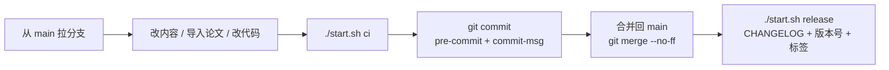

# 迭代流程（本地 CI/CD）

> 所有检查都能在本机通过 git 钩子和 `./start.sh` 离线运行，不需要 API Key。推送到 GitHub 后，同一套 CI 会在 GitHub Actions 上再跑一遍，通过才发布公网阅读站。
> 内容规范见 [STANDARD.md](STANDARD.md)，代码说明见 [agent/README.md](agent/README.md)。

## 一次迭代长什么样



第一次使用先执行一次：

```bash
./start.sh setup     # git init（如果还不是仓库）+ 启用 .githooks
```

## 1. 分支

`main` 永远是"CI 全绿、可直接启动阅读"的状态。每件事开一个分支：

| 分支前缀 | 用途 | 例子 |
|---|---|---|
| `content/` | 新增或改写知识章节 | `content/linux-tmux` |
| `paper/` | 导入、复核论文笔记 | `paper/vla-openvla` |
| `feat/` | Agent / Web 新功能 | `feat/web-related-papers` |
| `fix/` | 修复 | `fix/marked-renderer` |
| `ci/` | 检查器、钩子、发布脚本 | `ci/secret-scan` |

```bash
git switch -c paper/vla-openvla
```

## 2. 三类改动的标准步骤

### 写知识章节

1. 复制 `templates/tutorial-template.md`，按 STANDARD.md 第 4 节填写。
2. 在所在文件夹 `00-README.md` 的章节表登记。
3. `./start.sh ci`。

### 加一篇论文

1. `./start.sh paper <arXiv链接> Knowledge/Papers/<VLA|WAM|Robotics>`（Web 里"导入论文"也行）；没有 API 凭据时，在 Claude Code 里用 `/import-paper <arXiv链接>`。
   导入会自动：选领域 topic、填写 `related`（关联的知识章节）、刷新论文库目录表格。
2. 人工复核：数字是否和论文一致、`related` 是否贴切、`> ❓ 待解决：` 是否需要补充。复核完把 `status` 改成 `reviewed`。
3. 手动改过 `related` 或新增 / 删除论文后：`./start.sh papers` 重新生成目录表格。
4. 从对应领域 `00-README.md` 的"待读清单"里删掉这一行。
5. `./start.sh ci`。

### 改代码（agent/）

1. 改完 `node --check src/xxx.js`；新增行为要在 `agent/test/` 补测试（`node:test`，零依赖）。
2. 改了前端渲染：冒烟测试会用 marked 渲染全部文档；marked 必须保持 12.x（见 CLAUDE.md）。
3. 改了 STANDARD.md：同步 `templates/`、`agent/src/prompts.js` 和检查器，并先和仓库所有者确认。
4. `./start.sh ci`。

## 3. 提交信息（Conventional Commits）

格式：`<type>(<scope>): <说明>`，`commit-msg` 钩子会校验，发布脚本据此生成 CHANGELOG 和版本号。

| type | 用途 | 版本影响 |
|---|---|---|
| `content` | 知识章节 | minor |
| `paper` | 论文笔记 | minor |
| `feat` | Agent / Web 新功能 | minor |
| `fix` | 修复 | patch |
| `docs` | README / CONTRIBUTING / STANDARD 说明 | patch |
| `refactor` / `perf` | 重构 / 性能 | patch |
| `test` / `ci` / `chore` | 测试 / 流水线 / 杂项 | patch |
| `revert` | 回滚 | patch |

- scope 建议用主题或模块：`linux`、`vla`、`forcevla`、`wam`、`papers`、`agent`、`web`、`standard`。
- 破坏性变更（例如改了 STANDARD.md 的固定段落、改了 frontmatter 必填字段）：type 后加 `!`，如 `docs(standard)!: paper-note 新增必填 related`，或正文写 `BREAKING CHANGE:`。

```bash
git commit -m "paper(vla): 导入 OpenVLA 论文笔记"
```

## 4. 自动检查

| 时机 | 跑什么 | 耗时 |
|---|---|---|
| `git commit`（pre-commit） | 快速 CI：语法、密钥扫描、术语守卫、STANDARD 规范、论文库索引 | ~1 秒 |
| `git commit`（commit-msg） | 提交信息格式 | 即时 |
| `git push`（pre-push） | 完整 CI：上面全部 + 单元测试 + 冒烟测试（启动服务、打 API、渲染全部文档） | ~2 秒 |
| `git pull` / `merge`（post-merge） | `package-lock.json` 变了就自动 `npm install` | 按需 |
| 手动 | `./start.sh ci`（完整）/ `./start.sh ci --fast` | |

CI 各阶段：

| 阶段 | 检查什么 | 失败时怎么办 |
|---|---|---|
| 语法检查 | `agent/` 下所有 JS 的 `node --check`，`start.sh` 与钩子的 `sh -n` | 按报错行修 |
| 密钥扫描 | 将被提交的文件里不能出现 API Key / 私钥 / Token | Key 只放 `agent/.env`（已 gitignore） |
| 术语与路径守卫 | 不能出现废弃的 `Siemens/` 前缀；`Knowledge/` 里不能把 WAM 写成 Barrett 机械臂 | 改成 `Knowledge/...` / 世界模型 |
| 规范检查 | STANDARD.md：frontmatter、固定段落、文件名、坏链接、代码块语言、论文 `related`、论文库目录结构 | 按提示改文档 |
| 论文库索引 | `Knowledge/Papers/**/00-README.md` 的自动表格是否最新 | `./start.sh papers` 后重新 `git add` |
| 单元 + 冒烟测试 | `agent/test/*.test.js` | `cd agent && npm test` 看详细输出 |

> ⚠️ 注意：不要用 `git commit --no-verify` 绕过钩子。检查报错就说明 `main` 会变成不可用状态。

钩子检查的是**工作区**里的文件。只提交一部分改动时，未暂存的改动也会参与检查，这是故意的：保证你本地看到的就是能通过的。

## 5. 合并

```bash
./start.sh ci
git switch main
git merge --no-ff paper/vla-openvla
git branch -d paper/vla-openvla
```

用 `--no-ff` 保留"一个分支 = 一件事"的边界，`git log --graph` 能看出每次迭代。

## 6. 发布（CD）

在 `main` 上、工作区干净时：

```bash
./start.sh release --dry-run   # 先预览下一个版本号和 CHANGELOG
./start.sh release             # auto：按提交类型决定 patch / minor / major
./start.sh release minor       # 也可以手动指定
```

发布脚本依次做：完整 CI → 汇总上个标签以来的提交 → 写入 `CHANGELOG.md`（附知识库快照：文档数、论文数、状态分布）→ 更新 `agent/package.json` 版本号 → 提交 `chore(release): vX.Y.Z` → 打标签 `vX.Y.Z`。

建议节奏：每完成一个主题的若干章节、或一批论文复核完，发布一次。回到某个版本：`git switch --detach v0.2.0`。

### 部署：两个站点

| 站点 | 地址 | 内容 | 怎么更新 |
|---|---|---|---|
| 公网阅读站（GitHub Pages） | `https://<GitHub 用户名>.github.io/<仓库名>/` | 阅读、目录、搜索、论文关联（只读） | `git push` 到 `main`：`.github/workflows/pages.yml` 跑完整 CI → `build-static.js` 构建 → 发布。CI 不过就不发布 |
| 本机完整版（launchd 开机自启） | `http://localhost:8787` | 上面全部 + AI 助教 + 论文导入（Max 订阅） | 服务直接读工作区文件，改完 Markdown 自动重建索引；改了 `agent/` 代码后 `./start.sh service restart` |

公网站右上角的"助教（本机）"会在新标签页打开本机版的同一页面，所以在自己的 Mac 上可以无缝切换。

本机服务命令：`./start.sh service install | status | restart | logs | uninstall`。

> ⚠️ 注意：仓库必须放在 `~/Learning` 这类普通目录。macOS 不允许后台服务读取"桌面 / 文稿 / 下载"，放回桌面会导致服务报 `Operation not permitted`（桌面上的 `Learning` 只是指向 `~/Learning` 的快捷方式）。

本地预览公网站：`./start.sh build`，然后 `cd dist && python3 -m http.server 8790`。

## 7. 内容状态

| status | 含义 | 谁改 |
|---|---|---|
| `draft` | 初稿（包括 Agent 生成的论文笔记） | 写作者 / Agent |
| `reviewed` | 人工核对过事实、数字、链接 | 复核的人 |
| `stable` | 用过一段时间，结构不再大改 | 仓库所有者 |
