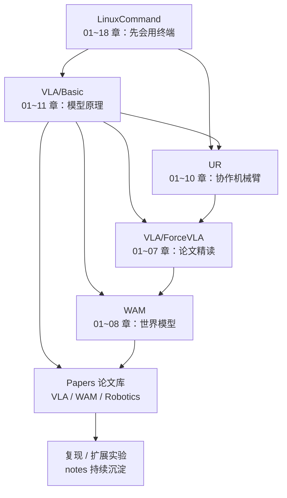

# 知识内容总目录

> `Knowledge/` 汇集全部学习内容：先学会用 Linux 终端，再理解 VLA（视觉-语言-动作）模型，精读 ForceVLA 论文，最后进入世界模型（WAM）。目标是让一个零基础的人最终能**读懂并复现一篇机器人学习论文，并知道世界模型如何让机器人"预测未来"**。

## 学习路线

| 顺序 | 主题 | 入口 | 难度 | 预计时长 |
|---|---|---|---|---|
| 1 | Linux 命令 | [LinuxCommand/00-README.md](LinuxCommand/00-README.md) | beginner → intermediate | ~15 小时 |
| 2 | VLA 基础 | [VLA/Basic/00-README.md](VLA/Basic/00-README.md) | beginner → intermediate | ~12 小时 |
| 3 | ForceVLA 论文专题 | [VLA/ForceVLA/00-README.md](VLA/ForceVLA/00-README.md) | intermediate | ~8 小时 |
| 4 | WAM 世界模型 | [WAM/00-README.md](WAM/00-README.md) | intermediate | ~10 小时 |
| 4.5 | UR 协作机械臂 | [UR/00-README.md](UR/00-README.md) | beginner → advanced | ~12 小时 |
| 5 | 论文库 | [Papers/00-README.md](Papers/00-README.md) | intermediate → advanced | 持续 |

## 子目录

- [LinuxCommand/00-README.md](LinuxCommand/00-README.md) —— Linux 命令与 Shell
- [VLA/00-README.md](VLA/00-README.md) —— VLA 总目录（基础 + 论文专题）
- [WAM/00-README.md](WAM/00-README.md) —— 世界模型（World Model / World Action Model）
- [UR/00-README.md](UR/00-README.md) —— UR 协作机械臂：硬件、安全、URScript / RTDE / ROS 2、力控、VLA 数据采集与部署
- [Papers/00-README.md](Papers/00-README.md) —— 论文库：每篇论文关联到上面的知识章节，章节页底部可反查相关论文

## 三个主题的关系

| | VLA | ForceVLA | WAM 世界模型 |
|---|---|---|---|
| 回答的问题 | 看到画面、听到指令后**该做什么动作** | 接触任务里如何把**力**也纳入决策 | 如果执行某个动作，**世界会变成什么样** |
| 输出 | 动作 | 动作（力感知） | 未来观测 / 隐状态（可再推出动作） |
| 典型用法 | 直接当策略 | 直接当策略 | 规划、数据生成、评估，或与 VLA 融合 |

## 关联

- 编写规范：[../STANDARD.md](../STANDARD.md)
- 总览与 Agent 系统：[../README.md](../README.md)
- 新论文通过 Agent 导入到 [Papers/](Papers/00-README.md) 的领域子目录，问答沉淀在 `../notes/qa-log.md`。
