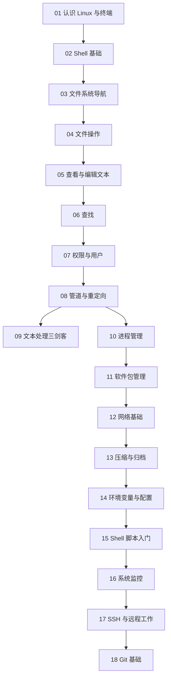

# Linux 命令学习路线

> 这个主题带你从"从未打开过终端"走到"能在远程服务器上独立跑任务、写脚本、管代码"。

## 主题简介

**Linux**（一个开源操作系统内核，服务器和机器人领域的事实标准）几乎是所有 AI 训练、机器人部署的运行环境。学完本主题你能做到：

- 在 macOS 终端和 Ubuntu 服务器上自如地找文件、改文件、看日志。
- 读懂并写出简单的 Shell 脚本，把重复操作自动化。
- 用 SSH 登录远程 GPU 服务器，用 tmux 挂起长时间训练任务。
- 用 Git 管理自己的代码和知识库。

## 学习路线

建议节奏：每天 1 章，每章先读后练。入门阶段（01~08）打牢，后面的章节可以按需跳读。

## 章节表格

| 章节 | 文件 | 难度 | 预计时长 | 状态 |
|---|---|---|---|---|
| 01 认识 Linux 与终端 | [01-what-is-linux-and-terminal.md](01-what-is-linux-and-terminal.md) | beginner | 30min | draft |
| 02 Shell 基础 | [02-shell-basics.md](02-shell-basics.md) | beginner | 40min | draft |
| 03 文件系统导航 | [03-filesystem-navigation.md](03-filesystem-navigation.md) | beginner | 40min | draft |
| 04 文件操作 | [04-file-operations.md](04-file-operations.md) | beginner | 45min | draft |
| 05 查看与编辑文本 | [05-viewing-and-editing-text.md](05-viewing-and-editing-text.md) | beginner | 50min | draft |
| 06 查找文件与内容 | [06-finding-things.md](06-finding-things.md) | beginner | 40min | draft |
| 07 权限与用户 | [07-permissions-and-users.md](07-permissions-and-users.md) | beginner | 50min | draft |
| 08 管道与重定向 | [08-pipes-and-redirection.md](08-pipes-and-redirection.md) | intermediate | 50min | draft |
| 09 文本处理三剑客 | [09-text-processing.md](09-text-processing.md) | intermediate | 60min | draft |
| 10 进程管理 | [10-process-management.md](10-process-management.md) | intermediate | 45min | draft |
| 11 软件包管理 | [11-package-management.md](11-package-management.md) | beginner | 40min | draft |
| 12 网络基础 | [12-networking-basics.md](12-networking-basics.md) | intermediate | 45min | draft |
| 13 压缩与归档 | [13-archives-and-compression.md](13-archives-and-compression.md) | beginner | 30min | draft |
| 14 环境变量与配置 | [14-environment-and-config.md](14-environment-and-config.md) | intermediate | 45min | draft |
| 15 Shell 脚本入门 | [15-shell-scripting-basics.md](15-shell-scripting-basics.md) | intermediate | 60min | draft |
| 16 系统监控 | [16-system-monitoring.md](16-system-monitoring.md) | intermediate | 45min | draft |
| 17 SSH 与远程工作 | [17-ssh-and-remote.md](17-ssh-and-remote.md) | intermediate | 60min | draft |
| 18 Git 基础 | [18-git-basics.md](18-git-basics.md) | intermediate | 60min | draft |

## 与其他主题的关系

- [VLA 机器人学习主题](../VLA/00-README.md)：训练 VLA 模型、部署到机械臂，全部在 Linux 服务器上进行。学完本主题的 01~10 和 17 章，再进入 VLA 会顺畅很多。
- 知识库本身用 Git 管理，见 [18 Git 基础](18-git-basics.md)。
- 编写规范见 [知识库编写标准](../../STANDARD.md)。

> 💡 要点：命令行不是"黑客技能"，而是和电脑对话的另一种语言。学语言的秘诀只有一个——多说、多用。
