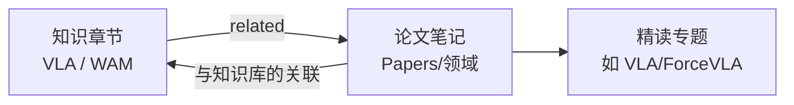

# 论文库总览（Research Papers）

> 这里集中存放"泛读"的论文笔记，每篇论文都挂在已有的知识章节上：读知识章节时能看到相关论文，读论文时能跳回它用到的基础知识。规则见 [STANDARD.md 第 11 节](../../STANDARD.md)。

## 主题简介

学完一个知识主题后，到这里按领域挑论文读，你能做到：

- 把教程里的概念对应到真实论文里的具体做法（比如"动作分块"在哪些论文里出现、效果如何）。
- 用统一的论文笔记结构（论文信息 → 方法 → 实验 → 复现清单）快速读完一篇论文并沉淀下来。
- 从任意知识章节反查"有哪些论文用到了它"，决定下一篇该读什么。

## 学习路线

1. 先学完对应主题的基础章节（[VLA 基础](../VLA/Basic/00-README.md) 或 [WAM 世界模型](../WAM/00-README.md)）。
2. 进入下面的领域目录，按"待读清单"或论文表挑一篇读。
3. 想读新论文：`./start.sh paper <arXiv链接> Knowledge/Papers/<领域>`，笔记会自动关联知识章节并更新这里的表格；人工复核后把 `status` 改成 `reviewed`。

## 章节表格

| 领域 | 目录 | 收录范围 | 难度 | 状态 |
|---|---|---|---|---|
| VLA | [VLA/00-README.md](VLA/00-README.md) | VLA 模型、动作表示、力/触觉融合 | intermediate | draft |
| WAM | [WAM/00-README.md](WAM/00-README.md) | 世界模型、视频生成、隐空间预测、基于模型的规划 | intermediate | draft |
| Robotics | [Robotics/00-README.md](Robotics/00-README.md) | 模仿学习、数据集等其他机器人学习论文 | intermediate | draft |

<!-- AUTO-GENERATED:papers START · 由 ./start.sh papers 生成，请勿手改 -->
### 各领域论文数

| 领域 | 论文数 | 入口 |
|---|---|---|
| VLA 视觉-语言-动作模型 | 2 | [VLA/00-README.md](VLA/00-README.md) |
| WAM 世界模型 | 0 | [WAM/00-README.md](WAM/00-README.md) |
| 通用机器人学习 | 0 | [Robotics/00-README.md](Robotics/00-README.md) |

### 知识章节 → 相关论文（反向索引）

| 知识章节 | 相关论文 |
|---|---|
| [Transformer 与多模态模型](../VLA/Basic/03-transformers-and-multimodal.md) | [OpenVLA：开源的视觉-语言-动作模型](VLA/01-openvla.md) [ForceVLA 论文总览（规范论文笔记）](../VLA/ForceVLA/01-paper-overview.md) |
| [VLA 是什么：视觉-语言-动作模型的定义与数据流](../VLA/Basic/04-vla-concept.md) | [OpenVLA：开源的视觉-语言-动作模型](VLA/01-openvla.md) [ForceVLA 论文总览（规范论文笔记）](../VLA/ForceVLA/01-paper-overview.md) |
| [代表性 VLA 模型纵览](../VLA/Basic/05-representative-models.md) | [OpenVLA：开源的视觉-语言-动作模型](VLA/01-openvla.md) [ForceVLA 论文总览（规范论文笔记）](../VLA/ForceVLA/01-paper-overview.md) |
| [数据集与数据采集](../VLA/Basic/06-datasets-and-data-collection.md) | [OpenVLA：开源的视觉-语言-动作模型](VLA/01-openvla.md) |
| [动作表示：从模型输出到电机转动](../VLA/Basic/07-action-representation.md) | [OpenVLA：开源的视觉-语言-动作模型](VLA/01-openvla.md) |
| [训练与微调：在自己的机器人上跑通 VLA](../VLA/Basic/08-training-and-finetuning.md) | [OpenVLA：开源的视觉-语言-动作模型](VLA/01-openvla.md) [ForceVLA 论文总览（规范论文笔记）](../VLA/ForceVLA/01-paper-overview.md) |
| [力觉与触觉感知：为什么只靠眼睛不够](../VLA/Basic/10-force-and-tactile-sensing.md) | [ForceVLA 论文总览（规范论文笔记）](../VLA/ForceVLA/01-paper-overview.md) |
| [世界模型 × VLA：融合范式](../WAM/05-world-models-meet-vla.md) | [ForceVLA 论文总览（规范论文笔记）](../VLA/ForceVLA/01-paper-overview.md) |
<!-- AUTO-GENERATED:papers END -->

## 与其他主题的关系

- 论文的 `related` 字段决定它关联到哪些知识章节；上面的"反向索引"表和网页每个章节底部的"📄 相关论文"都由它自动生成。
- 需要拆成多章精读的论文放在所属主题下（如 [ForceVLA 论文专题](../VLA/ForceVLA/00-README.md)），它的论文总览也会出现在对应领域的论文表里。
