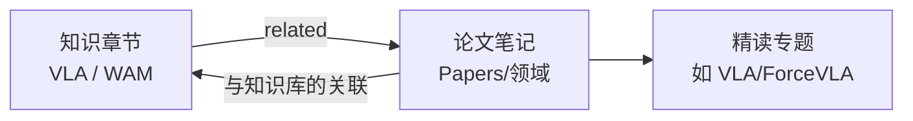

# 论文库总览（Research Papers）

> 这里集中存放"泛读"的论文笔记，每篇论文都挂在已有的知识章节上：读知识章节时能看到相关论文，读论文时能跳回它用到的基础知识。规则见 [STANDARD.md 第 11 节](../../STANDARD.md)。

## 主题简介

学完一个知识主题后，到这里按领域挑论文读，你能做到：

- 把教程里的概念对应到真实论文里的具体做法（比如"动作分块"在哪些论文里出现、效果如何）。
- 用统一的论文笔记结构（论文信息 → 方法 → 实验 → 复现清单）快速读完一篇论文并沉淀下来。
- 从任意知识章节反查"有哪些论文用到了它"，决定下一篇该读什么。

## 学习路线



1. 先学完对应主题的基础章节（[VLA 基础](../VLA/Basic/00-README.md) 或 [WAM 世界模型](../WAM/00-README.md)）。
2. 进入下面的领域目录，按"待读清单"或论文表挑一篇读。
3. 想加新论文：按下面的[如何添加一篇论文](#如何添加一篇论文)四步走（选领域 → 生成笔记 → 人工复核 → 收尾发布）。

## 章节表格

| 领域 | 目录 | 收录范围 | 难度 | 状态 |
|---|---|---|---|---|
| VLA | [VLA/00-README.md](VLA/00-README.md) | VLA 模型、动作表示、力/触觉融合 | intermediate | draft |
| WAM | [WAM/00-README.md](WAM/00-README.md) | 世界模型、视频生成、隐空间预测、基于模型的规划 | intermediate | draft |
| Robotics | [Robotics/00-README.md](Robotics/00-README.md) | 模仿学习、数据集等其他机器人学习论文 | intermediate | draft |

<!-- AUTO-GENERATED:papers START · 由 ./start.sh papers 生成，请勿手改 -->
### 各领域论文数

| 领域 | 论文数 | 入口 |
|---|---|---|
| VLA 视觉-语言-动作模型 | 9 | [VLA/00-README.md](VLA/00-README.md) |
| WAM 世界模型 | 0 | [WAM/00-README.md](WAM/00-README.md) |
| 通用机器人学习 | 0 | [Robotics/00-README.md](Robotics/00-README.md) |

### 知识章节 → 相关论文（反向索引）

| 知识章节 | 相关论文 |
|---|---|
| [力传感与力控模式：读力、恒力下压与对接 ForceVLA](../UR/09-force-sensing-and-force-mode.md) | [Tactile-VLA：解锁 VLA 模型的物理知识实现触觉泛化](VLA/07-tactile-vla.md) |
| [什么是机器人学习](../VLA/Basic/01-what-is-robot-learning.md) | [π*0.6：从经验中学习的 VLA（RECAP）](VLA/06-pi06.md) |
| [Transformer 与多模态模型](../VLA/Basic/03-transformers-and-multimodal.md) | [OpenVLA：开源的视觉-语言-动作模型](VLA/01-openvla.md)<br>[知识隔离：让 VLA 训练快、推理快、泛化好](VLA/05-knowledge-insulation.md)<br>[AT-VLA：自适应触觉注入与快慢双流的触觉反应](VLA/08-at-vla.md)<br>[ForceVLA 论文总览](../VLA/ForceVLA/01-paper-overview.md) |
| [VLA 是什么：视觉-语言-动作模型的定义与数据流](../VLA/Basic/04-vla-concept.md) | [OpenVLA：开源的视觉-语言-动作模型](VLA/01-openvla.md)<br>[π0：面向通用机器人控制的视觉-语言-动作流模型](VLA/02-pi0.md)<br>[FAST：面向 VLA 的高效动作 token 化](VLA/03-fast.md)<br>[Tactile-VLA：解锁 VLA 模型的物理知识实现触觉泛化](VLA/07-tactile-vla.md)<br>[ForceVLA 论文总览](../VLA/ForceVLA/01-paper-overview.md) |
| [代表性 VLA 模型纵览](../VLA/Basic/05-representative-models.md) | [OpenVLA：开源的视觉-语言-动作模型](VLA/01-openvla.md)<br>[π0：面向通用机器人控制的视觉-语言-动作流模型](VLA/02-pi0.md)<br>[π0.5：面向开放世界泛化的视觉-语言-动作模型](VLA/04-pi05.md)<br>[AT-VLA：自适应触觉注入与快慢双流的触觉反应](VLA/08-at-vla.md)<br>[ForceVLA 论文总览](../VLA/ForceVLA/01-paper-overview.md) |
| [数据集与数据采集](../VLA/Basic/06-datasets-and-data-collection.md) | [OpenVLA：开源的视觉-语言-动作模型](VLA/01-openvla.md)<br>[π0.5：面向开放世界泛化的视觉-语言-动作模型](VLA/04-pi05.md)<br>[Tactile-VLA：解锁 VLA 模型的物理知识实现触觉泛化](VLA/07-tactile-vla.md) |
| [动作表示：从模型输出到电机转动](../VLA/Basic/07-action-representation.md) | [OpenVLA：开源的视觉-语言-动作模型](VLA/01-openvla.md)<br>[π0：面向通用机器人控制的视觉-语言-动作流模型](VLA/02-pi0.md)<br>[FAST：面向 VLA 的高效动作 token 化](VLA/03-fast.md)<br>[Tactile-VLA：解锁 VLA 模型的物理知识实现触觉泛化](VLA/07-tactile-vla.md)<br>[AT-VLA：自适应触觉注入与快慢双流的触觉反应](VLA/08-at-vla.md) |
| [训练与微调：在自己的机器人上跑通 VLA](../VLA/Basic/08-training-and-finetuning.md) | [OpenVLA：开源的视觉-语言-动作模型](VLA/01-openvla.md)<br>[π0：面向通用机器人控制的视觉-语言-动作流模型](VLA/02-pi0.md)<br>[知识隔离：让 VLA 训练快、推理快、泛化好](VLA/05-knowledge-insulation.md)<br>[π*0.6：从经验中学习的 VLA（RECAP）](VLA/06-pi06.md)<br>[AT-VLA：自适应触觉注入与快慢双流的触觉反应](VLA/08-at-vla.md)<br>[ForceVLA 论文总览](../VLA/ForceVLA/01-paper-overview.md) |
| [评估与部署：从成功率到真机运行](../VLA/Basic/09-evaluation-and-deployment.md) | [FAST：面向 VLA 的高效动作 token 化](VLA/03-fast.md)<br>[π0.5：面向开放世界泛化的视觉-语言-动作模型](VLA/04-pi05.md)<br>[π*0.6：从经验中学习的 VLA（RECAP）](VLA/06-pi06.md) |
| [力觉与触觉感知：为什么只靠眼睛不够](../VLA/Basic/10-force-and-tactile-sensing.md) | [Tactile-VLA：解锁 VLA 模型的物理知识实现触觉泛化](VLA/07-tactile-vla.md)<br>[AT-VLA：自适应触觉注入与快慢双流的触觉反应](VLA/08-at-vla.md)<br>[ForceVLA 论文总览](../VLA/ForceVLA/01-paper-overview.md) |
| [方法详解：π0 骨干 + FVLMoE 力感知融合](../VLA/ForceVLA/03-method.md) | [AT-VLA：自适应触觉注入与快慢双流的触觉反应](VLA/08-at-vla.md) |
| [π 系列家族综述：一代解决一个问题](../VLA/Pi/01-pi-series-overview.md) | [π0：面向通用机器人控制的视觉-语言-动作流模型](VLA/02-pi0.md)<br>[FAST：面向 VLA 的高效动作 token 化](VLA/03-fast.md)<br>[π0.5：面向开放世界泛化的视觉-语言-动作模型](VLA/04-pi05.md)<br>[π*0.6：从经验中学习的 VLA（RECAP）](VLA/06-pi06.md) |
| [π0：VLM 骨干 + 流匹配动作专家](../VLA/Pi/02-pi0-architecture-and-flow-matching.md) | [π0：面向通用机器人控制的视觉-语言-动作流模型](VLA/02-pi0.md)<br>[知识隔离：让 VLA 训练快、推理快、泛化好](VLA/05-knowledge-insulation.md)<br>[Tactile-VLA：解锁 VLA 模型的物理知识实现触觉泛化](VLA/07-tactile-vla.md) |
| [FAST：把高频动作压缩成 token（π0-FAST）](../VLA/Pi/03-fast-action-tokenization.md) | [FAST：面向 VLA 的高效动作 token 化](VLA/03-fast.md) |
| [π0.5：异构数据协同训练、分层推理与知识隔离](../VLA/Pi/04-pi05-open-world-and-knowledge-insulation.md) | [π0.5：面向开放世界泛化的视觉-语言-动作模型](VLA/04-pi05.md)<br>[知识隔离：让 VLA 训练快、推理快、泛化好](VLA/05-knowledge-insulation.md) |
| [π*0.6：用 RECAP 从自身经验中学习](../VLA/Pi/05-pi06-learning-from-experience.md) | [π*0.6：从经验中学习的 VLA（RECAP）](VLA/06-pi06.md) |
| [世界模型 × VLA：融合范式](../WAM/05-world-models-meet-vla.md) | [ForceVLA 论文总览](../VLA/ForceVLA/01-paper-overview.md) |
<!-- AUTO-GENERATED:papers END -->

## 如何添加一篇论文

> 💡 要点：一篇论文 = 一个 `paper-note` 文件 + 一份 `related` 关联清单。目录表格和"相关论文"反查都是自动生成的，你只需要把笔记本身写对。完整规则见 [STANDARD.md 第 11 节](../../STANDARD.md)。

### 第 1 步：选领域

| 论文主要讲什么 | 放到 | topic |
|---|---|---|
| VLA 模型、动作表示、力/触觉融合进 VLA | `Knowledge/Papers/VLA/` | `vla` |
| 世界模型、视频生成、隐空间预测、用模型做规划 | `Knowledge/Papers/WAM/` | `wam` |
| 其他机器人学习：模仿学习策略、数据集、机械臂控制 | `Knowledge/Papers/Robotics/` | `robotics` |

- 跨领域的论文（比如"世界模型 + VLA"）按**主要贡献**选一个文件夹，在 `related` 里同时关联两边的章节即可。
- 一篇论文需要拆成多章精读（背景、方法、数据、复现……）时，不放进论文库，而是像 [ForceVLA](../VLA/ForceVLA/00-README.md) 一样在所属主题下单独建文件夹，`01-paper-overview.md` 用论文笔记模板。它会自动出现在对应领域的论文表里，并标注"精读专题"。
- 先看看领域目录页的"待读清单"，里面列好了推荐论文和现成的导入命令。

### 第 2 步：生成笔记（三选一）

| 方式 | 适合 | 怎么做 |
|---|---|---|
| 网页按钮 | 最省事；手上只有 PDF 文件时 | 打开本机版 http://localhost:8787 → 右上角"＋ 导入论文" → 贴 arXiv 链接或选本地 PDF → 文件夹选 `Knowledge/Papers/<领域>`（topic 自动填） |
| 命令行 | 批量导入、待读清单里的现成命令 | `./start.sh paper <arXiv链接或PDF> Knowledge/Papers/<领域>` |
| Claude Code | 想边导入边追问、让它顺便改别处 | 在 `~/Learning` 打开 Claude Code，输入 `/import-paper <arXiv链接>` |

```bash
# 例：把 Octo 导入 VLA 领域（约 2~5 分钟）
cd ~/Learning
./start.sh paper https://arxiv.org/abs/2405.12213 Knowledge/Papers/VLA
```

三种方式用的都是你 Claude Max 订阅的额度，生成结果完全一样：
- 按模板写好 9 个固定段落；
- 从已有章节里挑 2~6 篇填进 `related`；
- 自动编号存成 `NN-英文名.md`；
- 刷新论文库的各张表格。

> ⚠️ 注意：网页按钮和命令行要在本机版里用（公网阅读站是只读的）；本机服务没开时先运行 `./start.sh service status` 检查。

**不用 AI、自己手写**也可以：

1. 复制 [论文笔记模板](../../templates/paper-note-template.md) 到领域文件夹，文件名取该文件夹最大编号 + 1，例如 `02-octo.md`。
2. 填 frontmatter：
   - `type: paper-note`，`topic` 按上表；
   - `related` 写知识库根目录相对路径，例如 `Knowledge/VLA/Basic/07-action-representation.md`；
   - `sources` 放论文链接。
3. 按模板写 9 个固定段落，"一句话总结"不超过 60 字。
4. 想找该关联哪些章节，可以搜一下：`cd agent && node src/cli.js search 关键词`。

### 第 3 步：人工复核

AI 生成的笔记一律是 `status: draft`，复核过才改成 `reviewed`。逐项核对：

- [ ] **数字**：实验表格里的每个数字都能在论文原文里找到（对照论文表格编号）。
- [ ] **一句话总结**：说清"解决什么问题、怎么解决、效果如何"，不超过 60 字。
- [ ] **related**：关联的章节确实被这篇论文用到或延伸了，没有凑数；`## 与知识库的关联` 里每条都写了关联点。
- [ ] **待解决项**：逐条处理 `> ❓ 待解决：`，能查清的改成正文，查不清的保留。
- [ ] **和已有章节冲突**：笔记里指出的"与某章说法不一致"要么去改那一章，要么在笔记里说明原因。
- [ ] 改完把 `status` 改成 `reviewed`，`updated` 改成今天。

### 第 4 步：收尾并发布

```bash
./start.sh papers        # 改过 related / year / status 后刷新目录表格
./start.sh ci --fast     # 必须全绿
git switch -c paper/vla-octo
git add -A
git commit -m "paper(vla): 导入 Octo 论文笔记"
git switch main && git merge --no-ff paper/vla-octo
git push                 # GitHub 跑完 CI 后，公网阅读站两三分钟内更新
```

- 如果这篇论文在领域目录页的"待读清单"里，记得删掉那一行。
- 发布后，被关联的知识章节底部会自动出现"📄 相关论文"，读者从章节就能找到这篇论文。

## 与其他主题的关系

- 论文的 `related` 字段决定它关联到哪些知识章节；上面的"反向索引"表和网页每个章节底部的"📄 相关论文"都由它自动生成。
- 需要拆成多章精读的论文放在所属主题下（如 [ForceVLA 论文专题](../VLA/ForceVLA/00-README.md)），它的论文总览也会出现在对应领域的论文表里。
