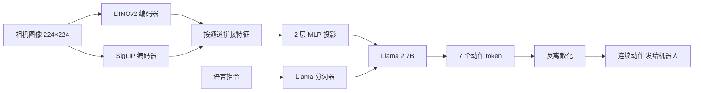

# OpenVLA：开源的视觉-语言-动作模型

## 论文信息

| 项目 | 内容 |
|---|---|
| 标题 | OpenVLA: An Open-Source Vision-Language-Action Model |
| 作者 / 机构 | Moo Jin Kim、Karl Pertsch、Siddharth Karamcheti、Ted Xiao、Ashwin Balakrishna、Suraj Nair、Rafael Rafailov、Ethan Foster、Grace Lam、Pannag Sanketi、Quan Vuong、Thomas Kollar、Benjamin Burchfiel、Russ Tedrake、Dorsa Sadigh、Sergey Levine、Percy Liang、Chelsea Finn（共 18 人）；机构：Stanford University、UC Berkeley、Toyota Research Institute、Google DeepMind、Physical Intelligence、MIT |
| 发表 | arXiv 预印本 2406.09246（v1 2024-06-13，v3 2024-09-05）；arXiv 页面未注明会议 |
| 链接 | [arXiv](https://arxiv.org/abs/2406.09246) · [HTML 全文](https://arxiv.org/html/2406.09246v3) · [项目页](https://openvla.github.io/) |
| 关键词 | VLA、离散动作 token、Prismatic VLM、DINOv2 + SigLIP、Llama 2、Open X-Embodiment、LoRA、量化推理 |

> ❓ 待解决：本文常被引用为某会议论文，但 arXiv 摘要页的 comments 只写了项目网址，没有会议信息，所以 frontmatter 暂不填 `venue`，需人工核实后补上。

## 一句话总结

把 7B 视觉语言模型在 97 万条机器人示范上微调成开源 VLA，比 55B 的 RT-2-X 更强，且能用 LoRA 和量化在消费级 GPU 上跑。

## 背景与动机

- **之前的方法有什么问题？**
  - 从头训练的机器人策略很难泛化：换个干扰物、换个新物体、换句没见过的指令就容易失败。
  - **视觉语言基础模型**（在海量互联网图文上预训练过的模型，比如 CLIP、SigLIP、Llama 2）泛化好得多，但机器人数据集规模小得多，原文说最大的机器人数据集也只有"100K to 1M examples"。
  - 已有的 **VLA**（Vision-Language-Action，看图、听指令、直接输出机器人动作的模型）比如 RT-2 是闭源的，外界拿不到权重，也不知道训练细节。
  - 社区缺少"怎么把 VLA 高效适配到新机器人"的经验，特别是在**消费级 GPU**（个人电脑上的显卡，如 RTX 4090）上怎么做。
- **为什么这个问题重要？**
  - 如果有一个开源的通用 VLA，大家就可以像在 NLP 里微调 Llama 一样，用少量自己的示范数据把它适配到自己的机器人上，不必每次从零开始训练。
  - 类比：以前每个厨师都要自己从种菜开始做饭；有了开源的"半成品高汤"，只需要按自家口味再调一调。

> 💡 要点：OpenVLA 的定位是"开源版 RT-2"——方法上沿用"把动作当文字 token"这一路线，贡献主要在开放权重、更好的骨干和数据，以及首次系统研究 VLA 的高效微调与量化部署。

## 方法

### 整体框架

OpenVLA 由三部分组成：**视觉编码器**（把图片变成特征向量的网络）、**投影层**（把视觉特征"翻译"到语言模型能读的维度）、**LLM 骨干**（大语言模型，负责根据图像和指令逐个吐出 token）。骨干直接用现成的 **Prismatic-7B** VLM：600M 参数的视觉编码器 + 一个小型 2 层 MLP 投影层 + 7B 参数的 Llama 2。

> ⚠️ 注意：图中"7 个动作 token"是按常见的 7 维末端执行器动作（位置 3 维 + 旋转 3 维 + 夹爪 1 维）画的示意，本笔记没有从原文逐字核对动作维度。

### 关键模块

#### 模块 1：双视觉编码器（DINOv2 + SigLIP）

- **输入**：一张第三人称相机图像，分辨率 224×224 像素。
- **处理**：图像分别送进 **DINOv2**（自监督训练的视觉模型，擅长空间和几何细节）和 **SigLIP**（图文对比学习的视觉模型，擅长语义——"这是什么东西"），两路特征按通道拼接。
- **输出**：一串图像 patch 特征，经 2 层 MLP 投影后变成 LLM 能直接读的"图像 token"。
- **为什么这样设计**：机器人既要知道"杯子在哪"（空间），也要知道"哪个是杯子"（语义）。原文附录的消融（OpenVLA-Bridge 对比 OpenVLA-Bridge-SigLIP）支持双编码器优于只用 SigLIP，见下文实验部分。
- **分辨率选择**：原文比较过 224×224 和 384×384，后者没有带来性能提升，训练时间却是 3 倍，所以最终用 224×224。

#### 模块 2：动作离散化与 token 复用

- **输入**：训练数据里的连续机器人动作（每一维是一个实数）。
- **处理**：
  1. 对动作的**每一维单独**离散化成 256 个 **bin**（区间桶，把连续值切成若干段，每段一个编号）。
  2. bin 的范围不用最小值/最大值，而是用训练数据中该维动作的**第 1 到第 99 百分位数**（分位数：把数据排序后位于 1% 和 99% 位置的值），这样少数离群值不会把区间撑得过宽、浪费精度。
  3. Llama 分词器只预留了 100 个特殊 token，不够放 256 个动作 token，于是作者**覆盖掉词表里最少使用的 256 个 token**，让它们代表动作 bin。
- **输出**：每一维动作对应一个 token；推理时 LLM 逐个生成这些 token，再反离散化回连续动作。
- **为什么这样设计**：动作变成普通 token 后，训练就和训练语言模型完全一样——**下一个 token 预测 + 交叉熵损失**（只在动作 token 上计算损失），可以直接复用成熟的 LLM 训练工具链。代价是有量化误差，且逐 token 自回归生成较慢。

> 🔗 关联：分位数归一化和 256 bin 离散化的公式与精度估算见 [07 动作表示](../../VLA/Basic/07-action-representation.md) 的 7.3、7.4 节；"范式 A：把动作当文字"的整体思路见 [04 VLA 是什么](../../VLA/Basic/04-vla-concept.md) 4.3 节。

#### 模块 3：训练数据整理（Open X-Embodiment 子集）

- **输入**：**Open X-Embodiment**（多家机构汇总的跨机器人数据集），原文说它包含 70 多个子数据集、200 多万条轨迹。
- **处理**：只保留满足以下条件的数据：是操作（manipulation）任务、至少有一个第三人称相机、单臂末端执行器控制。各子数据集的混合权重沿用 Octo 的设置，并额外加入 **DROID**（一个大规模真实场景 Franka 数据集），权重设得比较保守，为 10%；训练的最后三分之一把 DROID 去掉，把它的权重分给其他数据。
- **输出**：约 97 万条（原文："970k real-world robot demonstrations"）真实机器人示范组成的训练集。
- **为什么这样设计**：统一观测（第三人称图像）和动作空间（单臂末端控制），才能让一个模型在多种机器人上共享知识。

> ❓ 待解决：原文为什么在训练最后三分之一移除 DROID？本次阅读的正文片段里没有找到明确理由，需要再读原文 3.3 节确认。

#### 模块 4：训练设计决策

| 决策 | 原文的选择 | 原文给出的依据 |
|---|---|---|
| VLM 骨干 | Prismatic | 对比 IDEFICS-1 与 LLaVA：LLaVA 比 IDEFICS-1 高 35%（绝对成功率），Prismatic 又比 LLaVA 高约 10% |
| 图像分辨率 | 224×224 | 384×384 无提升，训练慢 3 倍 |
| 视觉编码器 | **要微调**（不冻结） | 和常见 VLM 训练习惯相反，原文认为微调视觉编码器对 VLA 很关键 |
| 训练轮数 | 27 个 epoch | 一直训练到动作 token 准确率超过 95% |
| 学习率 | 固定 2e-5，无 warmup | — |

- **为什么这样设计**：VLM 预训练时学的是"图里有什么"，而机器人控制需要精确的空间信息（"夹爪离杯把手还差几厘米"），所以视觉编码器必须跟着动作数据一起调。

#### 模块 5：训练与推理基础设施

- **训练**：64 张 A100 GPU 训练 14 天，共 21,500 A100 小时，batch size 2048。
- **推理**：bfloat16 精度加载需要 15GB 显存，在一张 RTX 4090 上约 6Hz（不做编译或其他加速技巧）。
- **开源代码库**：模块化的 PyTorch 代码，支持从单卡微调到多节点集群训练，支持 AMP（自动混合精度）、FlashAttention、FSDP（全分片数据并行，把模型参数拆到多张卡上），内置 Open X 数据读取，接入 Hugging Face 的 `AutoModel`，并支持 LoRA 微调与量化推理。

## 实验

### 数据集 / 任务 / 基线

| 实验 | 平台 / 数据 | 规模 | 对比对象 |
|---|---|---|---|
| 开箱直接评估 | WidowX（BridgeData V2）、Google 机器人 | Bridge：17 个任务 × 10 次 = 170 次；Google：12 个任务 × 5 次 = 60 次 | RT-1-X（35M）、Octo（93M）、RT-2-X（55B） |
| 新机器人数据高效适配 | Franka-Tabletop（5Hz）、Franka-DROID（15Hz） | 7 个 Franka 任务，每个 10~150 条示范；每种方法 129 次试验（Tabletop 99 + DROID 30） | Diffusion Policy、Diffusion Policy（matched）、Octo（微调）、OpenVLA（scratch） |
| 参数高效微调 | Franka-Tabletop 部分任务 | 33 次试验 | 全量微调、只训最后一层、冻结视觉、Sandwich、LoRA |
| 量化推理 | BridgeData V2 的 8 个任务 | 每种设置 80 次试验 | bfloat16 / int8 / int4 |
| 仿真（附录） | LIBERO 四个任务组 | 3 个随机种子 × 500 次 | Diffusion Policy（scratch）、Octo（微调） |

基线说明：

- **Diffusion Policy**：用扩散模型生成动作的模仿学习方法，这里从头训练。
- **Diffusion Policy（matched）**：把 Diffusion Policy 的输入输出改成与 OpenVLA 一致的版本——单张图像、无本体感知、无观测历史、无 action chunking。
- **OpenVLA（scratch）**：不用 Open X 预训练过的 OpenVLA，而是直接拿底座 Prismatic VLM 在目标机器人上微调，用来衡量"机器人预训练"本身的价值。

### 主要结果

**1）开箱直接评估（附录表 4、表 6 的平均成功率）**

| 方法 | BridgeData V2（WidowX） | Google 机器人 |
|---|---|---|
| RT-1-X | 18.5±2.7% | 33.3±6.1% |
| Octo | 20.0±2.6% | 26.7±5.8% |
| RT-2-X | 50.6±3.5% | 78.3±5.4% |
| OpenVLA | **70.6±3.2%** | **85.0±4.6%** |

- 原文称在两个平台共 29 个任务上，OpenVLA 比 RT-2-X 的绝对成功率高 16.5%。
- 在 BridgeData V2 上，OpenVLA 除"语义泛化"外的各类别都优于 RT-2-X；原文解释 RT-2-X 用了更大规模的互联网预训练数据，并与互联网数据共同微调，所以语义泛化更强。

> ❓ 待解决：16.5% 的具体计算口径原文没有在正文写清楚（是按任务平均还是按试验次数加权、是否包含其他子集）。直接用上表两个平台的均值按试验次数加权，算不出正好 16.5%，需要再查原文图 3/图 4 的说明。

**2）新机器人数据高效适配（附录表 7 的 Average 行）**

| 方法 | Franka-Tabletop | Franka-DROID |
|---|---|---|
| Diffusion Policy | 48.5±4.9% | 35.0±8.0% |
| Diffusion Policy（matched） | 43.4±4.7% | 26.7±7.5% |
| Octo（微调） | 43.4±4.4% | 38.3±8.5% |
| OpenVLA（scratch） | 43.4±4.6% | 21.7±6.6% |
| OpenVLA（微调） | **67.2±4.0%** | **58.3±7.2%** |

- 原文："OpenVLA is the only approach that achieves at least 50% success rate across all tested tasks."
- 对比 OpenVLA（scratch）与 OpenVLA 可以看出：同样的 7B 骨干，有没有经过 Open X 机器人数据预训练，差距很大。
- 原文定性描述：Diffusion Policy 在窄而精细的单指令任务上很强，而 OpenVLA 在需要语言指令区分多个物体的多任务场景中优势明显。

> ❓ 待解决：摘要里"比 Diffusion Policy 高 20.4%"的计算口径（哪些任务、怎么平均）在正文中没有找到定义，用表 7 两个 Average 行按试验次数加权也算不出正好 20.4%，需要再查原文。

**3）参数高效微调（表 1）**

这组实验用的是一个**变体模型**：原文说明它用较小的机器人数据混合预训练，且只用 SigLIP 一个视觉编码器（脚注 4）。显存为 batch size 16 时的数值。

| 微调策略 | 成功率 | 可训练参数（百万） | 显存 |
|---|---|---|---|
| 全量微调 | 69.7±7.2% | 7,188.1 | 163.3 GB（2 卡 FSDP） |
| 只训最后一层 | 30.3±6.1% | 465.1 | 51.4 GB |
| 冻结视觉编码器 | 47.0±6.9% | 6,760.4 | 156.2 GB（2 卡 FSDP） |
| Sandwich | 62.1±7.9% | 914.2 | 64.0 GB |
| LoRA，rank 32 | 68.2±7.5% | 97.6 | 59.7 GB |
| LoRA，rank 64 | 68.2±7.8% | 195.2 | 60.5 GB |

- **LoRA**（Low-Rank Adaptation，冻结原权重、只训练两个很小的低秩矩阵）只训练约 1.4% 的参数，就达到和全量微调相当的效果；rank 32 与 64 结果相同，所以默认用 32。
- 原文说用 LoRA 可以在一张 A100 上 10~15 小时内把 OpenVLA 微调到新任务。
- "冻结视觉编码器"掉得很多，再次印证模块 4 里"视觉编码器要微调"的结论。

**4）量化推理（表 2）**

**量化**：把模型权重从 16 位浮点压缩成 8 位或 4 位整数，省显存，但可能损失精度或改变速度。

| 精度 | Bridge 成功率 | 显存 |
|---|---|---|
| bfloat16 | 71.3±4.8% | 16.8 GB |
| int8 | 58.1±5.1% | 10.2 GB |
| int4 | 71.9±4.7% | 7.0 GB |

- int4 显存不到 bfloat16 的一半，成功率持平。
- int8 反而更差：原文解释是量化运算的额外开销让 int8 在多数 GPU 上**推理变慢**（在评估用的 A5000 上只有 1.2Hz，int4 为 3Hz），而评估用的是非阻塞控制器，推理慢导致动作跟不上；离线看 token 准确率，int8、int4 与 bfloat16 相当（脚注 5）。
- 附录用**阻塞式控制**（机器人等模型算完再动）重新测，把速度因素排除后：bfloat16 70.0±5.1%、int8 74.4±4.9%、int4 68.8±5.2%（附录表 11）。

> 🔗 关联：推理频率、量化与真机部署的取舍，可以和 [09 评估与部署](../../VLA/Basic/09-evaluation-and-deployment.md) 对照阅读。

**5）LIBERO 仿真（附录表 12，成功率 ± 标准误）**

| 方法 | Spatial | Object | Goal | Long | 平均 |
|---|---|---|---|---|---|
| Diffusion Policy（scratch） | 78.3±1.1% | 92.5±0.7% | 68.3±1.2% | 50.5±1.3% | 72.4±0.7% |
| Octo（微调） | 78.9±1.0% | 85.7±0.9% | 84.6±0.9% | 51.1±1.3% | 75.1±0.6% |
| OpenVLA（微调） | 84.7±0.9% | 88.4±0.8% | 79.2±1.0% | 53.7±1.3% | **76.5±0.6%** |

### 消融实验说明了什么

| 消融 | 结果 | 说明 |
|---|---|---|
| 训练数据：OpenVLA vs 只用 Bridge 数据训练（附录表 9） | OpenVLA 76.3±4.8%，OpenVLA-Bridge 45.6±5.6% | 大规模跨机器人预训练数据带来明显收益 |
| 双编码器 vs 只用 SigLIP（附录表 9） | OpenVLA-Bridge 45.6±5.6%，OpenVLA-Bridge-SigLIP 40.6±5.5% | DINOv2 + SigLIP 双编码器优于单 SigLIP |
| 微调 vs 冻结视觉编码器（附录表 10） | 在两者都测过的任务上，微调平均 80.0%，冻结平均 46.7% | 视觉编码器必须跟着机器人数据一起训练 |

## 优点与不足

| 优点 | 不足 / 疑问 |
|---|---|
| 完全开源：权重、训练代码、微调脚本都公开，成为后续研究的常用基线 | 只支持**单张图像**输入，不支持多相机、本体感知（关节角等）和观测历史 |
| 7B 参数却在开箱评估中优于 55B 的 RT-2-X | 推理吞吐有限（RTX 4090 上约 6Hz），难以用于 ALOHA 这类 50Hz 的高频双臂系统 |
| 首次系统验证 LoRA 和 4 位量化在 VLA 上可用，降低了上手门槛 | 原文承认在测试任务上通常达不到 90% 成功率，可靠性不足 |
| 设计决策（骨干、分辨率、是否冻结视觉）都有对比实验支撑，可复用为经验 | 离散 token + 逐 token 自回归：有量化误差、速度慢，后续的 π0 等改用连续动作头 |
| 跨平台（WidowX、Google 机器人、Franka、LIBERO 仿真）都做了评估 | 受算力限制，没回答：底座 VLM 规模的影响、与互联网图文数据共同训练是否有帮助、哪种视觉特征最适合 VLA |

原文给出的未来方向：用图文交错数据预训练的 VLM 来支持灵活输入；用 **action chunking**（一次预测一段连续动作）或**投机解码**（用小模型先猜、大模型校验，加速生成）提升推理速度。

## 与知识库的关联

- 用到的基础知识：[03 Transformer 与多模态模型](../../VLA/Basic/03-transformers-and-multimodal.md) —— OpenVLA 的骨干就是"视觉编码器 + 投影 + LLM"的 VLM 结构，DINOv2 / SigLIP / Llama 2 都在这一章有铺垫。
- 用到的基础知识：[04 VLA 是什么](../../VLA/Basic/04-vla-concept.md) —— OpenVLA 是"范式 A：把动作当文字（自回归离散 token）"的代表实现。
- 用到的基础知识：[07 动作表示](../../VLA/Basic/07-action-representation.md) —— 1%/99% 分位数归一化 + 256 bin 离散化正是本文的动作 token 化方案。
- 用到的基础知识：[06 数据集与数据采集](../../VLA/Basic/06-datasets-and-data-collection.md) —— 训练数据来自 Open X-Embodiment 的筛选子集，并混入 DROID。
- 可延伸的主题：[05 代表性模型](../../VLA/Basic/05-representative-models.md) —— 在 RT-2 → Octo → OpenVLA → π0 的时间线里，本文是"开源 + 离散 token"这一站，读完可以对比 π0 的连续动作头。
- 可延伸的主题：[08 训练与微调](../../VLA/Basic/08-training-and-finetuning.md) —— 8.2、8.4 节的 LoRA 微调实战直接基于本文的结论和代码库。

## 复现清单

- [ ] 环境：PyTorch 代码库（支持 AMP、FlashAttention、FSDP，接入 Hugging Face `AutoModel`）；具体安装步骤见 [08 训练与微调](../../VLA/Basic/08-training-and-finetuning.md) 8.4 节。推理需约 15GB 显存（bfloat16），int4 量化约 7.0GB。
- [ ] 数据：Open X-Embodiment 筛选子集（操作任务、有第三人称相机、单臂末端控制），混合权重沿用 Octo，DROID 权重 10% 且在最后三分之一训练中移除；共约 97 万条示范。详细混合比例见原文附录 A。
- [ ] 关键超参数：图像 224×224；每维动作 256 bin（1%~99% 分位数）；学习率固定 2e-5、无 warmup；batch size 2048；27 个 epoch（动作 token 准确率 > 95%）；预训练 64×A100、14 天。微调用 LoRA rank 32。
- [ ] 预期指标：BridgeData V2 平均 70.6±3.2%，Google 机器人 85.0±4.6%；Franka-Tabletop 微调 67.2±4.0%、Franka-DROID 58.3±7.2%；LIBERO 平均 76.5±0.6%。

> ❓ 待解决：论文正文没有给出 LoRA 微调时的学习率和 batch size。[08 训练与微调](../../VLA/Basic/08-training-and-finetuning.md) 示例命令里的 `--learning_rate 5e-4`、`--batch_size 8` 来自代码仓库的用法，不是论文数字，复现时以仓库 README 为准。

## 我的问题与想法

- 为什么 int4 量化几乎不掉点，而 int8 在非阻塞控制下明显变差？原文归因于 int8 的推理速度；这提示真机评估结果和**控制方式**（阻塞 / 非阻塞）强相关，比较不同模型时要统一控制方式。
- 原文的 LoRA 表格用的是 SigLIP-only、小数据混合的变体模型，结论能否完全迁移到正式的 OpenVLA-7B？
- 训练到"动作 token 准确率 > 95%"、跑了 27 个 epoch，远多于 LLM 常见的 1~2 个 epoch，这对过拟合和泛化意味着什么？

> ❓ 待解决：知识库 [07 动作表示](../../VLA/Basic/07-action-representation.md) 7.5 节写 OpenVLA 推理"约 3~5 Hz"，本文原文是 RTX 4090 上 bfloat16 约 6Hz、A5000 上 int4 约 3Hz；[08 训练与微调](../../VLA/Basic/08-training-and-finetuning.md) 8.2 节写 7B 模型 LoRA 显存"约 20~30 GB"，而原文表 1 中 LoRA rank 32 在 batch 16 时为 59.7GB。两者可能是硬件或 batch 设置不同造成的，建议人工复核后统一那两章的说法（本次未改动论文库以外的文件）。

> ❓ 待解决：动作的具体维度（是否为 7 维末端位姿增量 + 夹爪）本次没有从原文逐字核对。
