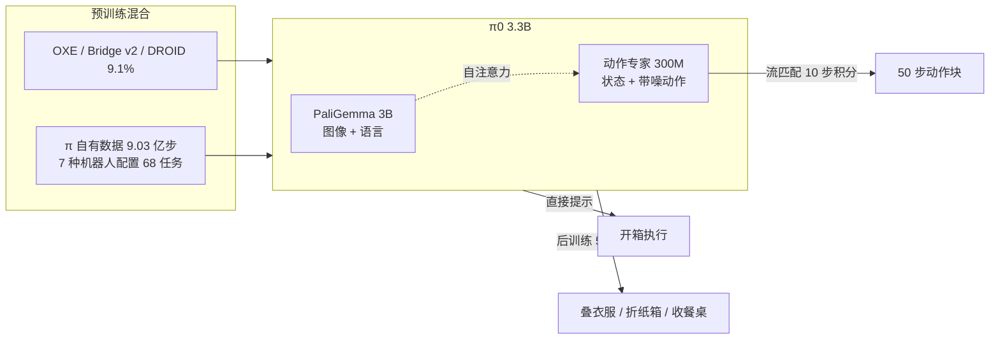

# π0：面向通用机器人控制的视觉-语言-动作流模型

## 论文信息

| 项目 | 内容 |
|---|---|
| 标题 | π0: A Vision-Language-Action Flow Model for General Robot Control |
| 作者 / 机构 | Kevin Black、Noah Brown、Danny Driess、Adnan Esmail、Michael Equi、Chelsea Finn、Niccolo Fusai、Lachy Groom、Karol Hausman、Brian Ichter、Szymon Jakubczak、Tim Jones、Liyiming Ke、Sergey Levine、Adrian Li-Bell、Mohith Mothukuri、Suraj Nair、Karl Pertsch、Lucy Xiaoyang Shi、James Tanner、Quan Vuong、Anna Walling、Haohuan Wang、Ury Zhilinsky（共 24 人）；机构：Physical Intelligence（美国旧金山） |
| 发表 | arXiv 2410.24164（v1 2024-10-31，v4 2026-01-08）；arXiv 页面注明 Published in RSS 2025 |
| 链接 | [arXiv](https://arxiv.org/abs/2410.24164) · [HTML 全文](https://arxiv.org/html/2410.24164) · [官方博客](https://www.pi.website/blog/pi0) · [代码 openpi（GitHub）](https://github.com/Physical-Intelligence/openpi) |
| 关键词 | VLA、流匹配、动作专家、PaliGemma、动作块、跨本体预训练、后训练、灵巧操作 |

## 一句话总结

在 PaliGemma 3B 上加 300M 流匹配动作专家，用 1 万小时跨机器人数据预训练再后训练，能叠衣服、折纸箱。

## 背景与动机

- **之前的方法有什么问题？**
  - 现有 VLA（RT-2、OpenVLA）把动作离散成 token 自回归生成，不支持**动作块**（一次输出一段连续动作）和高频控制。论文直接在实验里展示：在 π0 的数据混合上训练的 OpenVLA 在 5 个开箱任务里几乎全是 0 分。
  - 专门为灵巧操作设计的方法（ACT、Diffusion Policy）只在几十到几百条、不到 10 小时的数据上训练，没有互联网预训练，也没有跨机器人数据。
  - 以往的大规模机器人数据集（OXE、Bridge、DROID）任务简单，多是搬东西、开抽屉，控制频率只有 2~10 Hz。
- **为什么这个问题重要？**
  - 论文的核心论点是"机器人基础模型"：像 LLM 一样先在海量多样数据上预训练，再用少量高质量数据后训练，可以同时缓解数据稀缺、泛化差、不鲁棒三个老问题。
  - 要验证这一点，必须同时解决三件事：规模（1 万小时数据）、架构（既能用 VLM 又能输出 50 Hz 连续动作）、配方（预训练 / 后训练怎么分工）。
  - 类比：以前每做一道菜都要从头学，π0 想先把"通识厨艺"学会，再用一小本食谱专精某道菜。

> 💡 要点：π0 的贡献是"整合"——VLM 骨干、流匹配动作块、跨本体数据、两阶段配方各自都有先例，但把它们放到一起并在真实世界里做出 5~20 分钟的长任务，是第一次。

## 方法

### 整体框架

### 关键模块

#### 模块 1：VLM 骨干（PaliGemma）

- **输入**：每个机器人 2 或 3 张 RGB 图像 $I^1_t,\dots,I^n_t$（不足 3 张时掩码掉空槽位）+ 语言指令 $\ell_t$。
- **处理**：按标准"晚期融合"VLM 做法，图像编码器把图像嵌入到与语言 token 相同的空间，送入 Gemma 2B 语言模型（宽度 2048、18 层、MLP 维度 16384、18 头、1 个 KV 头、头维度 256）。
- **输出**：图像和文本 token 的键值，供动作专家在自注意力里读取。
- **为什么这样设计**：继承互联网规模的语义知识；选 PaliGemma 是因为它开源且只有 30 亿参数，适合实时控制。论文说框架兼容任何 VLM。

#### 模块 2：动作专家（action expert）

- **输入**：机器人本体状态 $q_t$（线性投影）和带噪动作块 $A_t^\tau=[a_t^\tau,\dots,a_{t+H-1}^\tau]$，$H=50$；每个带噪动作经 $W_3\cdot\text{swish}(W_2\cdot\text{concat}(W_1 a^\tau_{t'},\phi(\tau)))$ 嵌入，$\phi$ 是流匹配时间步的正弦编码。
- **处理**：整个模型是**一个** Transformer 但有两套权重（类似两个专家的 MoE），图像文本 token 走 VLM 权重，状态和动作 token 走动作专家权重，两者只在自注意力层交互。动作专家缩到宽度 1024、MLP 维度 4096，共 3 亿参数，总计 33 亿。
- **输出**：只取带噪动作位置的输出，线性投影成速度场 $v_\theta$。
- **为什么这样设计**：论文发现给机器人专属 token 单独一套权重比共用更好；专家做小是为了推理时 10 次前向够快。
- **注意力掩码**：三块因果——`[图像, 文本]` → `[q_t]` → `[带噪动作]`，块内双向、块间只能看前面的块。第一块不看后面是为了减少对 VLM 预训练分布的扰动；状态单独一块是因为它在积分过程中不变，键值可缓存。

#### 模块 3：流匹配训练与推理

- **输入**：真实动作块 $A_t$、噪声 $\epsilon\sim\mathcal N(0,I)$、时间步 $\tau$。
- **处理**：线性高斯路径 $A_t^\tau=\tau A_t+(1-\tau)\epsilon$，损失
  $$L^\tau(\theta)=\mathbb E_{p(A_t\mid o_t),q(A_t^\tau\mid A_t)}\big\|v_\theta(A_t^\tau,o_t)-u(A_t^\tau\mid A_t)\big\|^2,\quad u=A_t-\epsilon$$
  时间步从偏向高噪声的分布采样：$p(\tau)=\text{Beta}\big(\tfrac{s-\tau}{s};1.5,1\big)$，$s=0.999$，$\tau>s$ 不采。
- **输出**：推理时从 $A^0\sim\mathcal N(0,I)$ 出发做前向 Euler 积分 $A^{\tau+\delta}=A^\tau+\delta v_\theta(A^\tau,o_t)$，$\delta=0.1$，共 10 步，得到 50 步连续动作。
- **为什么这样设计**：论文认为观测对动作的约束比文字对图像强得多，"从纯噪声估计动作均值"是难点，所以不像图像生成那样偏向中间时间步，而是偏向噪声大的一端。

#### 模块 4：跨本体数据与加权

- **输入**：开源数据（OXE、Bridge v2、DROID）占 9.1%；自有数据 9.03 亿时间步（单臂 1.06 亿、双臂 7.97 亿），约 1 万小时，68 个任务，7 种机器人配置：UR5e（7 维）、双臂 UR5e（14 维）、Franka（8 维）、双臂 Trossen（14 维）、双臂 ARX / AgileX（14 维）、移动 Trossen / ARX（14 维状态、16 维动作）、移动 Fibocom（14 维状态、17 维动作）。
- **处理**：每个"任务 × 机器人"组合按 $n^{0.43}$ 加权降低过多数据的占比；状态和动作补零到最大的 18 维（两条 6 自由度臂、2 夹爪、底盘、可升降躯干）。语言标注含任务名和约 2 秒一段的片段标注。
- **输出**：一个同时控制 7 种配置的模型。
- **为什么这样设计**：论文的"任务"口径很宽（一个 bussing 任务涵盖各种餐具和垃圾），真实行为种类远超 68；加权是为了防止叠衣服这类长任务淹没其他任务。

#### 模块 5：预训练 → 后训练配方

- **预训练**：全部混合数据，主模型 70 万步；目标是广泛能力与纠错能力。
- **后训练**：任务专属高质量数据，最简单 5 小时、最复杂 100 小时以上；目标是流畅、稳定。
- **高层策略**：对收餐桌这类需要语义规划的任务，可用一个高层 VLM 把"bus the table"拆成"pick up the napkin"等子指令，类似 SayCan。
- **为什么这样设计**：只训高质量数据的模型不会从错误中恢复；只预训练的模型不够利索；两者结合才兼得。

#### 模块 6：对照模型 π0-small

4.7 亿参数、不用 VLM 初始化：DistilBERT 编码语言、R26-S-32 ResNet-ViT 混合编码器编码图像（不共享权重）、观测编码器不做互联网预训练、动作专家用 DiT（AdaLN-Zero 注入时间步）并通过交叉注意力读取观测；同样 10 步流匹配。用于衡量 VLM 预训练的价值。

## 实验

### 数据集 / 任务 / 基线

| 实验 | 任务 | 基线 | 试验次数 |
|---|---|---|---|
| 开箱评估（只预训练） | 叠 T 恤、收桌子（易 / 难）、装杂货、取吐司 | π0 算力对齐版（16 万步）、π0-small、OpenVLA 7B（全混合）、OpenVLA（仅 UR5e）、Octo 93M | 每任务 10 次 |
| 语言跟随（微调后） | 收桌子、摆餐桌、装杂货 | π0-flat / -human / -HL 对比 π0-small-flat / -human | 每任务 10 次 |
| 学新灵巧任务（微调） | UR5e 叠碗、叠毛巾、饭盒进微波炉、换纸巾卷、Franka 收抽屉 | OpenVLA、Octo（公开 OXE 权重微调）、ACT、Diffusion Policy、π0 从头训练 | 每任务 10 次，多种数据量 |
| 复杂多阶段任务（微调） | 叠一筐衣服、移动叠衣、卸烘干机、收真实餐桌、折纸箱、装外卖盒、装鸡蛋 | 自身消融：完整 / 只预训练（out-of-box）/ 只微调（scratch） | 每任务 10 次 |

评分用**部分得分**：完全成功 1.0，例如收桌子按正确放置的物体比例给分（附录 A-E 有每个任务的评分细则）。基线训练步数：OpenVLA 16 万、Octo 32 万，均在 π0 的混合上训练。

### 主要结果

**1）开箱评估（博客给出的归一化分数）**

| 任务（机器人） | π0 | π0-small | OpenVLA | OpenVLA（仅 UR5e） | Octo |
|---|---|---|---|---|---|
| Bussing Easy（UR5e） | 0.971 | 0.443 | 0 | 0.343 | 0.043 |
| Bussing Hard（UR5e） | 0.875 | 0.333 | 0 | 0 | 0 |
| Shirt Folding（双臂 ARX） | 1.000 | 0.500 | 0 | 0 | 0 |
| Grocery Bagging（UR5e） | 0.786 | 0.271 | 0 | 0 | 0 |
| Toast out of Toaster（双臂 Trossen） | 0.750 | 0 | 0 | 0 | 0 |

- 论文正文：π0 在所有开箱任务上"远好于"所有基线，叠衣服和简单收桌子接近满分；只训 16 万步的算力对齐版仍胜过全部基线；π0-small 也胜过 OpenVLA 和 Octo。
- 论文解释：OpenVLA 的自回归离散化不支持动作块，Octo 容量有限；π0-small 的差距说明 VLM 预训练有价值，但该对比不完全公平（π0-small 更小，而大模型不预训练很难训）。

> ❓ 待解决：上表数字来自官方博客的图表，论文图 7 是否完全一致、算力对齐版的分数是多少，本次未能从 HTML 正文读到，需对照 PDF 图 7。

**2）语言跟随**（图 9，正文只有定性结论）：π0 的语言跟随准确率显著高于 π0-small；人类专家逐步指令（π0-human）和高层 VLM 指令（π0-HL）都能提升 π0 的任务表现；π0-small 因为听不懂中间指令，加专家也不涨。

**3）学新灵巧任务**（图 11）：π0 总体优于所有方法；最强的先前方法反而是从头训练的 ACT / Diffusion Policy，说明以往方法难以利用预训练；预训练对与预训练相似的任务提升最大，预训练版常好于从头训练版，"有时达到 2 倍"；饭盒进微波炉任务上 5 小时数据的 π0 与基线相当，但 1 小时版本明显更好。

**4）复杂多阶段任务**（图 13）：这些任务其他方法做不了；完整的预训练 + 微调在**所有任务上超过满分的 50%**，并普遍优于消融，越难的任务预训练的收益越大。

> ❓ 待解决：图 9、11、13 的逐任务数值在 HTML 正文中没有文字版，本笔记只转述论文的定性描述；复现对比前请核对 PDF 原图。

**5）推理耗时**（表 I，RTX 4090，3 张相机）

| 环节 | 耗时 |
|---|---|
| 图像编码 | 14 ms |
| 观测前向 | 32 ms |
| 10 次动作前向（流匹配） | 27 ms |
| 网络延迟（离板时） | 13 ms |
| 本机总计 | **73 ms** |
| 离板总计 | 86 ms |

20 Hz 的 UR5e / Franka 每 0.8 秒（执行 16 步）推理一次，50 Hz 机器人每 0.5 秒（执行 25 步）一次；动作块开环执行，论文试过时间集成反而变差。

### 消融实验说明了什么

| 消融 | 结果 | 说明 |
|---|---|---|
| π0 vs π0-small | 开箱 5 任务 π0 均大幅领先，Toast 任务 small 为 0 | VLM 预训练 + 大骨干对灵巧任务和语言跟随都关键 |
| 完整 vs 算力对齐（16 万步） | 对齐版仍胜过全部基线 | 优势主要来自架构，不只是训练更久 |
| 完整 vs 只预训练 vs 只微调（复杂任务） | 完整最好，难任务差距最大 | 预训练提供纠错与多样性，后训练提供流畅性 |
| 微调数据量 1h / 5h / 更多 | 易任务少量数据即可，预训练版提升更大 | 预训练越相似的任务越省数据 |

## 优点与不足

| 优点 | 不足 / 疑问 |
|---|---|
| 第一个输出高频（50 Hz）动作块的流匹配 VLA，能做 5~20 分钟的长任务 | 预训练数据怎么配比、加多少才够，论文承认"仍是开放问题" |
| 1 万小时、7 种机器人配置、68 任务，规模远超以往 | 并非所有任务都稳定，也无法预测需要多少数据才能接近完美 |
| 预训练 / 后训练配方有消融支撑，且与 LLM 实践对应 | 跨任务、跨机器人的"正迁移"有多大未量化；能否扩展到导航、足式机器人未知 |
| 2025 年通过 openpi 开源代码与权重，可复现 | 许多关键分数只在图里，正文缺数字；π0-small 对比混杂了"更小"与"无预训练"两个因素 |
| 推理 73 ms（4090），能在消费级 GPU 上实时跑 | 动作块开环执行，每 0.5~0.8 秒才看一次画面，对快速变化的场景反应有限 |

## 与知识库的关联

- 用到的基础知识：[Pi 专题 02 π0 架构与流匹配](../../VLA/Pi/02-pi0-architecture-and-flow-matching.md) —— 本笔记的教程版，逐步推导流匹配公式与注意力掩码。
- 用到的基础知识：[Pi 专题 01 π 系列总览](../../VLA/Pi/01-pi-series-overview.md) —— π0 是整个系列的起点，总览里能看到它之后每一代改了什么。
- 用到的基础知识：[VLA 基础 04 VLA 是什么](../../VLA/Basic/04-vla-concept.md) —— π0 是"范式 B：连续动作生成头"的代表实现。
- 用到的基础知识：[VLA 基础 07 动作表示](../../VLA/Basic/07-action-representation.md) —— 动作块 $H=50$、补零到统一维度、开环执行与重规划周期都在这一章有铺垫。
- 可延伸的主题：[VLA 基础 05 代表性模型](../../VLA/Basic/05-representative-models.md) —— 在 RT-2 → OpenVLA → π0 的时间线上，本文是"VLM + 连续动作"这一站。
- 可延伸的主题：[VLA 基础 08 训练与微调](../../VLA/Basic/08-training-and-finetuning.md) —— 8.5 节的 openpi 微调实战就是本文"后训练"阶段的动手版。

## 复现清单

- [ ] 环境：openpi（JAX，2025 年起有 PyTorch 版），推理显存 >8 GB（RTX 4090 可），LoRA 微调 >22.5 GB，全量微调 >70 GB；具体步骤见 [VLA 基础 08](../../VLA/Basic/08-training-and-finetuning.md)。
- [ ] 数据：自有 1 万小时数据未公开；可用 OXE / Bridge v2 / DROID 复现开源部分；自己的机器人数据需转成 LeRobot 格式，状态和动作补零到模型维度。
- [ ] 关键超参数：$H=50$；流匹配 $\tau\sim\text{Beta}(\tfrac{s-\tau}{s};1.5,1)$，$s=0.999$；推理 10 步 Euler，$\delta=0.1$；动作专家宽度 1024、MLP 4096；数据加权 $n^{0.43}$；预训练 70 万步；后训练 5~100+ 小时数据。
- [ ] 预期指标：开箱 Bussing Easy 0.971、Shirt Folding 1.0、Grocery Bagging 0.786、Toast 0.75；RTX 4090 上单次推理约 73 ms。

> ❓ 待解决：论文正文没有给出学习率、batch size、优化器和图像分辨率等训练超参数，复现时以 openpi 仓库的 `TrainConfig` 为准。

## 我的问题与想法

- "偏向高噪声的时间步采样"是一个很具体的设计判断：观测对动作的约束比文字对图像强。这个假设在"观测模糊"（遮挡、只有力觉信号）的任务上还成立吗？ForceVLA 这类加入新模态的工作是否需要重新调这个分布？
- 动作块开环执行 0.5~0.8 秒，意味着突发扰动最坏要等近 1 秒才被看到。论文说时间集成反而变差，但没有解释原因，值得在自己的机器人上验证。
- 论文把"bussing"算一个任务，68 个任务的口径与 RT-1 的 700 个任务完全不同，横向比较任务数时要小心。

> ❓ 待解决：知识库 [VLA 基础 07 动作表示](../../VLA/Basic/07-action-representation.md) 7.5 节写 π0"约 10 Hz 推理（73 ms/次）"。73 ms 与论文表 I 一致，但论文实际是每 0.5~0.8 秒推理一次、中间开环执行 16~25 步，"10 Hz"更像是 1/73 ms 的理论上限，建议那一章补一句说明。

> ❓ 待解决：知识库 [VLA 基础 05 代表性模型](../../VLA/Basic/05-representative-models.md) 5.1 表写 π0 覆盖"7~8 种机器人平台"。论文正文是 7 种机器人**配置**，其中两类各包含两种平台（ARX / AgileX，移动 Trossen / 移动 ARX），博客写 8 种机器人；两种说法都对，建议统一口径为"7 种配置、8 种机器人"。

> ❓ 待解决：动作补零维度论文为 18（最大机器人），openpi 代码中常见的 32 维设置不在论文里，[VLA 基础 07](../../VLA/Basic/07-action-representation.md) 7.4 节未写具体数字，如要写请注明来源是代码还是论文。
