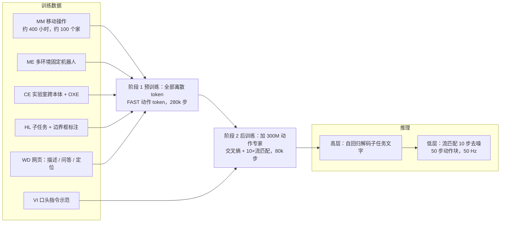

# π0.5：面向开放世界泛化的视觉-语言-动作模型

## 论文信息

| 项目 | 内容 |
|---|---|
| 标题 | π0.5: a Vision-Language-Action Model with Open-World Generalization |
| 作者 / 机构 | 署名 "Physical Intelligence" 加 35 位作者：Kevin Black、Noah Brown、James Darpinian、Karan Dhabalia、Danny Driess、Adnan Esmail、Michael Equi、Chelsea Finn、Niccolo Fusai、Manuel Y. Galliker、Dibya Ghosh、Lachy Groom、Karol Hausman、Brian Ichter、Szymon Jakubczak、Tim Jones、Liyiming Ke、Devin LeBlanc、Sergey Levine、Adrian Li-Bell、Mohith Mothukuri、Suraj Nair、Karl Pertsch、Allen Z. Ren、Lucy Xiaoyang Shi、Laura Smith、Jost Tobias Springenberg、Kyle Stachowicz、James Tanner、Quan Vuong、Homer Walke、Anna Walling、Haohuan Wang、Lili Yu、Ury Zhilinsky；机构：Physical Intelligence |
| 发表 | arXiv 预印本 2504.16054（v1，2025-04-22） |
| 链接 | [arXiv](https://arxiv.org/abs/2504.16054) · [HTML 全文](https://arxiv.org/html/2504.16054) · [博客](https://www.pi.website/blog/pi05) · 代码与权重见 [openpi](https://github.com/Physical-Intelligence/openpi) |
| 关键词 | 开放世界泛化、异构数据协同训练、分层推理、子任务预测、口头指令示范、FAST 离散 token、流匹配动作专家、移动操作 |

> ❓ 待解决：arXiv 摘要页没有注明会议或期刊，frontmatter 暂不填 `venue`，需人工核实后补上。

## 一句话总结

π0 加上多机器人、网页、子任务标注的协同训练，先离散预训练再加流匹配后训练，首次在陌生家庭完成长时程清理。

## 背景与动机

- **之前的方法有什么问题？**
  - **VLA**（Vision-Language-Action，看图像、听指令、直接输出动作的模型）虽然语言跟随能力不错，但几乎都在"和训练数据很像的环境"里评估。
  - 已有的开放世界泛化结果要么只限于抓取这类单一基础动作（靠抓取预测、模型规划等任务特定假设），要么任务很短（通常不到一分钟）、成功率不高。
  - 像"收拾厨房"这种长时程任务，靠暴力扩大机器人数据采集来覆盖所有可能场景不现实。
- **为什么这个问题重要？**
  - 机器人只有离开实验室、在没见过的家里也能干活才有用。论文用书中一句话作引："去看看这个世界，它比任何梦都精彩。"
  - 类比：人学一门手艺，不只靠自己反复练，还靠别人的示范、书本知识和口头指点。论文假设机器人也应该从多种来源迁移经验：目标机器人的一手数据、其他机器人的数据、网页上的视觉语言知识、人给的高层指令。

> 💡 要点：π0.5 的核心贡献是一套**数据配方 + 训练流程**，证明"泛化可以从足够多样的异构数据里涌现"，而不是一个新网络结构。

## 方法

### 整体框架

π0.5 基于 π0 的架构（PaliGemma VLM 骨干 + 动作专家），分两阶段训练，推理时同一个模型先输出子任务文字、再输出动作块。

### 关键模块

#### 模块 1：异构数据协同训练

- **输入**：六类数据（下表）。
- **处理**：全部转成"图像 / 文字 / token 序列"的统一格式，由同一个 Transformer 做下一个 token 预测；动作用 **FAST**（把动作块做离散余弦变换后压成离散 token 的分词器）表示。
- **输出**：一个既能回答视觉问题、又能输出子任务、又能预测动作的模型。
- **为什么这样设计**：VLA 本质是序列模型，任何能 token 化的数据都能一起训；不同数据管不同层次——其他机器人的数据教低层技能，网页和子任务标注教高层语义。

| 缩写 | 内容 | 规模 / 备注 | 预训练 | 后训练 |
|---|---|---|---|---|
| MM | 移动操作机器人在真实家庭做家务 | 约 400 小时，约 100 个家 | ✓ | ✓（只保留成功且不超长的片段） |
| ME | 单臂 / 双臂固定机器人在更多家庭的数据 | 轻便，能搬到更多家；本体不同 | ✓ | ✓ |
| CE | 实验室里多种机器人的任务数据 + 开源 OXE | π0 数据集的扩展版 | ✓ | ✗ |
| HL | 多步任务的子任务文字标注 + 相关物体边界框 | 先预测框再预测子任务 | ✓ | 只保留多环境部分 |
| WD | 图像描述（CapsFusion、COCO）、视觉问答（Cambrian-7M、PixMo、VQAv2）、物体定位（另补室内场景和家居物品框标注） | 网页数据 | ✓ | ✓ |
| VI | 专家用语言逐步"遥操作"已训练的低层策略，记录好的子任务序列 | 约占高层移动操作样本的 11% | ✗ | ✓ |

原文强调：第一阶段 **97.6%** 的训练样本不是"移动机器人在家里干活"。

动作统一处理：每个数据集按 1% 和 99% 分位数归一化到 $[-1, 1]$；动作维度固定为所有数据集中最大者，低维机器人补零；同时训练关节目标和末端位姿目标，提示词里加 `control_mode` 标记区分。

#### 模块 2：离散与连续动作的联合表示

- **输入**：观测 $\mathbf{o}_t$（多路图像 + 本体状态，状态离散化后作为文字 token 输入）、任务提示 $\ell$。
- **处理**：模型输出分两段——前面是文字 token 的 logits（可采样出子任务 $\hat{\ell}$ 或 FAST 动作 token），后面是动作专家产生的连续输出，经线性层得到流匹配的向量场。损失为

$$
\mathcal{L} = \text{CE}(\text{文字 token 与 FAST 动作 token}) + \alpha \cdot \mathcal{L}_{\text{flow}}
$$

  预训练 $\alpha = 0$（纯自回归 VLM），后训练 $\alpha = 10$。注意力掩码保证 FAST 动作 token 与连续动作 token 互不可见；动作专家只读前缀和自身，VLM 不读动作专家。
- **输出**：训练时两种动作表示都学；推理时只用流匹配产生连续动作。
- **为什么这样设计**：FAST 离散训练算力效率高、训练稳定、语言能力强；但自回归解码慢，不适合实时控制。流匹配推理快、动作细。两阶段把两者的好处拼起来。

#### 模块 3：架构细节

- VLM 骨干：PaliGemma，2B 语言模型（width 2048、depth 18、mlp_dim 16384、18 头、1 个 KV 头、head_dim 256）；动作专家同结构但 width 1024、mlp_dim 4096，共 300M 参数。
- 动作专家输入：动作块长度 50，带噪动作先经单层线性投影；与 π0 不同，流匹配时间步 $\tau$ 用单独的 MLP $\mathrm{swish}(W_2 \cdot \mathrm{swish}(W_1 \cdot \phi(\tau)))$ 编码，再用 adaptive RMSNorm 注入到动作专家每一层。
- 时间步采样沿用 π0：$p(\tau) = \mathrm{Beta}\big(\tfrac{s-\tau}{s}; 1.5, 1\big)$，偏向低噪声；$s$ 的取值允许最多 1000 步积分。推理用 10 步去噪。
- 图像增强：随机裁剪到 95%、缩放回原尺寸、旋转 ±5°、亮度 0.3 / 对比度 0.4 / 饱和度 0.5 的颜色抖动。

#### 模块 4：分层推理

- **输入**：高层命令 $\ell$（如 "clean the bedroom"）和全部四路相机图像。
- **处理**：分布分解为 $\pi_\theta(\mathbf{a}, \hat{\ell} \mid \mathbf{o}, \ell) = \pi_\theta(\mathbf{a} \mid \mathbf{o}, \hat{\ell})\,\pi_\theta(\hat{\ell} \mid \mathbf{o}, \ell)$。先自回归解码出子任务 $\hat{\ell}$，再以它为条件、只用腕部和前向相机，由动作专家去噪出动作块。
- **输出**：50 步动作块，以 50 Hz 发给 PD 控制器，无轨迹规划和碰撞检测。
- **为什么这样设计**：类似语言模型的思维链；高层受益于网页、子任务标注和口头指令，低层受益于其他机器人的动作数据。与 SayCan 等"两个模型"的方案不同，这里高层和低层是同一套权重。

#### 模块 5：机器人系统

两种移动操作平台，各有两条 6 自由度臂 + 平行夹爪 + 腕部单目相机、全向轮式底盘、躯干升降；前后各一个相机装在双臂之间。底盘动作为线速度（2D）+ 角速度（1D），升降 1D 或 2D，状态 / 动作总维度 18 或 19。

## 实验

### 数据集 / 任务 / 基线

| 实验 | 环境 | 任务 | 评估方式 |
|---|---|---|---|
| 真实家庭泛化 | 3 个真实家庭（各含厨房和卧室），训练集外 | 物品进抽屉、衣服进洗衣篮、餐具进水槽 | 每任务 10 次，评分表计分（如餐具进水槽：每拿起 1 分、每放进 1 分，满分 8） |
| 环境数量 scaling | 模拟房间 | 餐具进水槽、物品进抽屉、衣服进篮、铺床 | 3 / 12 / 22 / 53 / 82 / 104 个地点分别后训练 40k 步 |
| 语言跟随 | 2 个未见厨房 | 五选一拿指定物体放进抽屉或水槽 | 跟随率（选对物体）+ 成功率（放对位置）；目标物比干扰物远，瞎选只有 20% |
| 数据消融 | 模拟房间 + 语言跟随 | 同上 | no WD / no ME / no CE / no ME or CE |
| 与其他 VLA 对比 | 模拟房间 | 同上 | π0、π0-FAST+Flow（两阶段配方但只用动作数据） |
| 高层推理对比 | 模拟房间 | 同上 | no WD、no VI、implicit HL、no HL、GPT-4 高层、人类高层 |

### 主要结果

**1）真实家庭**：三个家都能稳定完成三类任务；模拟房间的得分与真实家庭基本一致。定量任务长 2~5 分钟；只给"clean the kitchen"这类提示时可以连续执行 10~15 分钟。

**2）环境数量 scaling（图 8、图 9）**：四项任务的平均得分随训练地点数稳步提升；104 个地点的模型与"训练集包含测试家庭"的对照模型表现相近。去掉协同训练配方、只用测试家庭数据或只用 104 个地点的移动操作数据直接训练，都明显更差。

**3）数据消融——语言跟随（博客给出的数字）**：

| 模型 | 见过类别·跟随率 | 见过类别·成功率 | 新类别·跟随率 | 新类别·成功率 |
|---|---|---|---|---|
| π0.5 | 86% | 83% | 94% | 94% |
| no WD | 86% | 82% | 80% | 74% |
| no CE | 74% | 67% | 67% | 49% |
| no ME | 66% | 57% | 33% | 31% |

**4）数据消融——整间任务（图 10）**：去掉 ME 或 CE 显著下降，两者都去掉更差；去掉 WD 在该实验中统计上不显著。按任务拆分（图 16）：物品进抽屉对 WD 敏感（需要认识广泛的日常物体），餐具进水槽对 WD 不敏感但依赖跨本体数据。

**5）与其他 VLA 对比（图 12）**：π0.5 显著优于 π0 和 π0-FAST+Flow；即使 π0 训练到 300k 步仍如此。附录图 15：语言跟随率 π0.5 略高于 π0-FAST+Flow，远高于 π0。

**6）高层推理（图 13）**：完整模型最好，甚至超过人类专家当高层策略的"上限"基线；第二名是 implicit HL（训练含 HL 数据、推理不分层）；no VI、no WD 显著变差；零样本 GPT-4 最差。

> ❓ 待解决：图 8、9、10、12、13 的具体数值只在图中给出，HTML 正文没有数字，本笔记未逐一抄录；复现时请对照论文原图。

### 消融实验说明了什么

| 消融 | 结论 |
|---|---|
| 去掉其他机器人数据（ME / CE） | 对所有评估条件都有大幅伤害，跨本体迁移是基础 |
| 去掉网页数据（WD） | 整间任务不显著，但新物体类别的跟随 / 成功率明显下降，高层推理也变差 |
| 去掉口头指令（VI） | 只占高层样本约 11%，去掉后显著变差 |
| 不做显式分层但保留 HL 数据 | 仍拿到大部分收益，说明协同训练配方比推理时的分层更关键 |
| 用 GPT-4 零样本当高层 | 最差，VLM 必须用机器人数据适配 |

## 优点与不足

| 优点 | 不足 / 疑问 |
|---|---|
| 首次展示端到端学习系统在完全陌生的家庭里完成 10~15 分钟的长时程操作 | 仍会出错：陌生把手、柜门太重、手臂遮住污渍、高层推理反复开关抽屉 |
| 数据配方可复用：约 400 小时目标数据 + 大量间接数据即可泛化，约 100 个环境时接近"见过测试家" | 只处理简单提示词，复杂偏好需要更多标注 |
| 两阶段训练兼顾训练效率与推理速度；同一模型做高层和低层 | 上下文短，缺乏记忆，跨房间任务困难 |
| 评估全部在训练集外，且有统计显著性检验 | 图中数字未在正文给出；评估依赖人工评分表 |
| 口头指令示范是一种新的监督方式 | 高层推理频率低于低层；与真正的具身思维链相比仍是"两次推理" |

## 与知识库的关联

- 用到的基础知识：[Pi 专题 04 π0.5 与知识隔离](../../VLA/Pi/04-pi05-open-world-and-knowledge-insulation.md) —— 本论文的教程版讲解，数据配方、两阶段训练和分层推理都在那里展开。
- 用到的基础知识：[Pi 专题 01 π 系列总览](../../VLA/Pi/01-pi-series-overview.md) —— π0.5 在 π0 → π0-FAST → π0.5 → π0.6 时间线里的位置。
- 用到的基础知识：[VLA 基础 06 数据集与数据采集](../../VLA/Basic/06-datasets-and-data-collection.md) —— OXE、跨本体数据和"数据越杂越好"的背景；本文把这一思想推到网页数据和语言标注。
- 用到的基础知识：[VLA 基础 09 评估与部署](../../VLA/Basic/09-evaluation-and-deployment.md) —— "见过 / 没见过"分层评估、评分表和 50 Hz 动作块部署方式。
- 可延伸的主题：[VLA 基础 05 代表性模型](../../VLA/Basic/05-representative-models.md) —— 5.7 节对 π0.5 的简介可以用本文的细节补充。

## 复现清单

- [ ] 环境：openpi 仓库提供 `pi05_base` 权重（用知识隔离配方训练，仅支持流匹配头），LoRA 微调约需 22.5 GB 显存，全量约 70 GB 以上。
- [ ] 数据：MM / ME / CE 为 Physical Intelligence 内部数据未公开；可复现的部分是 OXE 与网页数据（CapsFusion、COCO、Cambrian-7M、PixMo、VQAv2）。
- [ ] 关键超参数：预训练 280k 步、$\alpha = 0$；后训练 80k 步、$\alpha = 10$；动作块 50 步，推理 10 步去噪；动作按 1%/99% 分位数归一化；时间步 Beta(1.5, 1) 采样；图像增强如上。
- [ ] 预期指标：语言跟随实验中 π0.5 见过类别跟随 86% / 成功 83%，新类别跟随 94% / 成功 94%（博客数字）。

> ❓ 待解决：学习率、batch size、优化器等训练细节在 HTML 正文和附录里没有找到；后训练"片段长度阈值"的具体值也未给出。

## 我的问题与想法

- 高层推理超过人类专家当高层策略的"上限"，说明模型学到的子任务分解可能比人类的更贴合低层策略的能力边界；这是否意味着高层策略应该和低层策略一起训练、而不是外接一个通用 VLM？
- implicit HL 已经拿到大部分收益，那显式分层的额外价值主要在哪些任务？附录指出物品进抽屉和餐具进水槽受益最多，而衣服进篮和铺床不敏感——是否与任务长度和语义推理需求有关？
- 口头指令示范只占 11% 却很关键，这种"用语言遥操作"的数据采集方式成本比手柄遥操作低得多，值得在自己的系统里尝试。
- 本库 [05 代表性模型](../../VLA/Basic/05-representative-models.md) 把 π0.5 概括为"离散 token（高层）+ flow matching（低层）"，与原文一致；但原文预训练阶段动作本身也是离散 token，这点那一章没有写出来。

> ❓ 待解决：论文说后训练把 CE 去掉以聚焦移动操作，但没有说明为什么不保留一部分 CE 以防遗忘；配套的知识隔离论文改为单阶段联合训练，是否就是为了回避这个问题，需要对照 [知识隔离论文笔记](05-knowledge-insulation.md)。
