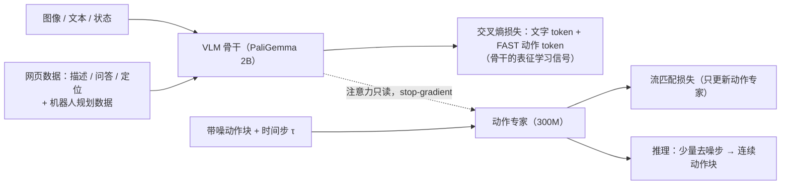

# 知识隔离：让 VLA 训练快、推理快、泛化好

## 论文信息

| 项目 | 内容 |
|---|---|
| 标题 | Knowledge Insulating Vision-Language-Action Models: Train Fast, Run Fast, Generalize Better |
| 作者 / 机构 | Danny Driess、Jost Tobias Springenberg、Brian Ichter、Lili Yu、Adrian Li-Bell、Karl Pertsch、Allen Z. Ren、Homer Walke、Quan Vuong、Lucy Xiaoyang Shi、Sergey Levine；机构：Physical Intelligence |
| 发表 | arXiv 预印本 2505.23705（v1，2025-05-29） |
| 链接 | [arXiv](https://arxiv.org/abs/2505.23705) · [HTML 全文](https://arxiv.org/html/2505.23705) · [项目页](https://www.pi.website/research/knowledge_insulation) · 权重见 [openpi](https://github.com/Physical-Intelligence/openpi) 的 `pi05_base` / `pi05_droid` |
| 关键词 | 知识隔离、梯度截断、流匹配动作专家、FAST 离散 token、联合训练、VLM 数据协同训练、语言跟随、训练收敛速度 |

> ❓ 待解决：arXiv 摘要页没有注明会议或期刊，frontmatter 暂不填 `venue`。

## 一句话总结

VLM 骨干只用离散 FAST 动作 token 和网页数据学表征，流匹配动作专家的梯度不回传，训练快 7.5 倍且更听指令。

## 背景与动机

- **之前的方法有什么问题？**
  - **自回归 VLA**（把动作切成离散 token、一个一个生成，如 π0-FAST）：离散化损失精度，而且解码慢——π0-FAST 在 RTX 4090 上生成 1 秒动作块要 750 ms，论文给出的控制频率约 1.3 Hz，很多高频任务用不了。
  - **连续动作头 VLA**（如 π0 的流匹配**动作专家**，即一组专门处理动作 token 的较小权重）：推理快（约 10 Hz），但动作专家是随机初始化后"嫁接"到预训练 VLM 上的。论文发现它的梯度会干扰预训练权重：训练慢，而且**听不进语言**——被要求把勺子放进桶里，π0 却去抓垃圾。
  - **冻结 VLM 只训新模块**：看似能保住知识，但 VLM 预训练里没有机器人数据，冻结后的表征不够用，物品进抽屉任务成功率 0%。
- **为什么这个问题重要？**
  - VLA 的全部卖点是继承网页规模预训练的语义知识。如果加动作模块的过程把这些知识冲掉，VLA 就退化成一个"从头训练的策略"。
  - 类比：新员工（动作专家）刚来时乱提修改意见，老员工（VLM）照单全收，结果把原来会的也忘了。

> 💡 要点：论文的问题意识是"动作专家到底有没有破坏 VLM 的知识"，答案是会，而且可以用三个简单手段避免。

## 方法

### 整体框架

在 π0 架构（PaliGemma 骨干 + 300M 动作专家）上改训练配方，不改推理结构：

### 关键模块

#### 模块 1：离散 + 连续动作联合训练

- **输入**：同一批机器人数据，动作既被 FAST 压成离散 token（接在文字后面），也以带噪连续动作块形式喂给动作专家。
- **处理**：联合损失

$$
\mathcal{L} = \mathcal{L}_{\text{token}}(\text{文字 + FAST 动作 token}) + \alpha\,\mathcal{L}_{\text{flow}}(\text{动作专家})
$$

  两个损失各有掩码，可以灵活混合"只有图文的 VLM 数据""只有动作的机器人数据""动作 + 下一步语言描述"三类样本。注意力掩码保证 FAST 动作 token 和连续动作 token 互不可见。
- **输出**：训练时两种表示都学；推理时只用动作专家做几步流积分，不做自回归解码。
- **为什么这样设计**：离散 token 的下一个 token 预测收敛快、信号稳定，但只当"表征学习目标"用；连续动作专家负责真正的高频输出。与 π0.5 的两阶段不同，这里是**单阶段**同时训。

#### 模块 2：VLM 数据协同训练

- **输入**：图像描述（CapsFusion、COCO）、视觉问答（Cambrian-7M、PixMo、VQAv2）、物体定位（另补室内场景与家居物品框标注），以及机器人规划数据。
- **处理**：与机器人数据混在同一个 token 损失里训练。
- **输出**：保住预训练知识的骨干。
- **为什么这样设计**：实验显示，有 VLM 数据时即使不做梯度截断，语言跟随也能改善；它是防止"灾难性干扰"的第二道保险。

#### 模块 3：梯度截断（知识隔离的核心）

- **输入**：注意力层里骨干 token 与动作专家 token 的交互。
- **处理**：骨干和动作专家只在注意力层相遇。把动作专家对骨干特征的注意力概率和 value 投影都包在 stop-gradient 里——前向照常，反向时动作专家的梯度到此为止，不进入骨干。
- **输出**：骨干只被文字 / FAST token 的交叉熵更新；动作专家只被流匹配更新。
- **为什么这样设计**：动作专家随机初始化，早期梯度是噪声；截断后它不会扰乱预训练权重。这样做只有在骨干同时用离散 token 学动作时才合理，否则骨干学不到控制所需的表征。副产物：两个损失作用在不相交的参数上，$\alpha$ 可以直接设为 1，不用调。

#### 模块 4：状态表示的选择

论文比较三种本体状态输入：离散化后当普通文字（text state，最接近预训练分布但 token 多）、离散桶对应特殊 token（special token state）、连续向量经仿射投影（continuous state）。结论：该配方对文字状态和连续状态都适用。

## 实验

### 数据集 / 任务 / 基线

| 设置 | 任务 | 评分 |
|---|---|---|
| 固定单臂专用模型 | 物品进抽屉（未见环境，3 件物品，满分 5）；收桌子（12 件物品按语言指令分到餐具桶 / 垃圾桶，满分 12） | 每任务每策略 10 次 |
| 固定双臂专用模型 | 叠 T 恤（满分 5，按方正度与褶皱） | 同上 |
| 通用模型（12 种机器人配置 + OXE + VLM 数据） | 收桌子；4 项移动操作任务（铺床、餐具进水槽、物品进抽屉、衣服进篮，均在未见环境） | 同上 |
| 公开基准 | DROID 真机桌面任务（与 FAST 论文同一组）；LIBERO 仿真（Spatial / Object / Goal / Long 联合训练，LIBERO-90 单独训练） | DROID 按任务进度打分 |

基线与消融：π0、π0-FAST、OpenVLA-OFT（并行解码 + 双向注意力，不用 FiLM）、Transfusion（在同一骨干里去噪）、HybridVLA（离散 + 连续同时训，但自回归 token 能看到扩散输入）、joint-training（本方法去掉梯度截断）、joint-training w/o VLM data、朴素分桶 token 代替 FAST、冻结骨干。

### 主要结果

**1）物品进抽屉（图 4，未见环境）**：本方法在成功率和语言跟随率上都最好。不截断梯度的 joint-training 和 π0 都听不进语言；π0-FAST 听得懂但动作慢、常打不开抽屉；HybridVLA 和冻结骨干都不可行。

**2）收桌子（图 5、图 6）**：专用模型和通用模型两种设置下本方法都最好；π0-FAST 性能也不错但因推理慢，完成任务的墙钟时间是本方法的两倍；OpenVLA-OFT 推理快但总体最差；Transfusion 表现好但比本方法慢。**收敛速度**：本方法和 π0-FAST 一样快，π0 需要 **7.5 倍**的训练步数才达到相近性能。

**3）DROID（真机，未见环境与物体）**：

| 方法 | 得分 |
|---|---|
| 本方法 | 0.55±0.09 |
| π0 | 0.49±0.09 |
| π0-FAST | 0.45±0.09 |

**4）LIBERO（表 1，成功率 %）**：

| 方法 | Spatial | Object | Goal | Long（LIBERO-10） | LIBERO-90 |
|---|---|---|---|---|---|
| Baku | — | — | — | 86.0 | 90.0 |
| MoDE | — | — | — | 94.0 | 95.0 |
| OpenVLA-OFT | 97.6 | 98.4 | 97.9 | 94.5 | — |
| π0 | 96.8 | 98.8 | 95.8 | 85.2 | — |
| π0-FAST | 96.4 | 96.8 | 88.6 | 60.2 | — |
| 本方法（从头训） | 96.6 | 97.2 | 94.6 | 84.8 | 92.7 |
| 本方法（从通用模型微调） | **98.0** | 97.8 | 95.6 | 85.8 | **96.0** |

LIBERO-Spatial 和 LIBERO-90 达到新的最优，LIBERO-10 不如 OpenVLA-OFT 和 MoDE。

**5）移动操作 4 项任务（图 9，未见环境）**：带 VLM 数据的本方法最好；π0 在相同训练步数下更差，原因是纯流匹配收敛慢。

**6）新物体泛化（图 7、图 8 "OOD Follow Rate"）**：把训练集里没有的物品从台面放进抽屉，VLM 数据协同训练对这种语义泛化尤其重要。

### 消融实验说明了什么

| 消融 | 结论 |
|---|---|
| 去掉梯度截断（joint-training） | 语言跟随明显变差；若同时有 VLM 数据则能部分挽回 |
| 去掉 VLM 数据 | 任务完成略降；对 joint-training 的语言跟随伤害最大 |
| 让自回归 token 看到连续动作（HybridVLA） | 显著变差，掩码必须隔开两种动作表示 |
| FAST → 朴素分桶 token 做表征信号 | 仍优于只用连续动作，但不如 FAST；每 5 步抽样一个 token 比稠密分桶好 |
| 冻结骨干 | 不可行，预训练表征不足以支撑操作 |
| Transfusion 式复用骨干去噪 | 语言跟随好于 π0，因为新初始化的参数只有动作投影——支持"随机初始化模块的梯度会干扰预训练权重"的假设 |

## 优点与不足

| 优点 | 不足 / 疑问 |
|---|---|
| 一个配方同时解决训练慢、推理慢、语言跟随差三个问题 | 同时训练两种输出使每步计算量增加约 20%（被更快收敛抵消） |
| 大量对照实验（8 种基线 / 消融、真机 + 仿真 + 公开基准），假设有充分证据 | 语言跟随仍"远非完美"，数据中的相关性仍会让模型无视指令 |
| 不改推理结构，openpi 的 π0.5 权重即按此训练，可直接使用 | 大部分真机数据和部分图中数值未公开 |
| 单阶段训练，比 π0.5 的两阶段更简单 | 是否适用于其他骨干（非 PaliGemma）或扩散头未验证 |

## 与知识库的关联

- 用到的基础知识：[Pi 专题 02 π0 架构与流匹配](../../VLA/Pi/02-pi0-architecture-and-flow-matching.md) —— 本文改的是 π0 的训练配方，动作专家、前缀掩码和时间步采样都来自 π0。
- 用到的基础知识：[Pi 专题 04 π0.5 与知识隔离](../../VLA/Pi/04-pi05-open-world-and-knowledge-insulation.md) —— 教程版讲解；π0.5 的两阶段训练是本文单阶段配方的前身。
- 用到的基础知识：[VLA 基础 03 Transformer 与多模态](../../VLA/Basic/03-transformers-and-multimodal.md) —— 注意力层的 Q / K / V 结构，本文的梯度截断正是在注意力里实现的。
- 可延伸的主题：[VLA 基础 08 训练与微调](../../VLA/Basic/08-training-and-finetuning.md) —— 微调自己的数据时同样面临"新模块梯度破坏预训练知识"的问题，LoRA 和本文思路可对照。

## 复现清单

- [ ] 环境：openpi 仓库（JAX，另有 PyTorch 实现），`pi05_base` 权重即知识隔离配方训练，仓库只支持流匹配头的训练与推理。
- [ ] 数据：真机数据为内部数据；可复现 LIBERO（按 OpenVLA 方式准备：224×224 重渲染、过滤失败与无操作帧，同时用第三人称和腕部相机）与 DROID。
- [ ] 关键超参数：PaliGemma 2B 骨干（width 2048、18 层、mlp 16384）+ 300M 动作专家（width 1024、mlp 4096）；动作块 50 步；FAST 分词；$\alpha = 1$（梯度截断后）；时间步采样沿用 π0 的 Beta 分布。
- [ ] 预期指标：DROID 0.55±0.09；LIBERO Spatial 98.0 / Object 97.8 / Goal 95.6 / Long 85.8 / LIBERO-90 96.0（从通用模型微调）。

> ❓ 待解决：学习率、batch size、训练步数、推理去噪步数在 HTML 正文中未给出；图 4、5、6、9 的具体数值只在图中。

## 我的问题与想法

- 梯度截断的前提是"骨干自己也在学动作"。那么 FAST token 的交叉熵到底让骨干学到了什么表征，使动作专家只读取就够用？能否用探针实验量化？
- 朴素分桶 token 每 5 步抽样一个反而比稠密分桶好，暗示表征学习信号要"信息密度高"而不是"多"；这与 FAST 论文关于高频数据下分桶 token 冗余的论点一致。
- Transfusion 语言跟随好但推理慢、OpenVLA-OFT 推理快但性能差，三者的取舍是否意味着"新参数越少越不伤知识、但专用模块越大越能控制"的权衡？
- 本库 [09 评估与部署](../../VLA/Basic/09-evaluation-and-deployment.md) 写"π0 微调后 LIBERO 可达 90% 以上，π0.5 更高"，与本文表 1 的 π0 四套件平均约 94% 一致；可把本文表 1 的具体数字补进那一章。

> ❓ 待解决：论文说"7.5 倍训练步数"是在收桌子通用模型设置下的结果，其他任务是否同样倍数未知。
