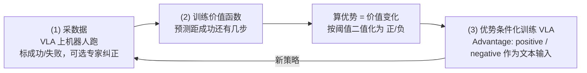

# π*0.6：从经验中学习的 VLA（RECAP）

## 论文信息

| 项目 | 内容 |
|---|---|
| 标题 | π*0.6: a VLA That Learns From Experience |
| 作者 / 机构 | 署名 Physical Intelligence，共 55 位作者（Ali Amin、Raichelle Aniceto、Ashwin Balakrishna、Kevin Black、…、Sergey Levine、…、Zhiyuan Zhou）；机构：Physical Intelligence |
| 发表 | arXiv 预印本 2511.14759（v1 2025-11-18，v2 2025-11-19）；arXiv 页面未注明会议 |
| 链接 | [arXiv](https://arxiv.org/abs/2511.14759) · [HTML 全文](https://arxiv.org/html/2511.14759) · [官方博客](https://www.pi.website/blog/pistar06) |
| 关键词 | VLA、强化学习、离线 RL、价值函数、优势条件化、人工纠正（DAgger）、流匹配、长时程任务 |

> ❓ 待解决：arXiv 页面只写了 cs.LG / cs.RO 分类，没有会议信息，所以 frontmatter 暂不填 `venue`，需人工核实后补上。

## 一句话总结

用 RECAP 把示范、专家纠正和自主经验统一进离线 RL，让 π0.6 在最难任务上吞吐量翻倍、失败率减半。

## 背景与动机

- **之前的方法有什么问题？**
  - 现有 VLA（包括 π0、π0.5）几乎全靠**模仿学习**（看人类遥操作示范做监督训练）。这类策略有众所周知的**复合误差**（compounding errors）问题：犯一个小错就进入训练数据没覆盖的状态，接着犯更大的错；而且上限就是示范者的水平，速度和稳健性都不会超过人。
  - 已有的 VLA 强化学习工作要么直接套 PPO 之类的策略梯度（对真实世界、大模型来说难以稳定和扩展），要么只训练残差策略 / 动作头 / 在扩散噪声空间里优化，或者只用离散动作和简单高斯分布，很少有**端到端训练流匹配 VLA** 的方案。
  - 真实世界里奖励信号稀疏、有歧义，而且数据来自不同策略（人类、旧策略、新策略），需要一种能吃"混合质量数据"的方法。
- **为什么这个问题重要？**
  - 实际应用要求机器人**又快又稳**：成功率要接近 100%，吞吐量要接近人。靠模仿只能做到"有时成功"。
  - 类比：学装纸箱，先看师傅示范，再让师傅在你出错时纠正，最后自己反复练。此前的机器人只做了第一步。

> 💡 要点：论文的定位不是提出全新的 RL 算法，而是把"离线 RL 预训练 + 价值函数 + 优势条件化 + 人工纠正"组合成一套**可扩展到大 VLA、可在真机迭代**的配方，并第一次在复杂真实任务上证明它能同时提升稳健性和吞吐量。

## 方法

### 整体框架

RECAP（RL with Experience and Corrections via Advantage-conditioned Policies）只有三个子程序，不同阶段只是换数据：

- **预训练阶段**：在数万小时的多任务、多机器人示范数据上做 (2) 和 (3)，得到 π*0.6 基座。
- **任务阶段**：先用目标任务示范微调（指示符固定为正，相当于 SFT），然后做一轮或多轮 (1)(2)(3)。

### 关键模块

#### 模块 1：π0.6 基座模型

- **输入**：相机图像、机器人状态、语言（任务指令 + 可选的元数据提示，如期望的执行质量）。
- **处理**：π0.6 从 π0.5 演化而来，三处改进：预训练数据加入更多机器人平台；骨干换成 **Gemma 3 4B**；动作专家扩大到 **860M** 参数。训练沿用知识隔离（KI）配方：主干用下一 token 预测学习子任务文本和 FAST 离散动作 token，流匹配动作专家通过 stop gradient 与主干隔离，并与网页视觉-语言数据共训。
- **输出**：先输出子任务文本（如"拿起咖啡杯"），再由动作专家以 **50 Hz** 生成关节角 + 夹爪动作块；动作生成以子任务为条件，推理时子任务预测频率低于动作生成。
- **为什么这样设计**：离散 + 连续双通道既保留 VLM 的语义能力和高层推理，又能高频输出平滑动作。

> ❓ 待解决：官方博客称 π0.6"基于 5B 参数的视觉语言模型"，论文写"基础 VLM 是 Gemma 3 4B"，可能是是否计入视觉编码器的口径差异，需对照模型卡核实。

#### 模块 2：分布式价值函数

- **输入**：与 VLA 相同的图像和语言输入。
- **处理**：奖励只来自每条轨迹的成功 / 失败标签：成功轨迹的价值 = （负的）距离成功还需要的步数，失败轨迹给一个很大的负常数；再按每个任务的最大轨迹长度归一化。价值函数是**分布式**的：把经验回报离散成若干分桶，用交叉熵训练（蒙特卡洛估计，对应数据集里的行为策略），取各桶期望得到连续值。架构与 VLA 相同，但骨干只有 **670M**（也从 Gemma 3 初始化），并混入少量多模态网页数据防止过拟合。
- **输出**：当前画面"离成功还有多远"的分布。
- **为什么这样设计**：奖励定义通用到可以用在任何任务上；小骨干让训练 VLA 时可以**在线算优势**，成本几乎不增加；论文承认这个 on-policy 估计不如经典 off-policy Q 函数"最优"，但简单可靠。

#### 模块 3：优势条件化的策略提取

- **输入**：价值函数算出的优势（后训练用 n 步 lookahead 估计；预训练用整条轨迹的回报估计，方便单次推理算出）。
- **处理**：优势超过**任务相关阈值**就标为正，否则为负；在输入序列里插入文本 `Advantage: positive` / `Advantage: negative`，位置在子任务文本之后、动作之前，因此只影响动作部分的似然。所有数据（示范、旧策略、新策略、纠正）都参与监督训练；专家纠正的动作**强制为正**。训练目标 = 离散动作 token 的交叉熵 + 连续动作的流匹配损失（可解释为动作似然的下界）。训练时 30% 概率随机去掉指示符，这样推理时既可直接条件采样，也可用无分类器引导（CFG）进一步锐化。
- **输出**：推理时固定输入 `Advantage: positive`，得到比数据更优的策略。
- **为什么这样设计**：策略梯度在流匹配模型上算不出精确似然、难稳定；AWR 等加权回归实际上丢掉大量数据。优势条件化用全部数据、实现简单，而且理论上（与 CFGRL 同源）条件化后的策略保证不差于参考策略。用阈值而不是 CFG 引导权重来控制"多激进"，是因为高引导权重会把动作推到分布边缘、动作变粗暴，而且对自回归部分无效。

> ❓ 待解决：阈值的具体分位数（预训练按示范数据的某个百分位、微调按评估 rollout 的某个百分位，T 恤任务额外调高）、lookahead 步数 n、分桶数量在 HTML 版里被公式吞掉，需查 PDF 附录 A-F。

#### 模块 4：数据收集与迭代

- **输入**：当前策略、真机、可选的专家遥操作员。
- **处理**：采用 human-gated DAgger 式纠正——策略自主执行，专家在出错时接管；整条轨迹（自主段 + 纠正段）都进数据集。每轮迭代**价值函数和策略都从预训练检查点重新微调**，而不是从上一轮模型继续，以避免多轮漂移。
- **输出**：新一轮数据集与新策略；论文发现一轮通常就有明显提升。
- **为什么这样设计**：纠正擅长修"大错"和解决探索问题，但人无法保证纠正质量，也改不了"速度"这类细微指标，所以必须配合自主经验 + RL。

## 实验

### 数据集 / 任务 / 基线

实验平台：固定双臂系统，两条 6 自由度机械臂 + 平行夹爪，50 Hz 关节位置控制，三个相机（基座 1 个 + 每臂腕部 1 个）。任务都是 5~15 分钟的多阶段任务：

| 任务 | 说明 | 成功判定 |
|---|---|---|
| 叠衣（T 恤与短裤） | π0.5 论文的标准叠衣任务：从筐里取出、铺平、折叠、叠放到桌子右上角 | 200 秒内完成 |
| 叠衣（多样物品） | 11 类衣物：毛巾、纽扣衬衫、毛衣、牛仔裤、T 恤、短裤、Polo、裙子、长袖、袜子、内衣；定量指标只统计最难的纽扣衬衫 | 500 秒内完成 |
| 叠衣（针对性去除失误） | 固定铺平的橙色 T 恤，严格要求领口居中朝上 | 200 秒内完成 |
| 咖啡（双份浓缩） | 取手柄 → 磨豆 → 压粉 → 锁入咖啡机 → 取杯 → 萃取 → 上桌 | 200 秒内无重大失误（掉手柄、洒咖啡算失败） |
| 装纸箱 | 真实工厂部署：平板纸箱折成型、贴标签、放入货箱指定位置 | 600 秒内完成 |

基线与消融：

| 模型 | 说明 |
|---|---|
| π0.5 预训练 | 不用 RL、不用 RECAP |
| π0.6 预训练 | 监督预训练，无优势指示符 |
| π*0.6 离线 RL 预训练 | 与价值函数一起做 RL 预训练，含优势指示符 |
| π*0.6 离线 RL + SFT | 在上者基础上用目标任务示范微调（指示符固定为正） |
| **π*0.6（完整 RECAP）** | 再加自主 rollout + 专家纠正的 RL 迭代；默认直接条件采样，部分实验加 CFG |
| AWR | 同样数据，用优势加权回归做策略提取 |
| PPO | 同样数据，DPPO / FPO 风格的 PPO 变体，用单步扩散似然，SPO 式信赖域约束 |

两个指标：**吞吐量**（每小时成功次数，同时反映速度与成功率）和**成功率**（人工标注，多项质量指标汇总）。

### 主要结果

论文主结果在图 7（吞吐量）和图 8（成功率），正文给出的结论：

| 结论 | 原文依据 |
|---|---|
| 完整 π*0.6 在所有任务上都显著优于 π0.6 监督模型、RL 预训练模型和离线 RL + SFT 模型 | VI-C1 |
| 多样叠衣和咖啡任务：加入机器人上收集的数据后（离线 RL + SFT → 最终模型）吞吐量**提高 2 倍以上**，失败率**降低约 2 倍** | VI-C1、摘要 |
| T 恤与短裤任务：SFT 后成功率已接近上限，但最终模型吞吐量仍显著提升 | VI-C1 |
| 除多样叠衣外，最终模型成功率均在 **90% 以上** | VI-C1 |
| 装纸箱按四个阶段（取纸板、折箱、贴标签、放入货箱）拆分，π*0.6 各阶段成功率都最高；多数失败是超时 | VI-C1 |

> ❓ 待解决：各模型每小时成功次数和成功率的具体数值只在图中，HTML 文本未给出，需对照 PDF 的图 7、图 8 补成数字表格。

**多轮迭代（图 9、图 10）**

| 任务 | 每轮数据 | 结果 |
|---|---|---|
| T 恤与短裤 | 仅自主评估数据（无纠正），每轮 300 条轨迹（4 台机器人） | 第一轮成功率即超过 90%，第二轮主要提升吞吐量 |
| 装纸箱 | 每轮 600 条自主 + 360 条带纠正 | 两轮后吞吐量提升 2 倍；折箱和贴标签成功率约 90% |

**策略提取方法对比（图 11，T 恤与短裤任务，使用与最终模型相同的数据）**：AWR 和 PPO 都远不如优势条件化，很难超过离线 RL + SFT；PPO 需要很小的信赖域才能稳定，性能差；AWR 成功率尚可但策略慢、吞吐量低。

**去除特定失误模式（图 12）**：严格要求领口朝上的 T 恤任务，仅用纯 RL（无纠正、无新示范）迭代两轮就把失误模式去掉，且速度快。

> ❓ 待解决：该实验每轮轨迹数和最终成功率百分比被公式吞掉，需查 PDF。

**长时间部署展示**：论文称 π*0.6 连续做咖啡 **13 小时**、在新家里连续叠新衣物 **2 小时以上**、在工厂装真实包装箱；博客展示从早上 5:30 到晚上 11:30 做咖啡、叠 50 件没见过的衣物、装并贴标 59 个巧克力包装箱，各阶段成功率超过 90%。

### 消融实验说明了什么

| 消融 | 说明 |
|---|---|
| π0.6 监督预训练 vs π*0.6 离线 RL 预训练 | 仅把预训练改成带优势指示符的离线 RL 就有提升，且离线 RL + SFT 优于普通 SFT，是后续真机 RL 的好起点 |
| 离线 RL + SFT vs 完整 RECAP | 真机经验（自主 + 纠正）贡献了最大的增益：最难任务吞吐量翻倍、失败率减半 |
| 优势条件化 vs AWR / PPO | 相同数据下，策略提取方式决定成败；优势条件化显著更好 |
| 纯自主 RL（无纠正） | T 恤任务和失误清除实验证明，不靠人工纠正也能提升 |

## 优点与不足

| 优点 | 不足 / 疑问 |
|---|---|
| 奖励定义极简（每条轨迹一个成功 / 失败标签），通用到任何任务 | 系统并非全自动：成功标签、纠正、场景复位都靠人 |
| 优势条件化不丢数据、实现简单，能端到端训练流匹配大 VLA | 探索很"贪心"，只依赖策略随机性和人工纠正 |
| 示范、纠正、自主经验统一进同一个离线 RL 框架 | 每轮是"采一批、训一次"的离线迭代，不是实时在线 RL |
| 在真实长时程任务（5~15 分钟）上吞吐量翻倍、失败率减半，可连续运行十几小时 | 价值函数用 on-policy 蒙特卡洛估计，论文承认不如 off-policy Q 函数 |
| 多轮迭代稳定（每轮从预训练检查点出发） | 阈值、lookahead 等超参数按任务手调；是否开源权重未提及 |

## 与知识库的关联

- 用到的基础知识：[01 什么是机器人学习](../../VLA/Basic/01-what-is-robot-learning.md) —— 1.2 节讲的"模仿学习很难超过示范者"正是本文要突破的上限，强化学习的定义也在那里。
- 用到的基础知识：[08 训练与微调](../../VLA/Basic/08-training-and-finetuning.md) —— 本文的"离线 RL 预训练 → 任务 SFT → 经验迭代"是在标准"预训练 → 微调"流程上多加了一个阶段。
- 用到的基础知识：[09 评估与部署](../../VLA/Basic/09-evaluation-and-deployment.md) —— 本文用吞吐量（每小时成功次数）补充成功率，评估多阶段长任务时值得借鉴。
- 可延伸的主题：[π 系列 · 05 π*0.6 从经验中学习](../../VLA/Pi/05-pi06-learning-from-experience.md) —— 面向零基础的完整讲解，包含价值函数与优势条件化的类比。
- 可延伸的主题：[π 系列 · 01 系列总览](../../VLA/Pi/01-pi-series-overview.md) —— 在 π0 → π0-FAST → π0.5 → π0.6 的时间线里，本文是"从模仿走向 RL"的一站。

## 复现清单

- [ ] 环境：固定双臂（2 × 6 自由度 + 平行夹爪），50 Hz 关节位置控制，3 个相机；π0.6 / π*0.6 权重论文未说明是否公开，复现需自行训练或等待发布。
- [ ] 数据：目标任务示范 + 每轮自主 rollout（每条轨迹标成功 / 失败）+ 可选专家纠正；参考规模：T 恤任务每轮 300 条自主轨迹，装纸箱每轮 600 条自主 + 360 条纠正，多样叠衣 450 条评估 + 287 条纠正，咖啡只做一轮。
- [ ] 关键超参数：价值函数骨干 670M（Gemma 3 初始化）、分布式分桶 + 交叉熵、按任务最大长度归一化；优势指示符 dropout 30%；纠正动作强制为正；每轮从预训练检查点微调；阈值分位数、lookahead 步数、分桶数见 ❓ 待解决。
- [ ] 预期指标：最难任务（多样叠衣、咖啡）吞吐量 ≥ 2 倍于离线 RL + SFT、失败率约减半；其余任务成功率 90%+；T 恤任务一轮后成功率 > 90%。

## 我的问题与想法

- 价值函数只看"剩余步数"，意味着"快"会被天然奖励；在需要小心（比如倒液体）的阶段，会不会把策略推得过于激进？论文提到高 CFG 权重会让动作变粗暴，阈值方案是否完全避免了这一点？
- 每轮都从预训练检查点重新微调是为了防漂移，但随着迭代轮数增加，数据集里旧策略的数据越来越多，价值函数估计的是"混合行为策略"的价值，这对优势阈值的选择有什么影响？
- 奖励只有轨迹级成功 / 失败，"部分成功"（比如装纸箱折好了但标签贴歪）在价值函数里只能靠剩余步数间接体现；更细的阶段奖励会不会更有效？
- RECAP 解决的是"同一任务反复练习的熟练度"，和 π0.5 的"换新环境泛化"互补；两者叠加时，自主经验是否会损害泛化（过拟合到部署环境）？

> ❓ 待解决：本笔记里所有"具体数值只在图中"的项（图 7、8、9、10、12 的吞吐量与成功率、附录 A-F 的阈值分位数与 lookahead 步数）需要对照 PDF 原文补齐后，再把 status 改为 reviewed。
