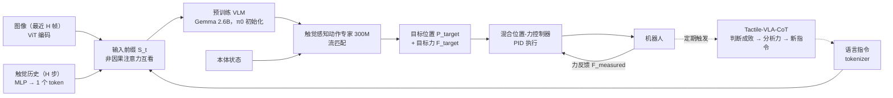

# Tactile-VLA：解锁 VLA 模型的物理知识实现触觉泛化

## 论文信息

| 项目 | 内容 |
|---|---|
| 标题 | Tactile-VLA: Unlocking Vision-Language-Action Model's Physical Knowledge for Tactile Generalization |
| 作者 / 机构 | Jialei Huang*、Shuo Wang*、Fanqi Lin、Yihang Hu、Chuan Wen、Yang Gao（* 共同一作）；清华大学、电子科技大学（UESTC）、上海交通大学 |
| 发表 | arXiv 预印本 2507.09160（v1 2025-07-12，分类 cs.RO / cs.LG）；arXiv 页面未注明会议 |
| 链接 | [arXiv](https://arxiv.org/abs/2507.09160) · 项目页 / 代码：论文未给出 |
| 关键词 | 触觉 VLA、力控、混合位置-力控制、思维链（CoT）推理、零样本泛化、UMI 手持采集 |

> ❓ 待解决：arXiv 页面没有会议信息，frontmatter 暂不填 `venue`，需人工核实后补上。

## 一句话总结

把触觉 token 和目标力直接接进 π0，配混合位置-力控制器，少量示范就能让 VLA 零样本听懂"轻一点"并自我纠正力度。

## 背景与动机

- **之前的方法有什么问题？**
  - 现有 VLA 的强项来自视觉-语言骨干的隐式知识，擅长"做什么"，但在**接触丰富任务**（需要持续接触、精细控制力度的任务，如插 USB、擦黑板）上落地不稳，因为它们不知道"怎么用力"。
  - 已有把触觉 / 力觉接进机器人系统的工作，多数只把触觉当作一路"补充感知"，不直接参与动作生成；更没有让语言去调节力度。
  - 常规遥操作采集没有力反馈，操作者自己都感觉不到接触力，采出来的示范天然不依赖触觉，策略也就学不到。
- **为什么这个问题重要？**
  - "轻轻插 USB"和"用力插 USB"运动轨迹几乎一样，纯视觉无法区分，只有力能区分。
  - VLM 在海量图文里已经学到"铁球重、火龙果易碎"这类**物理常识**，缺的只是一条把常识接到传感器和执行器上的通道。
  - 类比：新手厨师听得懂"轻轻搅"，但手上没分寸；只要师傅扶着手练几次，语言和手感就对上了，之后面对没做过的菜也知道该用多大劲。

> 💡 要点：论文的核心主张不是"又加了一个传感器"，而是**VLM 的隐空间里本来就有对物理交互的语义理解**，只要用少量示范把它接到触觉传感器上，就能在接触丰富任务上零样本泛化。

## 方法

### 整体框架

整体分三层：策略网络输出"去哪 + 用多大力"，混合控制器把力目标翻译成位置修正，CoT 变体定期回看结果、必要时改写指令重来。

### 关键模块

#### 模块 1：触觉感知的策略网络（token 级融合）

- **输入**：最近 H 帧图像、语言指令、最近 H 步触觉测量、本体状态。
- **处理**：ViT 把每一帧编码成一组 token（与 π0 相同）；一个简单的 MLP 把 H 步触觉历史拼接后压成**一个** token，代表接触的时间动态；语言用普通 tokenizer。三者拼接成前缀序列 $S_t = [E'_{vis}(I_{t-H+1}),\dots,E'_{vis}(I_t),\ E_{lang}(L_t),\ E'_\psi([T_{t-H+1},\dots,T_t])]$，前缀内部用**非因果注意力**（每个 token 都能看到其他所有 token）互相融合，再进 Transformer 主干，最后交给"触觉感知动作专家"。共享部分用 π0 预训练权重初始化；触觉编码器和改过的动作专家随机初始化。整个模型用**条件流匹配**（CFM）损失端到端微调，损失同时惩罚运动学维度和力维度的误差。
- **输出**：增广动作向量 $a_t$，显式包含目标位置 $P_{target}$ 和目标接触力 $F_{target}$，两者都来自专家示范。
- **为什么这样设计**：只有把力放进动作空间，模型才可能学到"gently → 0.5 N"这种从语言细微差别到力大小的直接映射；token 级深度融合让触觉也能参与后面的 CoT 推理（而不是只在动作头里打转）。

#### 模块 2：混合位置-力控制器

- **输入**：动作专家给出的 $P_{target}$、$F_{target}$；传感器实测的 $F_{measured}$。
- **处理**：策略是**位置主导**、最终只发位置指令。先算力误差 $\Delta F = F_{target} - F_{measured}$，只有误差的模超过阈值 $\tau$ 才修正位置：

$$
P_{hybrid} = P_{target} + \begin{cases} K\,\Delta F & \lVert \Delta F \rVert > \tau \\ 0 & \lVert \Delta F \rVert \le \tau \end{cases}
$$

  其中 $K$ 是增益矩阵；再由 PID 控制器把关节驱动到动态更新的 $P_{hybrid}$。两类力分开控制：**夹爪的笛卡尔位置**负责调节对外的净作用力（压多重），**夹爪开口宽度**负责调节内部抓握力（握多紧），两条通道互不干扰。
- **输出**：位置指令。
- **为什么这样设计**：大多数操作任务以精确运动为主，力控只在接触阶段才需要（Raibert & Craig 1981 的混合位置 / 力控制思想）；做法借鉴**阻抗控制**（Hogan 1985，让机器人像弹簧一样受力会退让），但目标不是被动柔顺，而是**主动跟踪目标力**；阈值 $\tau$ 避免小抖动引起频繁修正，让运动更平滑。

> 🔗 关联：阻抗 / 导纳控制的直观解释见 [10 力觉与触觉感知](../../VLA/Basic/10-force-and-tactile-sensing.md)；在 UR 上用 `force_mode` 做"恒力下压 + 擦拭"的实例见 [UR 09 力传感与力控模式](../../UR/09-force-sensing-and-force-mode.md)。

> ❓ 待解决：增益矩阵 $K$ 和阈值 $\tau$ 的具体取值、PID 参数、控制频率，论文正文均未给出。

#### 模块 3：Tactile-VLA-CoT（基于推理的自适应）

- **输入**：按固定时间间隔触发；提示词先问"任务完成了吗"，若判定失败，再让模型结合传感反馈分析原因。
- **处理**：用 VLM 自己的预训练解码器生成一段显式的"内心独白"。为此用一个小而有针对性的数据集微调：每条样本 = 一次失败事件（例如擦黑板打滑）的多模态数据流 + 一段分析失败原因的文字标注（例如"力太轻了，需要更大的力，现在试 5 N"）。
- **输出**：显式分析各个力分量（"抓握力够，但法向力太低"），然后生成一条新的纠正指令（"再擦一次，向下用更大的力"），作为下一次尝试的输入。
- **为什么这样设计**：这种微调一方面保留了 VLM 的通用推理能力，缓解灾难性遗忘；另一方面把推理延伸到触觉模态——从剪切力信号读出工具打滑、从法向力读出压力不足。固定间隔触发简单但有效，相当于让机器人定期"回头看一眼"。

#### 模块 4：带触觉的数据采集（VLA-T 数据集）

- **输入**：人的示范。
- **处理**：在 **UMI**（Universal Manipulation Interface，一种带 GoPro 相机的手持夹爪，人拿着它直接操作物体来录数据）上加装两个高分辨率触觉传感器，能同时测法向力和剪切力，操作者直接感受接触动态，示范因此是"被力引导"的。采集前对齐所有数据流的时间戳；采集时触觉 100 Hz、视觉 20 Hz，之后把高频触觉下采样对齐到对应图像帧。硬件：GoPro 相机 + 触觉传感器 + 3D 打印夹爪。
- **输出**：视觉、语言、触觉、动作轨迹精确同步的 VLA-T 训练集。
- **为什么这样设计**：遥操作的操作员没有力反馈，采出来的数据里"力"是随机的，策略学不到力与语言的对应；人手直接感受接触，才能示范出"轻"和"重"的区别。

## 实验

### 数据集 / 任务 / 基线

基线：**π0-base**（通用 VLA 流模型）、**π0-fast**（π0 的 FAST 离散动作 token 变体），两者都没有触觉融合结构；本文方法 **Tactile-VLA** 与 **Tactile-VLA-CoT**。三个任务对应三个研究问题：

| 任务 | 训练数据 | 回答的问题 |
|---|---|---|
| 充电器 / USB 插拔 | USB（任务 A）："softly""hard"各 100 条示范，指令里带力相关词；充电器（任务 B）：100 条只学动作，训练时没有任何力相关语言 | RQ1：力相关副词能否跨任务零样本迁移 |
| 桌面抓取 | 6 个训练物体（木块、铁块、电池、火龙果、瓜、充电器）各 50 条；评估时另加 6 个未见物体 | RQ2：能否用 VLM 常识给未知物体选合适的抓力 |
| 擦板子 | 白板上 100 条成功 + 100 条失败示范（失败配纠正文字）；训练从未见过黑板 | RQ3：能否从触觉反馈推理出失败原因并自主调整力 |

> ❓ 待解决：实验用的机械臂型号、触觉传感器型号、历史长度 H、训练步数等实现细节论文正文未给出。

### 主要结果

**RQ1：插拔成功率（表 1）**

| 模型 | USB 插拔（%） | 充电器插拔（%） |
|---|---|---|
| π0-base | 5 | 40 |
| π0-fast | 0 | 25 |
| Tactile-VLA | **35** | **90** |

**RQ1：不同指令下实际施加的插入力（表 2，单位 N）**

| 模型 | softly（学过） | hard（学过） | gently（未见词） | firmly（未见词） | rigidly（未见词） | harder（未见词） | 充电器 softly（零样本任务） | 充电器 hard（零样本任务） |
|---|---|---|---|---|---|---|---|---|
| π0 | 2.41 | 2.68 | 2.35 | 2.72 | 2.53 | 2.29 | 6.61 | 5.69 |
| π0-fast | 2.61 | 2.33 | 2.79 | 2.45 | 2.26 | 2.58 | 7.37 | 6.42 |
| Tactile-VLA | **0.51** | **2.57** | **0.75** | **1.98** | **2.42** | **2.94** | **4.68** | **9.13** |

怎么读这张表：

- 学过的词：softly 0.51 N、hard 2.57 N，拉开了 5 倍。
- 没学过的近义词：gently（0.75）< firmly（1.98）< rigidly（2.42），模型给出了合理的中间档位；对 harder 施加 2.94 N，**超过**了训练里 hard 的 2.57 N，说明能外推。
- 零样本迁移到充电器任务（训练时没有任何力相关语言）：softly 4.68 N vs hard 9.13 N，力的量级随任务变了，但"轻 / 重"的相对关系保住了。
- 两个基线对所有副词几乎无响应，力的大小与指令无关。

**RQ2：抓取未见物体不压坏的成功率（表 3，每个物体 10 次）**

| 模型 | 铁块（ID） | 电池（ID） | 钉子（OOD） | 钢球（OOD） | 木块（ID） | 充电器（ID） | 轻固体 OOD 物体之一 | 塑料玩具（OOD） | 火龙果（ID） | 瓜（ID） | 蓝莓（OOD） | 纸盒（OOD） |
|---|---|---|---|---|---|---|---|---|---|---|---|---|
| π0-base | 100 | 80 | 30 | 60 | 60 | 70 | 40 | 30 | 50 | 0 | 0 | 0 |
| π0-fast | 70 | 60 | 10 | 70 | 70 | 50 | 30 | 40 | 40 | 10 | 0 | 0 |
| Tactile-VLA | **100** | **90** | **100** | **90** | **90** | **100** | **80** | **90** | **90** | **80** | **100** | **90** |

三组分别是"固体重物（期望用大力）""固体轻物（期望中等力）""易碎轻物（期望小力）"。基线在易碎物上几乎全军覆没（蓝莓、纸盒 0%），Tactile-VLA 对从未见过的蓝莓做到 100%。图 6 的柱状图（每物体 5 次平均抓力）显示模型对未见物体也按重 / 轻 / 易碎给出了大 / 中 / 小三档抓力。

> ❓ 待解决：表 3 "固体轻物"一组有 4 个物体，PDF 文本抽取只保留了 3 个名字（木块、充电器、塑料玩具），缺失的那个 OOD 物体名称及列顺序需对照原文核实；图 6 各物体的平均抓力只有柱状图，没有数值。

**RQ3：擦板子成功率（表 4，%）**

| 模型 | 白板（域内） | 黑板（域外、零样本） |
|---|---|---|
| π0-base | 40 | 0 |
| π0-fast | 45 | 0 |
| Tactile-VLA | **80** | 15 |
| Tactile-VLA-CoT | 75 | **80** |

过程：机器人只收到"Wipe the board"，先用默认 3.5 N 擦黑板，失败；CoT 从触觉反馈判断"没进展"，推理出需要更大的力，自主把力提高到 6.7 N——比白板训练数据里对应成功的 5 N 还高 34%，粉笔字被擦掉。基线能复现擦拭动作，但无法解读触觉上的失败，只会用同样的小力反复擦。

### 消融实验说明了什么

论文没有单独的消融章节，但几组对照能回答两个问题：

| 对照 | 说明 |
|---|---|
| Tactile-VLA vs Tactile-VLA-CoT（表 4） | CoT 对域内任务略有代价（80 → 75），但域外从 15 跳到 80：**"调整力度"的能力来自显式推理，而不是触觉输入本身** |
| π0-base vs π0-fast（所有表） | 动作表示（流匹配 vs 离散 token）对结果影响很小，没有触觉通道怎么换都不行 |
| 学过的词 vs 未见词 vs 零样本任务（表 2） | 力的语义泛化是分层的：同任务内插值 → 同任务外推 → 跨任务迁移，三层都成立 |

> ❓ 待解决：论文没有对"触觉 token 放在前缀 vs 放在动作头""力是否进动作空间""控制器阈值"等设计做消融，这些设计的必要性只有定性论证。

## 优点与不足

| 优点 | 不足 / 疑问 |
|---|---|
| 把力放进动作空间 + 混合控制器，语言能直接调节力度，而且力是可量化的（0.51 N vs 2.57 N） | 每个任务仍需 100~200 条示范做任务内微调，不是通用基座 |
| 证明 VLM 先验能迁移到触觉：未见副词、未见物体、未见板面三个层面都有零样本证据 | 基线只有 π0 / π0-fast（无触觉），没有和 ForceVLA、FuSe 等触觉 VLA 直接比较 |
| CoT 让失败可解释、可纠正，纠正过程落在具体的力分量上 | CoT 固定间隔触发而非事件驱动；纠正数据需要人工写失败分析文本 |
| UMI + 触觉传感器的采集方案让示范本身带力信息，成本低、可移动 | 机器人、传感器型号、$K$ / $\tau$ 等实现细节缺失，无代码；每个物体只测 10 次 |
| 控制器解耦"对外净力"和"抓握力"，直观易实现 | 位置主导的间接力控在刚性接触下的稳定性没有讨论 |

## 与知识库的关联

- 用到的基础知识：[10 力觉与触觉感知](../../VLA/Basic/10-force-and-tactile-sensing.md) —— 10.4 节讲了力信息进入 VLA 的几种方式，本文是"触觉作为输入 token + 力作为输出动作"两头都接；10.3 节的阻抗控制是混合控制器的思想来源。
- 用到的基础知识：[π 系列 · 02 π0 架构与流匹配](../../VLA/Pi/02-pi0-architecture-and-flow-matching.md) —— 本文直接用 π0 权重初始化（Gemma 2.6B 骨干 + 300M 动作专家），训练目标也是流匹配，读懂 π0 就读懂了本文的骨架。
- 用到的基础知识：[04 VLA 是什么](../../VLA/Basic/04-vla-concept.md) —— 本文在 4.2 节的标准数据流上多加了一路触觉输入和一路力输出，对照那张图看最清楚。
- 用到的基础知识：[07 动作表示](../../VLA/Basic/07-action-representation.md) —— 本文把目标力拼进动作向量，是"动作到底是什么"的一个扩展例子：动作不一定只有位置。
- 用到的基础知识：[06 数据集与数据采集](../../VLA/Basic/06-datasets-and-data-collection.md) —— 6.3 节的遥操作采集没有力反馈，本文改用带触觉传感器的 UMI 手持夹爪，就是为了补这个缺口。
- 可延伸的主题：[UR 09 力传感与力控模式](../../UR/09-force-sensing-and-force-mode.md) —— 想在 UR 机械臂上实现本文"目标力 → 位置修正"的控制器，可以对照那一章 `force_mode` 恒力下压的例子。

## 复现清单

- [ ] 环境：π0 预训练权重（openpi）；带双触觉传感器（能测法向 + 剪切力）的平行夹爪；能接收位置指令并读回接触力的机械臂；UMI 手持夹爪 + GoPro 用于采集。机械臂与传感器型号论文未给出。
- [ ] 数据：触觉 100 Hz / 视觉 20 Hz 时间戳对齐后下采样；USB 任务 softly / hard 各 100 条、充电器 100 条；抓取 6 个物体各 50 条；擦白板成功 100 + 失败 100（失败样本配纠正文本）。
- [ ] 关键超参数：历史长度 H、增益矩阵 $K$、阈值 $\tau$、CoT 触发间隔、流匹配步数均未在正文给出。
- [ ] 预期指标：USB / 充电器插拔成功率 35% / 90%；softly 约 0.5 N、hard 约 2.6 N；未见物体抓取成功率 80%~100%；黑板擦拭 CoT 版 80%。

## 我的问题与想法

- 目标力由示范给出，意味着"gently = 0.5 N"其实是采集者的手感；换一个操作者、换一种触觉传感器，这个标定还成立吗？是否需要按传感器归一化力？
- 混合控制器只在 $\lVert \Delta F \rVert > \tau$ 时才修正，接触瞬间的冲击力如何处理？阈值内的小误差会不会累积成"一直压不到位"？
- 本文把触觉 token 放进 VLM 前缀（早期融合），而 ForceVLA 的消融显示"VLM 之前注入力会破坏预训练表示"。为什么本文没遇到这个问题——是因为触觉只占一个 token、而且做了全量 CFM 微调吗？这正是 [08 AT-VLA](08-at-vla.md) 要正面回答的问题。
- CoT 的固定间隔在长任务里可能太慢也可能太频繁，能否用力信号的突变（打滑、卡住）做事件触发？
- 只有 3 个任务、每任务 20 次左右的试验，成功率差 5 个百分点在统计上并不显著；更多任务上的结论还需要验证。

> ❓ 待解决：表 3 缺失的物体名称、图 6 的抓力数值、实现细节（机器人 / 传感器型号、$K$、$\tau$、H）需对照原文 PDF 补齐后，再把 status 改为 reviewed。
