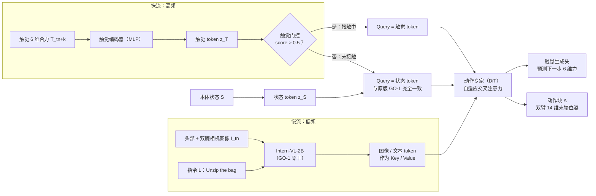

# AT-VLA：自适应触觉注入与快慢双流的触觉反应

## 论文信息

| 项目 | 内容 |
|---|---|
| 标题 | AT-VLA: Adaptive Tactile Injection for Enhanced Feedback Reaction in Vision-Language-Action Models |
| 作者 / 机构 | Xiaoqi Li*、Muhe Cai*、Jiadong Xu、Juan Zhu、Hongwei Fan、Yan Shen、Guangrui Ren、Hao Dong（* 共同一作）；北京大学计算机学院、PrimeBot、智元机器人（AGIBOT） |
| 发表 | CVPR 2026（Open Access 版第 28764–28774 页）；arXiv 2605.07308（v1 2026-05-08，v2 2026-05-18） |
| 链接 | [arXiv](https://arxiv.org/abs/2605.07308) · [CVPR Open Access](https://openaccess.thecvf.com/content/CVPR2026/html/Li_AT-VLA_Adaptive_Tactile_Injection_for_Enhanced_Feedback_Reaction_in_Vision-Language-Action_CVPR_2026_paper.html) · [项目页](https://sites.google.com/view/at-vla) · 代码：论文未给出 |
| 关键词 | 触觉门控、自适应交叉注意力、快慢双流、触觉生成、模态无关鲁棒性、GO-1、接触丰富操作 |

> ❓ 待解决：CVPR 会议网站的检索结果把本文列在 oral 场次，需人工到会议网站核实后在"发表"一栏补上。

## 一句话总结

只在接触时把触觉 token 注入动作专家、再让触觉以 3 倍频率驱动快流，既保住预训练能力又能 0.04 s 闭环反应。

## 背景与动机

- **之前的方法有什么问题？**
  - 开源预训练操作数据集几乎没有触觉，所以触觉只能在下游微调时加进去。已有工作（表示对齐、思维链等）关注"让模型读懂触觉"，却忽略了一个副作用：**在微调阶段引入一个预训练时从没见过的模态，会破坏预训练能力**（视觉感知、物体定位）。
  - 作者做了一个直观实验（图 3）：同样只微调动作专家，加上触觉 token 的版本抓取定位反而变差，动作专家的注意力图从目标物体飘到周围区域。消融表里这种"直接注入"把四个接触任务的平均成功率从 0.22 拉低到 0.13。
  - VLA 推理慢，跟不上高频触觉反馈，闭环调整不及时：拉链卡住、盖章一直往桌面压、擦花瓶撞到瓶颈。
- **为什么这个问题重要？**
  - 触觉只在接触的那一小段时间有信息量，接触之前靠视觉就够了；"常开"触觉等于让一个没见过触觉的大脑一直分心。
  - 真实部署里触觉传感器可能不稳定或缺失，策略不能一离开触觉就崩。
  - 类比：走路时脚底的感觉只在踩到东西时才重要，平时靠眼睛；一个人如果走每一步都盯着脚底感觉，反而看不清路。

> 💡 要点：AT-VLA 要同时解决两件事——**何时 / 在哪**注入触觉才不伤预训练（Adaptive Tactile Injection），以及接触后**怎样快速**用触觉改动作（Tactile Reaction Dual-Stream）。

## 方法

### 整体框架

### 关键模块

#### 模块 1：基座 GO-1 + 轻量触觉编码器

- **输入**：头部相机 + 左右腕相机三路图像 $I$、语言指令 $L$、触觉 $T$（从触觉传感器提取**合力**：3 维法向力 + 3 维切向力）、本体状态 $S$。
- **处理**：原版 VLA 用智元 **GO-1**（在 AgiBot World 数据集上预训练，VLM 为 Intern-VL-2B，动作专家是 DiT，即扩散 Transformer），沿用它的结构和动作损失 $L_a$；新增的触觉编码器只是几层 MLP，为了推理快。
- **输出**：动作块 $A = \pi_\theta(I, L, T, S)$，双臂共 14 自由度的末端位姿序列。
- **为什么这样设计**：选 GO-1 是因为它和实验硬件（智元 Genie1）同款、多任务表现强；作者强调框架是模块化的，大多数 VLA 稍改就能接。

#### 模块 2：触觉门控（Tactile Gate）——决定"何时"注入

- **输入**：触觉 token $z_T$。
- **处理**：几层 MLP 组成的门控网络输出一个"接触分数"。训练时人工把每条示范的每一帧标注为 0（未接触）或 1（接触），用二元交叉熵损失 $L_g$ 监督；推理时分数超过阈值（0.5）就开门。
- **输出**：开 / 关两种状态。
- **为什么这样设计**：视觉负责"东西在哪"，触觉负责"碰上了什么"，两者互补；未接触阶段应保持原版 VLA 的行为，只在接触后才引入触觉。

#### 模块 3：自适应交叉注意力（Adaptive Cross Attention）——决定"在哪"注入

- **输入**：动作专家交叉注意力的 Key / Value 是图像 token $z_I$ 和文本 token $z_L$；Query 在原版 GO-1 里是状态 token $z_S$。
- **处理**：门关时 Query 仍然用 $z_S$，模型的输入和结构与原版 GO-1 **完全相同**；门开时 Query 换成触觉 token $z_F$。不改网络结构、不改特征维度，也不往 token 序列里"追加"触觉。
- **输出**：接触时以触觉为条件生成动作，未接触时等同原版。
- **为什么这样设计**：已有的触觉门控工作在开门时把触觉 token 追加进序列，作者观察到这种"追加没见过的模态"会扰乱 VLA 预训练好的序列建模；换 Query 来源对原模型侵入最小，最大程度保住了靠视觉定位、靠近目标物体这类预训练行为。

> 🔗 关联：Query / Key / Value 的含义见 [03 Transformer 与多模态模型](../../VLA/Basic/03-transformers-and-multimodal.md) 3.2 节；ForceVLA 用另一条路（晚期融合 + MoE 路由）解决同一个"别破坏预训练"的问题，见 [ForceVLA 03 方法](../../VLA/ForceVLA/03-method.md) 3.5 节。

#### 模块 4：触觉反应快慢双流（Tactile Reaction Dual-Stream）——决定"怎样快速反应"

- **输入**：慢流 = 图像 + 语言经过大 VLM 得到的隐特征（作 Key / Value）；快流 = 最新的触觉反馈（作 Query）。
- **处理**：借用动作分块的思想，$t_n$ 时刻的视觉-语言观测可以指导未来 $H$ 步动作，所以慢流输出在接下来 $H$ 步内重复使用；快流在每一步用最新触觉 $t_{n+k}$（$0 < k < H$）生成可执行动作。训练时快慢频率比随机设为 $h:1$（$1 < h < H$），即快流最多领先慢流一个动作块；门关时两条流同步。推理时固定 **3:1**——慢流推理一次，快流连续推理三次（借鉴 GR00T N1 和 Fast-in-Slow 的经验）。
- **输出**：0.04 s 内完成一次闭环反应。
- **为什么这样设计**：VLA 大模型推理慢是硬约束，但触觉变化很快；把"理解"和"反应"分到两个频率，就像人边想边动手。与 GR00T N1 等用视觉 / 点云做快流不同，这里快流是触觉，专门服务接触事件。

#### 模块 5：触觉生成（Tactile Generation）辅助目标

- **输入**：动作专家之后的触觉 token。
- **处理**：一个轻量解码器预测**下一时刻**的 3 维法向 + 3 维切向力，用 MSE 损失 $L_r$ 与真实测量对比。
- **输出**：未来触觉预测（只作为训练信号）。
- **为什么这样设计**：逼模型理解接触的物理动力学，而不只是"读当前数值"，把瞬时接触感知和预测性推理连起来。

#### 训练目标与推理流程

总损失 $L = L_a + \lambda_1 L_g + \lambda_2 L_r$，$\lambda_1 = \lambda_2 = 0.01$，三个目标同时训练。推理时：门关 → 模型与原版 VLA 完全一致、两流同频；门开 → 两流异步 3:1，交叉注意力的 Query 切换为触觉 token。

## 实验

### 数据集 / 任务 / 基线

硬件：智元 Genie1 双 7 自由度臂，前视相机 + 两个腕部相机，夹爪装 Xense Robotics 触觉传感器，VR 头显遥操作采集。每个任务采 30~50 条示范，测试 15 次。

| 任务 | 类型 | 难点 |
|---|---|---|
| 拉开拉链（Unzip Bag） | 接触丰富 | 要沿拉链的曲线不断调整轨迹，否则卡住 |
| 盖章（Stamp） | 接触丰富 | 要识别"已经盖好"，否则一直下压撞到桌面 |
| 擦花瓶（Wipe Vase） | 接触丰富 | 顺着曲面走，不够柔顺会撞到瓶颈 |
| 拧开盖子（Unscrew Lid） | 接触丰富 | 力与运动配合，防止打滑 |
| 抓放（Pick and Place） | 非接触丰富 | 把胡萝卜放到盘子里 |
| 开抽屉（Open Drawer） | 非接触丰富 | 抓住把手拉开 |

基线：

| 基线 | 说明 | 训练 / 测试条件 |
|---|---|---|
| GO-1 | 本文的原版模型，同一数据集预训练 | 同样的下游数据微调，不用触觉 |
| π0.5 | 带预训练 + 后训练的 SOTA VLA | 同样的下游数据微调，不用触觉 |
| VTLA | 触觉 VLA：Qwen2-VL 骨干 + 额外 ViT 读"视触图像"；官方未开源，作者基于 DexVLA 代码复现 | 无大规模预训练，只在接触阶段的子集上训练；测试时人工摆到理想初始位姿（例如已经抓住印章） |
| RDP | Diffusion Policy + 2D 标记点触觉（PCA 降维） | 同 VTLA |

VTLA 和 RDP 在完整序列上训练时常在抓取阶段就失败，所以作者去掉了它们的感知和定位要求，只评估"对触觉反馈的反应"，因此它们只有接触阶段的分数。

### 主要结果

**表 1：接触丰富任务的逐子任务成功率**（15 次试验）

拉开拉链：

| 方法 | 左手抓 | 右手抓 | 拉开一半 | 拉开全部 | 总体 |
|---|---|---|---|---|---|
| GO-1 | 1.00 | 0.87 | 0.87 | 0.20 | 0.20 |
| π0.5 | 1.00 | 0.67 | 0.67 | 0.00 | 0.00 |
| AT-VLA | 1.00 | 0.80 | 0.80 | **0.33** | **0.33** |
| VTLA | — | — | 0.20 | 0.00 | — |
| RDP | — | — | 0.87 | 0.06 | — |

盖章：

| 方法 | 右手抓 | 盖章 | 放回 | 总体 |
|---|---|---|---|---|
| GO-1 | 1.00 | 0.80 | 0.33 | 0.33 |
| π0.5 | 1.00 | 0.53 | 0.20 | 0.20 |
| AT-VLA | 0.90 | 0.87 | **0.46** | **0.46** |
| VTLA | — | 0.93 | 0.13 | — |
| RDP | — | 0.40 | 0.40 | — |

擦花瓶 / 拧盖子（AT-VLA 的子任务分数见下方待解决）：

| 方法 | 擦一半 | 擦完（总体） | 旋转（总体） |
|---|---|---|---|
| GO-1 | 0.30 | 0.07 | 0.27 |
| π0.5 | 0.40 | 0.33 | 0.47 |
| AT-VLA | ❓ | **0.67** | 0.53 |
| VTLA | 0.93 | 0.60 | **0.80** |
| RDP | 0.80 | 0.33 | **0.87** |

> ❓ 待解决：PDF 文本里表 1 的 AT-VLA 在"擦花瓶 / 拧盖子"那一行与"拉拉链 / 盖章"那一行数字完全相同（1.00 / 0.80 / 0.80 / 0.33 …），疑为排版复制错误；上表 AT-VLA 的擦完 0.67、旋转 0.53 取自消融表 3 的 Ex4（同一配置），其余子任务分数需对照原文图表核实。

怎么读：

- **接触前阶段**（抓取）AT-VLA 与 GO-1 / π0.5 相当，说明预训练的视觉定位和语义能力保住了。
- **接触阶段**全面高于两个无触觉的 VLA；GO-1 和 π0.5 的典型失败是卡在拉链上、盖章压过头、被花瓶凸起卡住。
- 与触觉策略 VTLA / RDP 比，拉链、盖章、擦花瓶更好；**拧盖子略差**，原因是基线被人工摆到理想抓姿、抓得稳，AT-VLA 自己抓有时不够紧，拧的时候打滑。

**表 2：模态无关评估**（同一套权重，推理时有 / 无触觉）

| 方法 | 抓放 | 开抽屉 | 盖章 | 平均 |
|---|---|---|---|---|
| GO-1 | 1.00 | 0.93 | 0.13 | 0.68 |
| π0.5 | 1.00 | 0.93 | 0.20 | 0.70 |
| AT-VLA（推理无触觉） | 1.00 | 0.93 | 0.20 | 0.70 |
| AT-VLA（推理有触觉，上限） | 1.00 | 0.93 | **0.46** | **0.79** |

训练时用了触觉、部署时拔掉传感器，AT-VLA 在非接触任务上与基线持平，在盖章上甚至比原版 GO-1 略高——作者解释为训练中学到了接触动态和跨模态相关性，测试时能从视觉推断近似的触觉线索。

> ❓ 待解决：GO-1 的盖章成功率在表 1 是 0.33、在表 2 是 0.13，论文未解释差异（可能是不同批次的评估），需核实。

### 消融实验说明了什么

**表 3：组件与触觉格式消融**（四个接触任务的成功率）

| 编号 | 触觉门控 | 自适应交叉注意力 | 触觉生成 | 快慢双流 | 触觉格式 | 拉链 | 盖章 | 擦花瓶 | 拧盖 | 平均 |
|---|---|---|---|---|---|---|---|---|---|---|
| Ex0（原版 GO-1） | – | – | – | – | 无 | 0.20 | 0.33 | 0.07 | 0.27 | 0.22 |
| Ex1 | – | ✓ | – | – | 6 维力 | 0.07 | 0.13 | 0.07 | 0.20 | 0.13 |
| Ex2 | ✓ | ✓ | – | – | 6 维力 | 0.27 | 0.40 | 0.53 | 0.33 | 0.39 |
| Ex3 | ✓ | ✓ | ✓ | – | 6 维力 | 0.27 | 0.46 | 0.60 | 0.40 | 0.43 |
| **Ex4（本文）** | ✓ | ✓ | ✓ | ✓ | 6 维力 | 0.33 | 0.46 | 0.67 | 0.53 | **0.50** |
| Ex5 | – | ✓ | – | – | 2D 标记点 | 0.00 | 0.13 | 0.07 | 0.00 | 0.05 |
| Ex6 | ✓ | ✓ | ✓ | ✓ | 2D 标记点 | 0.27 | 0.33 | 0.27 | 0.40 | 0.32 |
| Ex7 | – | ✓ | – | – | 视触图像 | 0.00 | 0.00 | 0.07 | 0.00 | 0.02 |
| Ex8 | ✓ | ✓ | ✓ | ✓ | 视触图像 | 0.27 | 0.46 | 0.47 | 0.40 | 0.40 |

| 结论 | 证据 |
|---|---|
| **直接注入触觉比不用还差** | Ex1 比 Ex0 低 9 个百分点，失败集中在抓取阶段，说明视觉定位被破坏，与图 3 的注意力图一致 |
| 门控是最大的一步 | Ex2 比 Ex0 高 17 个百分点：只在接触时换 Query，预训练能力保住了 |
| 触觉生成辅助目标有小幅帮助 | Ex3 比 Ex2 高 4 个百分点 |
| 快慢双流对"反应要快"的任务关键 | Ex4 比 Ex3 高 7 个百分点，拉链任务反应慢就会卡住 |
| 三种触觉格式直接注入都会崩 | Ex5 0.05、Ex7 0.02；用本文方法后分别回到 0.32（+27）和 0.40（+38） |
| 6 维力 > 2D 标记点 > 视触图像 | 作者推测高维触觉 token 数量多，对预训练表示空间的扰动更大 |

触觉格式说明：**视触图像**把传感器表面形变映射成 H×W×3 的 RGB 图，用预训练触觉编码器 Sparsh 提特征；**2D 标记点**是 N 个表面标记点的位移（N×2），用轻量 MLP 编码；**6 维力**是 3 维切向 + 3 维法向合力。

## 优点与不足

| 优点 | 不足 / 疑问 |
|---|---|
| 第一个正面处理"新模态微调破坏预训练能力"的触觉 VLA，有注意力图和消融两种证据 | 门控靠人工逐帧标注接触 / 未接触，换任务要重标，扩展成本高 |
| 门关时与原版完全一致，推理时没有触觉也不掉点（模态无关） | 触觉只在接触后作为 Query 使用，"接触前的预判"（看到易碎物提前减力）不在设计内 |
| 快慢 3:1 双流，0.04 s 闭环反应 | 每任务只 15 次试验，很多差距在 1~2 次之内，统计上偏弱 |
| 对 6 维力、2D 标记点、视触图像三种格式都有效 | 拧盖子不如 VTLA / RDP，且基线对比条件不对等（基线人工摆位、只测接触阶段） |
| 实现路径清晰：换 Query 源，不改结构、不改维度 | GO-1 权重与本文数据是否公开论文未提，复现受限 |

## 与知识库的关联

- 用到的基础知识：[10 力觉与触觉感知](../../VLA/Basic/10-force-and-tactile-sensing.md) —— 本文的触觉输入是 6 维合力（3 法向 + 3 切向），与 10.2 节六维力传感器的输出一一对应；10.4 节"力信息怎么进入 VLA"里，本文属于"进动作头、带门控"的新路线。
- 用到的基础知识：[08 训练与微调](../../VLA/Basic/08-training-and-finetuning.md) —— 8.6 节的灾难性遗忘在这里以另一种形式出现：不是学习率太大，而是新模态的 token 扰乱了预训练的注意力分布。
- 用到的基础知识：[03 Transformer 与多模态模型](../../VLA/Basic/03-transformers-and-multimodal.md) —— 3.2 节的 Query / Key / Value：本文的核心操作就是"门开时把 Query 从状态 token 换成触觉 token"。
- 用到的基础知识：[07 动作表示](../../VLA/Basic/07-action-representation.md) —— 7.5 节的控制频率与动作块：快慢双流就是在一个动作块的 H 步内让触觉以更高频率更新动作。
- 用到的基础知识：[05 代表性模型](../../VLA/Basic/05-representative-models.md) —— 5.7 节 GR00T N1 的"双系统"是本文快慢流的直接灵感，区别在于本文的快流是触觉而不是视觉。
- 可延伸的主题：[ForceVLA 03 方法](../../VLA/ForceVLA/03-method.md) —— 3.5 节"为什么晚期融合"的消融（VLM 之前注入力会破坏预训练表示）与本文的直观实验结论一致，两篇对照读：ForceVLA 用 MoE 按阶段路由，AT-VLA 用门控 + 换 Query。

## 复现清单

- [ ] 环境：智元 Genie1 双 7 自由度臂（或其他双臂平台）；GO-1 预训练权重（Intern-VL-2B + DiT 动作专家）；Xense Robotics 触觉夹爪（输出 6 维合力）；VR 遥操作。
- [ ] 数据：每任务 30~50 条示范；逐帧人工标注接触 / 未接触（0 / 1）；触觉与图像时间戳对齐。
- [ ] 关键超参数：门控阈值 0.5；$\lambda_1 = \lambda_2 = 0.01$；训练时快慢比 $h:1$ 随机（$1 < h < H$）；推理快慢比 3:1；动作块长度 H、触觉编码器层数、训练步数论文未给出。
- [ ] 预期指标：四个接触任务平均成功率 0.50（原版 0.22）；盖章有触觉 0.46 / 无触觉 0.20；闭环反应 0.04 s。

## 我的问题与想法

- 门控只看触觉 token：传感器噪声或轻微误触会不会让门频繁开关，Query 来回切换导致动作抖动？论文没讨论滞回或平滑。
- "接触后才用触觉"（本文）与 [07 Tactile-VLA](07-tactile-vla.md) 的"看到易碎物就提前轻抓"是两种哲学：前者保预训练，后者挖常识。能否结合——未接触时用 VLM 常识定目标力，接触后用快流跟踪？
- 推理 3:1 的固定比例是经验值；能否按门控分数或力的变化率自适应调整快流频率？
- 快流只换 Query，Key / Value 仍是 $t_n$ 时刻的视觉特征；如果接触导致物体明显移动（拉链位置变了），过期的视觉条件会不会误导动作？
- 模态无关实验里 AT-VLA 无触觉仍比 GO-1 高一点，作者解释为"训练时学到了跨模态相关性"，这个说法还需要更多证据（例如可视化无触觉时的注意力）。

> ❓ 待解决：表 1 中 AT-VLA 在擦花瓶、拧盖子两组的子任务分数（PDF 文本疑为复制错误）；GO-1 盖章成功率在表 1 与表 2 不一致；oral 身份待核实。复核后再把 status 改为 reviewed。
