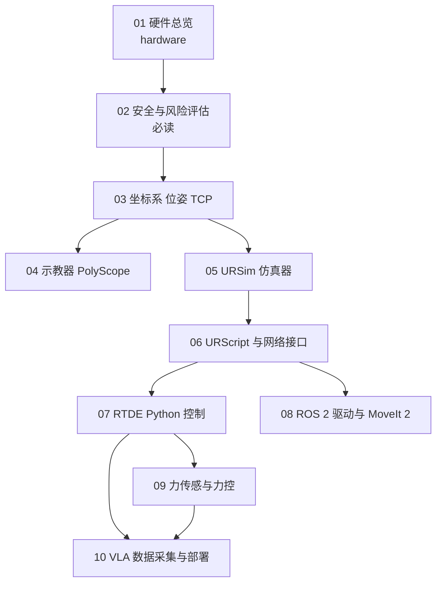

# UR 协作机械臂主题目录

> **UR（Universal Robots，优傲）协作机械臂**是实验室里最常见的一类六轴机械臂：能和人在同一空间工作、可以用手拖着示教、对外开放了完整的编程接口。本主题带你从"第一次开机"走到"用 Python 控制它、读它的力传感器、在它上面采集数据并部署 VLA 策略"。

## 主题简介

学完本主题你能够：

- 说清楚 UR e-Series 由哪几部分组成、关键参数怎么看，安全地完成开机、初始化和关机。
- 理解急停、保护性停止和安全配置，知道上手真机前必须做哪些检查。
- 看懂 UR 的位姿 `p[x, y, z, rx, ry, rz]`，正确设置 TCP 和负载。
- 不碰真机，先在 URSim 仿真器里用示教器、URScript、RTDE（Python）和 ROS 2 控制机械臂。
- 读取末端内置的六维力/力矩传感器，使用力控模式，并把它和 [ForceVLA](../VLA/ForceVLA/00-README.md) 这类力感知模型对接。
- 用 UR 采集 VLA 训练数据，并把训练好的策略安全地部署回真机。

> ⚠️ 注意：机械臂力量很大，任何运动程序都要**先在仿真器里跑通、再在真机上以低速运行**，并且始终有人能在一伸手的距离内按下急停。第 02 章必须在操作真机之前读完。

## 学习路线

两条路线：

1. **只想会用示教器**：01 → 02 → 03 → 04。
2. **要写程序 / 做研究**：01 → 02 → 03 → 05 → 06 → 07 → 09 → 10；需要 ROS 生态时加读 08。

前置知识：[Linux 网络基础](../LinuxCommand/12-networking-basics.md)（配 IP、ping 通机械臂）、[SSH 与远程](../LinuxCommand/17-ssh-and-remote.md)；做 VLA 部分前先读 [VLA 基础](../VLA/Basic/00-README.md)。

## 章节表格

| 章节 | 文件 | 类型 | 难度 | 状态 |
|---|---|---|---|---|
| 00 目录 | `00-README.md` | index | all | draft |
| 01 UR e-Series 硬件总览 | [01-ur-e-series-hardware.md](01-ur-e-series-hardware.md) | hardware | beginner | draft |
| 02 安全与风险评估 | [02-safety-and-risk-assessment.md](02-safety-and-risk-assessment.md) | tutorial | beginner | draft |
| 03 坐标系、位姿与 TCP | [03-coordinates-poses-and-tcp.md](03-coordinates-poses-and-tcp.md) | tutorial | beginner | draft |
| 04 示教器 PolyScope 编程 | [04-polyscope-teach-pendant.md](04-polyscope-teach-pendant.md) | tutorial | beginner | draft |
| 05 URSim 仿真器 | [05-ursim-simulator.md](05-ursim-simulator.md) | tutorial | beginner | draft |
| 06 URScript 与网络接口 | [06-urscript-and-network-interfaces.md](06-urscript-and-network-interfaces.md) | tutorial | intermediate | draft |
| 07 RTDE 与 Python 控制 | [07-rtde-python-control.md](07-rtde-python-control.md) | tutorial | intermediate | draft |
| 08 ROS 2 驱动与 MoveIt 2 | [08-ros2-driver-and-moveit.md](08-ros2-driver-and-moveit.md) | tutorial | advanced | draft |
| 09 力传感与力控 | [09-force-sensing-and-force-mode.md](09-force-sensing-and-force-mode.md) | tutorial | intermediate | draft |
| 10 VLA 数据采集与部署 | [10-vla-data-collection-and-deployment.md](10-vla-data-collection-and-deployment.md) | tutorial | advanced | draft |

## 与其他主题的关系

- **VLA**：UR 是 VLA 模型落地的"身体"。第 10 章对应 [数据集与数据采集](../VLA/Basic/06-datasets-and-data-collection.md)、[动作表示](../VLA/Basic/07-action-representation.md) 和 [评估与部署](../VLA/Basic/09-evaluation-and-deployment.md)。
- **ForceVLA**：原论文用的是 Flexiv Rizon 机械臂；第 09 章讲怎样从 UR 的内置力传感器拿到同类信号，换平台复现见 [ForceVLA 复现指南](../VLA/ForceVLA/06-reproduction-guide.md)。
- **力感知基础**：[力觉与触觉感知](../VLA/Basic/10-force-and-tactile-sensing.md)。
- **论文**：与机械臂控制、模仿学习相关的论文放在 [论文库 · 通用机器人学习](../Papers/Robotics/00-README.md)，在 `related` 里关联本主题章节即可出现在章节底部的"📄 相关论文"里。

> 🔗 关联：本主题所有 `> ❓ 待解决：` 都是写作时没能从官方资料核实的细节，拿到真机或官方手册后请逐条确认并把章节 `status` 改为 `reviewed`。
