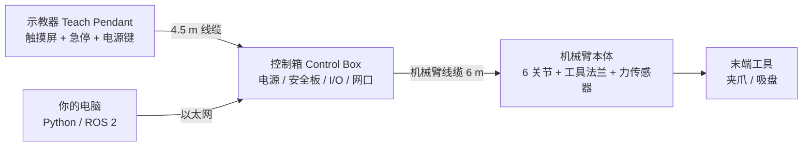

# UR e-Series 协作机械臂（UR3e / UR5e / UR10e / UR16e）

> 实验室里那台蓝灰色的六轴机械臂是什么、能干什么、怎么安全地开机和关机、能通过哪些接口用代码控制它。本章是整个 UR 主题的“设备说明书导读”。

## 设备概览

**协作机械臂**（cobot，设计上允许在做好风险评估的前提下与人共享工作空间的工业机械臂）的特点是：自重轻、带力/碰撞检测、可以用手拖着示教。丹麦公司 **Universal Robots**（优傲，简称 UR）是这一品类最常见的厂商。

**e-Series** 是 UR 的第 5 代机械臂家族，2018 年发布，包括四个型号：

| 型号 | 一句话定位 | 类比 |
|---|---|---|
| UR3e | 桌面级，小而灵活 | 一只小手 |
| UR5e | 最常见的科研 / 轻载型号 | 成年人的手臂 |
| UR10e | 臂展更长、负载更大 | 长胳膊 |
| UR16e | 臂展较短、负载最大 | 粗壮的短胳膊 |

在本知识库里，UR e-Series 是**机器人学习的实验平台**：用它采集 VLA 训练数据、部署策略；它在末端内置**六维力/力矩传感器**，可以直接为 [力觉与触觉感知](../VLA/Basic/10-force-and-tactile-sensing.md) 和 [ForceVLA](../VLA/ForceVLA/00-README.md) 一类工作提供力信号。

**UR 产品线的代际关系**（按官方 FAQ 与数据表整理）：

| 家族 | 代表型号 | 与 e-Series 的主要区别 |
|---|---|---|
| CB3（CB-Series，老款） | UR3 / UR5 / UR10 | **末端没有内置力/力矩传感器**；UR5 重复定位精度 ±0.1 mm（e 款为 ±0.03 mm）；15 项安全功能（e 款 17 项）；以太网 100 Mbit |
| e-Series（第 5 代，2018） | UR3e / UR5e / UR10e / UR16e | 本章主角 |
| UR Series（第 6 代，2022） | UR20 / UR30 | 重载长臂：UR20 负载 20 kg、臂展 1750 mm；UR30 负载 30 kg、臂展 1300 mm；重复定位精度 ±0.1 mm；防护等级 IP65 |
| g-Series / Gen 7（第 7 代，2026） | UR10g-1750 等 | 新控制箱 CB7、示教器 TP7、软件 PolyScope X；型号名直接写“负载+家族+臂展” |

> ⚠️ 注意：UR 近两年在改名。2025 年 5 月官方宣布 UR5e 负载提升 2.5 kg 并改名 **UR7e**（7.5 kg），UR10e 改名 **UR12e**（本来就是 12.5 kg）；Gen 7 又改成 UR3e-540、UR7e-920、UR12e-1300 这样的名字。官方说明机械结构不变。**你手上那台到底按 5 kg 还是 7.5 kg 用，以它自己的铭牌、软件版本和对应手册为准。**

> ❓ 待解决：已出厂的 UR5e 是否能通过软件升级获得 7.5 kg 负载、需要哪个 PolyScope 版本，官方新闻稿没有写明，需查对应版本的发布说明。

> ❓ 待解决：CB3 的控制周期为 125 Hz 这一说法来自 ur_rtde 官方文档（见 [07 RTDE 与 Python 控制](07-rtde-python-control.md)），e-Series 的 500 Hz 已由 UR 官方手册确认；CB3 的 125 Hz 尚未在 UR 自己的手册原文里找到。

> 💡 要点：下文所有数值默认以 **UR5e** 为例，数据来自 UR 官方 2023 年 11 月版合集数据表与 UR5e 用户手册（PolyScope 5）。

## 关键参数

**机械臂本体（官方合集数据表）**

| 参数 | UR3e | UR5e | UR10e | UR16e | 备注 |
|---|---|---|---|---|---|
| 额定负载 | 3 kg | 5 kg | 12.5 kg | 16 kg | UR5e 新命名见上文 ⚠️ |
| 工作半径（臂展） | 500 mm | 850 mm | 1300 mm | 900 mm | 从底座关节中心算起 |
| 重复定位精度（ISO 9283） | ±0.03 mm | ±0.03 mm | ±0.05 mm | ±0.05 mm | “回到同一点”的偏差，不是绝对精度 |
| 自重（含线缆） | 11.2 kg | 20.6 kg | 33.5 kg | 33.1 kg | UR5e 用户手册写 20.7 kg |
| 自由度 | 6 个旋转关节 | 同左 | 同左 | 同左 | 底座、肩、肘、腕 1、腕 2、腕 3 |
| 关节范围 | ±360°，腕 3 无限旋转 | 全部 ±360° | 全部 ±360° | 全部 ±360° | |
| 关节最大速度 | 底座/肩/肘 180°/s，三个腕 360°/s | 全部 180°/s | 底座/肩 120°/s，其余 180°/s | 底座/肩 120°/s，其余 180°/s | |
| TCP 最大速度 | 3 m/s | 4 m/s | 4 m/s | 3 m/s | 数据表值，见下方 ❓ |
| 末端力传感器量程（力 / 力矩） | 30 N / 10 Nm | 50 N / 10 Nm | 100 N / 10 Nm | 160 N / 10 Nm | x、y、z 三个方向 |
| 力传感器精度（力 / 力矩） | 2.0 N / 0.1 Nm | 3.5 N / 0.2 Nm | 5.0 N / 0.2 Nm | 5.0 N / 0.2 Nm | 数据表的 Precision |
| 力传感器准确度（力 / 力矩） | 3.5 N / 0.1 Nm | 4.0 N / 0.3 Nm | 5.5 N / 0.5 Nm | 5.5 N / 0.5 Nm | 数据表的 Accuracy |
| 底座直径 | Ø128 mm | Ø149 mm | Ø190 mm | Ø190 mm | 设计安装板用 |
| 功耗（最大 / 中等设置） | 300 / 100 W | 570 / 200 W | 615 / 350 W | 585 / 350 W | |
| 防护等级 | IP54 | IP54 | IP54 | IP54 | 防尘、防溅水，不防泡水 |

> ❓ 待解决：TCP 最大速度——2023 年 11 月合集数据表写 UR3e/UR5e/UR10e/UR16e 分别为 3/4/4/3 m/s，而 UR5e 用户手册（SW5.19）的技术规格写“Tool: Approx. 1 m/s”。两者口径（理论峰值 vs 典型值）尚未核实。无论哪个数，实际速度都会被安全配置限制，见 [02 安全](02-safety-and-risk-assessment.md)；做实验时请远低于这个值。

**四个型号共用的参数**

| 参数 | 数值 | 备注 |
|---|---|---|
| 安全功能 | 17 项可配置安全功能 | 通过 EN ISO 13849-1（PLd，Cat.3）、EN ISO 10218-1 认证 |
| 控制周期 | 500 Hz | 用户手册“System update frequency” |
| 示教器 | 12 英寸触摸屏，1280×800，线长 4.5 m | 标配或选配 3PE 示教器 |
| 工具法兰 | EN ISO 9409-1-50-4-M6，M8 8 针接口 | 装夹爪的机械 + 电气接口 |
| 工具端 I/O | 2 数字输入、2 数字输出、2 模拟输入；12/24 V 供电 | UR3e 供电 600 mA，其余双针 1.5~2 A |
| 控制箱 I/O | 16 数字输入、16 数字输出、2 模拟输入、2 模拟输出 | 24 V 2 A 供电 |
| 通信 | 1 Gb/s 以太网；Modbus TCP、EtherNet/IP、PROFINET | |
| 控制箱电源 | 100~240 VAC，47~440 Hz | |
| 工作环境 | 0~50 °C，湿度 ≤90%（不结露） | 手册：高于 35 °C 可能降速运行 |
| 机械臂线缆 | 标准 6 m | |

## 安全须知

> ⚠️ 注意：本节必须在第一次给机械臂上电**之前**读完。完整的安全概念见 [02 安全基础与风险评估](02-safety-and-risk-assessment.md)。

1. **先做风险评估再上电。** 官方手册要求：风险评估必须在机器人应用第一次上电之前完成。“协作”是应用的属性，不是机械臂自带的免检标签。
2. **认清急停按钮。** 示教器上的红色蘑菇头就是急停，按下后会锁住，必须顺时针旋转才能复位。复位前先查明为什么按下。
3. **初始化时人退出工作范围。** 官方启动步骤明确要求：点 ON 之前先走出机械臂可达范围。
4. **负载和安装方向必须设对**，否则手拖（Freedrive）时机械臂可能下坠或漂移，运行中也会频繁误停。
5. **注意夹手区。** 以 UR5e 为例，手册指出两类易夹区域：腕 1 距底座 ≥750 mm 时的径向运动区域，以及底座 200 mm 以内的切向运动区域。
6. **设置安全密码。** 防止有人无意中改动安全配置。
7. **拔掉示教器时急停也随之失效。** 无示教器运行时必须另外接急停，并把拔下的示教器移出现场，以免有人误按一个“不起作用”的急停。
8. **小心高温。** 长时间运行后机械臂和控制箱表面会发热，手册建议断电冷却一小时再长时间接触。
9. **不要改装机械臂**，不要穿宽松衣服、戴首饰，长发束起。
10. **仿真先行。** 任何新程序先在 PolyScope 的仿真模式或 [URSim](05-ursim-simulator.md) 中跑通，再上真机，并把速度滑块调低。

## 系统组成

一套 UR e-Series 由三大件组成：**机械臂本体 + 控制箱 + 示教器**。



### 机械

- **底座（Base）**：固定在桌面或支架上。
- **肩（Shoulder）、肘（Elbow）**：负责大范围移动。
- **腕 1、腕 2（Wrist 1/2）**：负责较精细的姿态调整。
- **腕 3（Wrist 3）+ 工具法兰（Tool Flange）**：装工具的地方。e-Series 的六维力/力矩传感器就内置在这里，类比“手腕上的触感神经”。

### 电气

- **控制箱**：机器人的“大脑 + 配电箱”。里面有电源、安全控制板、16 进 16 出数字 I/O、模拟 I/O、以太网口和 USB 口。
- **示教器**：带急停按钮的 12 英寸触摸屏，背面有 **Freedrive 按钮**（按住后可以用手拖动机械臂）。选配的 **3PE 示教器**带三位置使能开关（轻按为“使能”，松开或用力按到底都会停止）。
- **工具端 I/O**：法兰上的 M8 8 针接口，可给夹爪供电和传信号。

### 软件

- **PolyScope**：示教器上的图形界面，e-Series 默认运行 PolyScope 5；新一代硬件运行 PolyScope X（详见 [04 示教器编程](04-polyscope-teach-pendant.md)）。
- **URScript**：控制器上真正执行的脚本语言，PolyScope 程序最终也会变成 URScript。
- **URCap**：第三方插件（例如夹爪厂商提供的控制界面）。

## 安装与启动流程

> ⚠️ 注意：首次安装应由受过培训的人员执行，并且风险评估已经完成。以下步骤以 PolyScope 5（SW 5.23 软件手册的 Quick System Start-up）为准。

1. **固定机械臂。** 安装面要平整、无振动，手册要求能承受底座关节满扭矩的 10 倍、机械臂自重的 5 倍。（预期现象：用力推机械臂，底座和桌子都不晃。）
2. **接线。** 机械臂线缆接到机械臂和控制箱；接上控制箱电源线。供电侧应有接地、主保险、漏电保护和可上锁的总开关。（预期现象：线缆插头到位、锁紧。）
3. **按下示教器急停。**（预期现象：急停被锁在按下位置。）
4. **按示教器电源键开机。**（预期现象：屏幕先显示底层系统的文字，然后进入 PolyScope。）
5. **首次开机时填写机器人信息**：选择机械臂型号、控制箱型号，输入机械臂铭牌上的序列号。（预期现象：重装软件后也会再次要求填写。）
6. **进入初始化界面。** 弹窗提示需要初始化时，点 **Go to Initialize Screen**。
7. **松开急停。**（预期现象：机器人状态从 Emergency Stopped 变为 Power off。）
8. **人退出机械臂的可达范围。**
9. **点 ON 上电。**（预期现象：状态变为 **Idle**，指示灯变黄。）
10. **核对负载与安装方向。** 在 Payload 栏核对当前负载质量，在 Robot 栏核对安装方式。
11. **点 START 松刹车。**（预期现象：机械臂轻微振动并发出咔哒声，表示刹车已松开、可以编程和运行。如果传感器测到的安装方向与设置相差超过 30°，START 按钮会变灰并显示错误。）

> 💡 要点：开机口诀——**急停按下 → 开机 → 初始化 → 松急停 → 人退开 → ON → 核对负载 → START**。

## 基本操作

| 操作 | 怎么做 | 说明 |
|---|---|---|
| 手拖示教（Freedrive） | 按住示教器背面的 Freedrive 按钮，用手拖动机械臂 | 刹车松开、关节阻力很小；靠近关节限位或安全平面时会变“沉” |
| 点动（Jog） | Move 页面，按住方向箭头 | 可选择相对 Base（基座）、Tool（工具）或自定义特征坐标系移动，见 [03 坐标系](03-coordinates-poses-and-tcp.md) |
| 单关节转动 | Move 页面的 Joint Position 滑条 | 默认范围 −360°~+360° |
| 调速 | 屏幕底部速度滑块 | 新程序先调到很低的百分比 |
| 仿真运行 | 底部 Simulation 按钮 | 程序照常执行但机械臂不动，用于检查逻辑 |
| 手动 / 自动模式 | 顶栏用户图标切换 | 手动模式可编辑程序；自动模式只能运行已有程序 |
| 本地 / 远程控制 | 设置中启用 Remote Control 后在顶栏切换 | 外部程序通过 Dashboard 启停程序时必须处于远程模式 |

> ⚠️ 注意：手册要求 Freedrive 只在风险评估允许时使用；使用前确认负载和安装设置正确，其他人退出机械臂范围。

## 编程接口

UR 提供多层接口，从“在屏幕上点”到“每 2 ms 发一次指令”：

| 接口 | 端口 | 用途 | 详见 |
|---|---|---|---|
| PolyScope 图形编程 | 示教器 | 拖拽式编程、示教航点 | [04 示教器编程](04-polyscope-teach-pendant.md) |
| URScript | 通过下列端口发送 | 控制器原生脚本语言 | [06 URScript 与网络接口](06-urscript-and-network-interfaces.md) |
| Dashboard Server | 29999 | 文本命令：加载/启动/停止程序、上电、松刹车、查询状态 | [06](06-urscript-and-network-interfaces.md) |
| Primary / Secondary 接口 | 30001 / 30002 | 接收 URScript；推送机器人状态（10 Hz） | [06](06-urscript-and-network-interfaces.md) |
| Real-time 接口 | 30003 | 高频状态推送（官方推荐改用 RTDE） | [06](06-urscript-and-network-interfaces.md) |
| RTDE | 30004 | 官方推荐的实时数据交换，e-Series 最高 500 Hz | [07 RTDE Python 控制](07-rtde-python-control.md) |
| ROS 2 驱动 | 基于上述接口 | ROS 2 + MoveIt 2 | [08 ROS 2 驱动](08-ros2-driver-and-moveit.md) |
| 力控 force_mode | URScript 函数 | 用内置力传感器做力控 | [09 力觉与力控](09-force-sensing-and-force-mode.md) |

两条 e-Series 的规则（官方 CB3→e-Series 迁移指南）：

- 远程控制必须在示教器上启用/关闭。
- e-Series 不能同时由示教器和 Dashboard Server 控制，同一时刻只有一个控制源。

**最小示例：只读查询机器人状态（不会让机械臂运动）。** 把 `192.168.1.100` 换成你的机器人 IP，网络配置见 [Linux 网络基础](../LinuxCommand/12-networking-basics.md)。

```python
import socket

ROBOT_IP = "192.168.1.100"  # 换成你的机器人 IP

with socket.create_connection((ROBOT_IP, 29999), timeout=5) as s:
    print(s.recv(1024).decode().strip())          # 欢迎信息
    for cmd in ["robotmode", "safetystatus", "PolyscopeVersion"]:
        s.sendall((cmd + "\n").encode())          # Dashboard 命令必须以换行结尾
        print(cmd, "->", s.recv(1024).decode().strip())
```

```text
# 输出（示例，具体文字随软件版本不同）：
robotmode -> Robotmode: IDLE
safetystatus -> Safetystatus: NORMAL
PolyscopeVersion -> URSoftware 5.x.x ...
```

> 💡 要点：`robotmode`、`safetystatus` 这类查询命令在本地模式下也能用；`power on`、`brake release`、`play`、`unlock protective stop` 等会改变机器人状态的命令只在**远程控制模式**下有效。

## 常见故障与排查

| 现象 | 可能原因 | 处理 |
|---|---|---|
| 无法上电，状态一直是 Emergency Stopped | 急停（示教器或外部）被按下并锁住 | 先查明原因，再顺时针旋转急停复位；检查外部急停回路 |
| START 按钮是灰的，提示安装方向不符 | 安装设置与传感器测得的重力方向相差超过 30° | Installation → Mounting 改成真实安装方式（地装 0°、壁装 90°、吊装 180°） |
| 运行中弹出保护性停止（新版手册称 robot stop），代码 C157 Collision detected | 撞到东西；负载/重心设置错误；加速度过大 | 检查路径上的障碍物、负载、重心和加速度设置；确认安全后在弹窗中解锁 |
| 保护性停止，代码 C153 Position deviates from path | 实际运动与控制器模型不一致（负载错、被外力拉住） | 同上；官方指出频繁出现保护性停止说明应用有问题或关节硬件故障 |
| Freedrive 时机械臂往下掉或自己漂 | 负载质量、重心或安装角度设置错误 | 用 Payload 估算向导重新测量，见 [03 坐标系与 TCP](03-coordinates-poses-and-tcp.md) |
| 上电后进入恢复模式（Recovery mode） | 某个安全限制（如关节限位、安全平面）在上电时已处于违规状态 | 小心手动把机械臂移回限值内；恢复模式下关节位置、工具位置和姿态限制是关闭的 |
| 修改安全配置后无法上电 | 改动未应用确认 | 点 Apply → Apply and Restart → 核对 → Confirm Safety Configuration |
| 冬天开机性能差或频繁停止 | 低温下润滑油脂黏度变高 | 手册指出低温启动可能需要一个预热阶段 |
| 外部脚本发 `power on` 被拒绝 | 机器人处于本地控制模式 | 设置中启用 Remote Control，并在顶栏切到 Remote |
| 力传感器空载读数不为零 | 未置零 / 负载未设置 | 设置正确负载，使用前调用 `zero_ftsensor()`，见 [09 力觉与力控](09-force-sensing-and-force-mode.md) |

## 维护与关机

### 关机

1. 停止正在运行的程序，把机械臂移到安全、稳定的姿态（例如收拢姿态，不要停在人头高度伸展着）。
2. 点右上角菜单（三条横线）→ **Shutdown Robot** → **Power Off**。（预期现象：PolyScope 关闭，示教器黑屏。）
3. 需要安装、拆卸或维修时，还要拔掉控制箱电源线，并**等待 30 秒**让机器人释放存储的能量。

> ⚠️ 注意：控制箱内部电源在断电后数小时内仍可能存在高达 600 V 的电压。不要自行拆开控制箱电源。维修应由 UR 或经培训的人员按 Service Manual 进行。

### 日常维护

- **定期检查**（官方检查表分为每月、每半年、每年三档）：机械臂线缆及接头有无破损、底座安装螺栓和工具法兰螺栓是否拧紧、关节处平环（flat rings）是否磨损。
- **刹车保持检查**：卸掉工具（或正确设置 TCP/负载），用 Freedrive 把机械臂拉成水平伸展姿态后松手，确认它能自己保持住。
- **清洁**：用布配合水、70% 异丙醇、10% 乙醇或 10% 石脑油（去油脂）。**不要用漂白剂，不要用压缩空气吹机械臂。**
- **查看 Log 页**：可以看到各关节温度、负载和状态，异常发热时及早处理。
- **无动力移动**：紧急情况下断电后仍可强行推动关节（刹车带摩擦离合），需要两人以上配合，单个关节不要推超过 160°，断电前先托住机械臂。

## 参考资料

- [UR 机械臂合集数据表（2023-11，PDF）](https://www.universal-robots.com/media/1829346/11_2023_collective_data-sheet.pdf) —— 本章参数表的来源，含 UR20/UR30
- [UR5e 用户手册（PolyScope 5，PDF）](https://www.universal-robots.com/manuals/EN/PDF/SW5_19/user-manual-UR5e-PDF_online/710-965-00_UR5e_User_Manual_en_Global.pdf) —— 安装、首次开机、急停、维护的权威说明
- [PolyScope 5 软件手册 SW 5.23（PDF）](https://www.universal-robots.com/manuals/EN/PDF/SW5_23/Poly5_handbook_online/e-Series_Software_Handbook_en_Global.pdf) —— 启动流程、Freedrive、关机步骤
- [UR 官方 FAQ](https://www.universal-robots.com/insights/faq/) —— 产品代际、改名（UR7e/UR12e、Gen 7）与 PolyScope X
- [Overview of client interfaces（UR 官方文章）](https://www.universal-robots.com/articles/ur/interface-communication/overview-of-client-interfaces/) —— 各网络端口的用途
- [Dashboard Server 命令表（SW 5.25）](https://www.universal-robots.com/manuals/EN/HTML/SW5_25/Content/prod-dashboard/Dashboard_table.htm) —— 29999 端口全部命令及返回值
- [Stop recovery 教程](https://docs.universal-robots.com/tutorials/controlling-robot-externally/stop-recovery.html) —— 各种停止后的恢复步骤
- [CB3 到 e-Series 迁移指南](https://www.universal-robots.com/articles/ur/interface-communication/cb3-to-e-series-programs-transferring-quick-guide/) —— 新老两代的差异
- [UR5（CB3）数据表 2016（PDF）](https://www.universal-robots.com/media/50588/ur5_en.pdf) —— 老款参数对比
