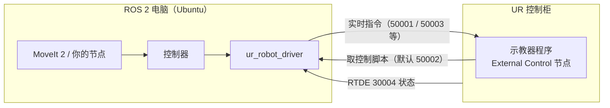

# ROS 2 驱动与 MoveIt 2：把 UR 接入 ROS 生态

> 想让 UR 机械臂和相机、规划器、仿真器"说同一种语言"？这一章讲官方 ROS 2 驱动的安装、机器人端配置、URSim 测试、控制器切换、MoveIt 2 规划，以及为什么一定要做标定。

## 学习目标

- 能说出驱动支持的 ROS 2 发行版与对应 Ubuntu 版本，并为 Mac 选一种可行的运行方式
- 能用 apt 安装驱动，并在示教器上配置 External Control URCap（主机 IP、端口）
- 能写出 `ur_control.launch.py` 启动命令，知道假硬件参数在 Humble 和 Jazzy 中名字不同
- 能用 `ros2 control` 查看和切换控制器，能启动 MoveIt 2 规划
- 能提取并加载标定，解释不标定的后果

## 前置知识

- 需要先读：[05 URSim 仿真器](05-ursim-simulator.md)、[06 URScript 与网络接口](06-urscript-and-network-interfaces.md)、[07 RTDE 与 Python 控制](07-rtde-python-control.md)
- 需要会：[11 软件包管理](../LinuxCommand/11-package-management.md)、[12 网络基础](../LinuxCommand/12-networking-basics.md)、[17 SSH 与远程](../LinuxCommand/17-ssh-and-remote.md)
- ROS 2 本身的节点、话题、launch 不在本章展开，建议先过一遍 ROS 2 官方入门教程

## 核心概念

| 术语 | 一句话解释 | 类比 |
|---|---|---|
| **ROS 2** | 机器人软件的中间件 + 工具集，程序（节点）之间通过话题、服务、动作通信 | 机器人界的通用插座标准 |
| **ur_robot_driver** | UR 官方 ROS 2 驱动，发布机器人状态、执行 ROS 发来的轨迹 | 把 UR 的"方言"翻译成 ROS 普通话 |
| **External Control URCap** | 示教器插件；程序里的 External Control 节点运行时从外部电脑取控制脚本 | 示教器程序里留给"外援"的位置 |
| **ros2_control 控制器** | 一个控制器负责一种控制方式（轨迹、速度、力等），可切换 | 汽车的不同驾驶模式 |
| **MoveIt 2** | ROS 2 运动规划框架，算出避障轨迹交给控制器执行 | 导航软件 |
| **标定** | 每台 UR 出厂时测得的真实运动学参数 | 眼镜要按真实度数配 |

## 详细讲解

### 8.1 为什么用 ROS 2 驱动

[07 章](07-rtde-python-control.md)的 ur_rtde 适合"一个脚本控一台臂"。系统里还有相机、夹爪、规划、数据录制时，统一用 ROS 2 通信能省很多胶水代码。官方驱动基于 Universal_Robots_Client_Library，支持急停/保护性停止时暂停、跟随示教器速度滑块缩放等协作特性，并内置 MoveIt 支持。



端口默认值来自 `ur_control.launch.py`：`reverse_port` 50001、`script_sender_port` 50002、`trajectory_port` 50003、`script_command_port` 50004。

### 8.2 系统要求：必须是 Linux

驱动 README 写明："A fundamental requirement for the driver is using Linux. Currently, there is no support for any other OS."

| 发行版 | Ubuntu（官方构建农场） | 备注 |
|---|---|---|
| Humble | 22.04 | 长期支持，资料最多 |
| Jazzy | 24.04 | 长期支持，新项目推荐 |
| Kilted / Lyrical / Rolling | 24.04 / 26.04 | 较新或滚动版，初学不建议 |

安装文档建议用 lowlatency 或 `PREEMPT_RT` 内核，并让电脑与机器人**网线直连、不经过交换机**。

**Mac 用户的选择**：

- **Ubuntu 虚拟机**（UTM、Parallels 等）：适合学习、假硬件、看 RViz。2026-10-18 查询 ROS 官方 apt 源，Humble 和 Jazzy 的 `ur-robot-driver` 都有 arm64 包。
- **远程 Linux 工作站 + SSH**：Mac 只当终端。
- **实体 Linux 电脑直连机器人**：连真机时最稳妥。

> ❓ 待解决：URSim 官方 Docker 镜像（`universalrobots/ursim_e-series`）在 Docker Hub 上只有 amd64 版本，能否在 Apple Silicon 的 arm64 虚拟机里通过模拟流畅运行未验证。稳妥做法是在 x86_64 机器上跑 URSim，见 [05 章](05-ursim-simulator.md)。

> ⚠️ 注意：不要用虚拟机连真机做控制。虚拟机的网络和调度延迟不可控，通信超时会让机器人程序中断。

### 8.3 安装驱动

先按 ROS 2 官方文档装好发行版，然后：

```bash
source /opt/ros/jazzy/setup.bash
sudo apt-get install ros-${ROS_DISTRO}-ur
sudo apt-get install ros-${ROS_DISTRO}-ros2controlcli
```

`ros-<发行版>-ur` 是元包，包含 `ur_robot_driver`、`ur_controllers`、`ur_moveit_config`、`ur_calibration`、`ur_dashboard_msgs`；第二行提供 `ros2 control` 命令。Humble 把第一行的 `jazzy` 换成 `humble`。

### 8.4 机器人端：External Control URCap

驱动需要机器人运行它提供的脚本，有两种方式：**远程控制模式**（控制权全交给电脑），或 **External Control URCap**（上电、启动程序仍在示教器上做，可与其他程序节点混用，推荐初学者用）。PolyScope 5 步骤（UR Client Library 官方文档）：

1. PolyScope ≥ 5.10：Settings → Security → Services，解锁后启用 Dashboard Server、Primary Client Interface、RTDE。
2. 从 [External Control URCap 发布页](https://github.com/UniversalRobots/Universal_Robots_ExternalControl_URCap/releases) 下载 `externalcontrol-X.Y.Z.urcap`（PolyScope 5 需 ≥ 5.9.4，CB3 需 ≥ 3.14.3；PolyScope X 用单独的 URCapX），用 U 盘或 scp 拷到机器人。
3. Settings → System → URCaps，点 "+" 安装，按提示重启。
4. Installation 标签 → External Control：**Host IP 填 ROS 电脑的 IP**，端口保持默认（对应驱动 `script_sender_port` 50002）。
5. 新建程序，插入 External Control 节点，保存为如 `ros.urp`。

> 💡 要点：Host IP 填**你的电脑**的地址，不是机器人的，两者要在同一网段（如机器人 192.168.56.101、电脑 192.168.56.1）。

### 8.5 启动驱动：ur_control.launch.py

```bash
ros2 launch ur_robot_driver ur_control.launch.py ur_type:=ur5e robot_ip:=192.168.56.101
```

驱动起来后，**在示教器上加载 `ros.urp` 并按 Play**（无头模式除外）。常用参数（核对自 humble 与 jazzy 分支的 launch 文件）：

| 参数 | 默认值 | 说明 |
|---|---|---|
| `ur_type` | 必填 | `ur3`、`ur5`、`ur10`、`ur3e`、`ur5e`、`ur7e`、`ur10e`、`ur12e`、`ur16e`、`ur8long`、`ur15`、`ur18`、`ur20`、`ur30` |
| `robot_ip` | 必填 | 机器人或 URSim 的 IP |
| `launch_rviz` | `true` | 是否打开 RViz |
| `use_fake_hardware`（Humble）/ `use_mock_hardware`（Jazzy 起） | `false` | 用 ros2_control 假硬件，不连机器人 |
| `initial_joint_controller` | `scaled_joint_trajectory_controller` | 启动时激活的运动控制器 |
| `kinematics_params_file` | 名义参数 | 标定文件，见 8.9 |
| `headless_mode` | `false` | true 时驱动直接发脚本，不需要示教器程序 |

> ⚠️ 注意：Humble 分支 launch 文件声明的是 `use_fake_hardware`（尽管 Humble 文档正文写成了 `use_mock_hardware`），Jazzy 分支是 `use_mock_hardware`。参数名写错时 ROS 2 launch 不一定报错，可能按"连真机"启动。用下面的命令确认：

```bash
ros2 launch ur_robot_driver ur_control.launch.py --show-args
```

纯假硬件启动（Jazzy 写法）：

```bash
ros2 launch ur_robot_driver ur_control.launch.py ur_type:=ur5e robot_ip:=yyy.yyy.yyy.yyy use_mock_hardware:=true initial_joint_controller:=joint_trajectory_controller
```

假硬件下 TCP 位姿广播、力模式等功能不可用；Humble 的 MoveIt 启动文件注释写明 scaled 轨迹控制器在假硬件上不工作，所以这里换成了普通 `joint_trajectory_controller`。

### 8.6 配合 URSim 测试

URSim 对驱动来说和真机等价。驱动文档推荐用 UR Client Library 自带脚本启动 Docker 版 URSim（默认最新 PolyScope 5 镜像，IP `192.168.56.101`）：

```bash
ros2 run ur_client_library start_ursim.sh -m ur5e
```

浏览器打开 `http://192.168.56.101:6080/vnc.html`，上电、松抱闸后启动驱动（加 `launch_rviz:=true`）。在示教器界面拖动机器人，RViz 模型应同步移动；运行 External Control 程序后 ROS 才能控制它。

### 8.7 控制器：查看、测试与切换

同一时刻，一组关节的指令接口只能被一个控制器占用。

```bash
ros2 control list_controllers
```

| 控制器 | 作用 |
|---|---|
| `scaled_joint_trajectory_controller` | 默认，执行关节轨迹并**跟随示教器速度滑块与安全减速**，支持暂停/继续 |
| `joint_trajectory_controller` | 普通轨迹控制器，不做速度缩放 |
| `forward_position_controller` / `forward_velocity_controller` | 直接转发位置/速度指令，适合 `moveit_servo`，可达性由使用者负责 |
| `force_mode_controller` / `freedrive_mode_controller` | 内置力模式、手动拖动模式 |
| `joint_state_broadcaster` 等广播器 | 只读，发布关节状态、力/力矩 |

> ⚠️ 注意：下面的测试会让机器人运动。先在 URSim 跑；真机上把速度滑块调到 10%~20%，确认周围无人，手放急停旁。官方测试节点会先检查机器人是否在 `config/test_goal_publishers.yaml` 规定的起始姿态附近，不在就拒绝执行。

```bash
ros2 launch ur_robot_driver test_scaled_joint_trajectory_controller.launch.py
```

切换控制器（官方文档示例）：

```bash
ros2 control switch_controllers --deactivate scaled_joint_trajectory_controller --activate forward_position_controller
```

> ⚠️ 注意：`forward_position_controller` 会让机器人"尽快到达"收到的每个位置，不做插值。目标离当前关节角太远时机器人会高速运动。

> 🔍 深入：Rolling（main 分支）里 `initial_joint_controller` 默认值已改为 `joint_trajectory_controller`，可选值中不再有 scaled 版本。用新发行版时以 `--show-args` 为准。

### 8.8 MoveIt 2：在 RViz 里规划

驱动启动后，另开一个终端：

```bash
ros2 launch ur_moveit_config ur_moveit.launch.py ur_type:=ur5e launch_rviz:=true
```

在 RViz 的 MotionPlanning 面板拖动末端标记，点 Plan 看结果，确认后再 Execute。

> ⚠️ 注意：Execute 会让机器人真的运动。先在 URSim 执行；真机上先只 Plan，确认不会扫到桌面、相机支架、线缆再执行。MoveIt 只避开你建模过的障碍物。

官方配置默认关闭执行时长监控（`execution_duration_monitoring: false`）：scaled 控制器会按滑块放慢执行，MoveIt 不知情，开着会误判超时而中止。

### 8.9 标定：为什么必须做

每台 UR 出厂时都单独测量过运动学参数。驱动文档说明：不提取标定也能控制，但**末端位置可能偏差到厘米量级**，这对抓取、手眼标定、VLA 数据采集都是致命的。机器人上电（可空闲）后运行：

```bash
ros2 launch ur_calibration calibration_correction.launch.py robot_ip:=192.168.56.101 target_filename:="${HOME}/my_robot_calibration.yaml"
```

启动驱动时加 `kinematics_params_file:="${HOME}/my_robot_calibration.yaml"`。日志出现 `Calibration checked successfully.` 表示匹配；出现 `don't match` 报错说明文件不属于这台机器人。

> 🔗 关联：TCP 位姿准确性直接决定 VLA 动作标签质量，见 [10 章](10-vla-data-collection-and-deployment.md)和 [评估与部署](../VLA/Basic/09-evaluation-and-deployment.md)。

## 动手练习

1. **假硬件冒烟测试**：在 Ubuntu（虚拟机也行）上用假硬件启动 UR5e 并列出控制器。（验收：RViz 显示 UR5e；`joint_trajectory_controller` 为 active。）

<details><summary>参考做法</summary>

```bash
ros2 launch ur_robot_driver ur_control.launch.py --show-args | grep -i -A2 "hardware"
ros2 launch ur_robot_driver ur_control.launch.py ur_type:=ur5e robot_ip:=yyy.yyy.yyy.yyy use_mock_hardware:=true initial_joint_controller:=joint_trajectory_controller
ros2 control list_controllers
```

Humble 上改用 `use_fake_hardware`，第一条命令就是用来确认参数名的。
</details>

2. **URSim 闭环**：启动 URSim、驱动和 MoveIt，规划并执行一次小幅运动。（验收：URSim 中的机器人按 RViz 规划运动。）

<details><summary>参考做法</summary>

```bash
ros2 run ur_client_library start_ursim.sh -m ur5e
ros2 launch ur_robot_driver ur_control.launch.py ur_type:=ur5e robot_ip:=192.168.56.101
ros2 launch ur_moveit_config ur_moveit.launch.py ur_type:=ur5e launch_rviz:=true
```

三条命令各占一个终端。驱动起来后在 URSim 网页里运行 External Control 程序，其 Host IP 填运行驱动的机器在 192.168.56.0/24 网段上的地址。
</details>

## 常见错误与排查

| 现象 | 原因 | 解决 |
|---|---|---|
| 驱动已启动但机器人不动 | 示教器没运行 External Control 程序 | 加载并按 Play，或用 `headless_mode:=true` |
| External Control 节点连不上 | Host IP 填错、防火墙拦截 50001~50004、不同网段 | 填电脑地址，ping 互测，放行端口 |
| 传了 `use_mock_hardware:=true` 却在连机器人 | Humble 上应为 `use_fake_hardware` | 用 `--show-args` 确认 |
| 日志出现 `Connection to reverse interface dropped.` | 程序被停止、保护性停止/急停、示教器手动移动等 | 处理原因后重新按 Play |
| 启动报标定不匹配 | 标定文件来自另一台机器人 | 重新提取 |

## 小结

- 驱动只支持 Linux：Humble 对应 Ubuntu 22.04，Jazzy 对应 24.04；Mac 用虚拟机学习、用实体 Linux 电脑连真机。
- 安装 `ros-${ROS_DISTRO}-ur`；External Control URCap 的 Host IP 填电脑地址，端口保持默认 50002。
- 启动只需 `ur_type` 和 `robot_ip`；假硬件参数 Humble 叫 `use_fake_hardware`，Jazzy 叫 `use_mock_hardware`。
- 默认 scaled 轨迹控制器跟随速度滑块；`switch_controllers` 切换；MoveIt 用 `ur_moveit.launch.py`。
- 用 `ur_calibration` 提取标定并加载，否则末端可能偏差厘米级。

## 自测题

1. External Control URCap 的 Host IP 填谁的地址？为什么端口不要改？

<details><summary>答案</summary>填运行驱动的电脑 IP，因为是机器人主动去电脑取脚本。端口默认 50002，对应驱动 `script_sender_port` 的默认值，不一致就取不到脚本。</details>

2. scaled 与普通轨迹控制器的关键区别是什么？MoveIt 为什么默认关掉执行时长监控？

<details><summary>答案</summary>scaled 版本按机器人速度缩放（滑块、安全减速）放慢轨迹并支持暂停；普通版本不会。被放慢后 MoveIt 按原计划时长判断会误认为超时而中止。</details>

3. 不连任何机器人测试 launch 文件，Jazzy 和 Humble 分别加什么参数？

<details><summary>答案</summary>Jazzy：`use_mock_hardware:=true`；Humble：`use_fake_hardware:=true`。建议同时加 `initial_joint_controller:=joint_trajectory_controller`。</details>

## 参考资料

- [Universal_Robots_ROS2_Driver（GitHub）](https://github.com/UniversalRobots/Universal_Robots_ROS2_Driver) —— 发行版状态表与快速上手
- [驱动安装文档](https://docs.universal-robots.com/Universal_Robots_ROS2_Documentation/doc/ur_robot_driver/ur_robot_driver/doc/installation/installation.html) —— apt 安装、源码编译、实时内核
- [机器人端设置与标定](https://docs.universal-robots.com/Universal_Robots_ROS2_Documentation/doc/ur_robot_driver/ur_robot_driver/doc/installation/robot_setup.html) —— 标定的意义与提取方法
- [驱动使用文档](https://docs.universal-robots.com/Universal_Robots_ROS2_Documentation/doc/ur_robot_driver/ur_robot_driver/doc/usage/toc.html) —— 启动、仿真、控制器、MoveIt
- [UR Client Library 机器人设置](https://github.com/UniversalRobots/Universal_Robots_Client_Library/blob/master/doc/setup/robot_setup.rst) —— 三代示教器的 URCap 安装步骤
- [External Control URCap 发布页](https://github.com/UniversalRobots/Universal_Robots_ExternalControl_URCap/releases) —— 下载 `.urcap`
- [MoveIt 2 RViz 快速上手](https://moveit.picknik.ai/main/doc/tutorials/quickstart_in_rviz/quickstart_in_rviz_tutorial.html) —— MotionPlanning 面板用法
