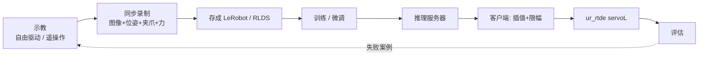

# 用 UR 为 VLA 采集数据与部署策略（Data Collection & Deployment）

> 把前面学的"让 UR 动、读出力"串成 VLA 闭环：怎么示教、同步录数据、存成训练格式，以及怎么安全地让训好的模型控制 UR。

## 学习目标

- 能比较自由驱动示教、3D 鼠标、主从臂、VR 四种示教方式，为自己的任务选一种
- 能设计一个同步记录图像、关节 / TCP 位姿、夹爪、力的采集程序，并说清时间戳怎么对齐
- 能把录到的数据映射成 LeRobot / RLDS 的字段
- 能用 ur_rtde 的 `servoL` 执行模型输出的动作块，并加上限幅、看门狗、力阈值等安全兜底

## 前置知识

- 需要先读：[02 安全与风险评估](02-safety-and-risk-assessment.md)、[07 RTDE 与 ur_rtde](07-rtde-python-control.md)、[09 力传感与力控模式](09-force-sensing-and-force-mode.md)
- VLA 侧：[06 数据集与数据采集](../VLA/Basic/06-datasets-and-data-collection.md)、[07 动作表示](../VLA/Basic/07-action-representation.md)、[09 评估与部署](../VLA/Basic/09-evaluation-and-deployment.md)

## 核心概念

| 术语 | 一句话解释 | 类比 |
|---|---|---|
| **示教（demonstration）** | 人操作机器人完成一次任务并被录下来 | 师傅手把手带徒弟 |
| **自由驱动（freedrive）** | 机械臂变"软"，人直接用手拖着走 | 牵着别人的手写字 |
| **时间戳对齐** | 把不同频率的传感器数据对到同一时刻 | 给多机位视频打板 |
| **动作块（action chunk）** | 模型一次输出未来多步动作 | 一次说出接下来的几步棋 |
| **servoL** | 以高频连续发送笛卡尔目标位姿，机器人平滑跟随 | 牵着狗绳一路小步走 |
| **看门狗（watchdog）** | 规定时间内收不到"我还活着"的信号就停机 | 司机脚离开"死人踏板"就刹车 |

## 详细讲解

### 10.1 全流程



训练见 [VLA 08 训练与微调](../VLA/Basic/08-training-and-finetuning.md)，本章只讲采集和部署两端。

### 10.2 示教方式怎么选

| 方式 | UR 上怎么做 | 优点 | 缺点 |
|---|---|---|---|
| 自由驱动示教 | 示教器上的自由驱动按钮；URScript `freedrive_mode()` / `teach_mode()`；ur_rtde `teachMode()` / `freedriveMode()` | 零额外设备 | 人会入镜；难同时操作夹爪；**手握在法兰之后的工具上时，手的力会混进力读数** |
| 3D 鼠标（SpaceMouse） | 6 维输入换算成末端速度；ur_rtde `jogStart()` 文档提到可用 3D 鼠标 | 便宜，人不入镜 | 慢，难做精细动作 |
| 主从臂 | 人拖同构小臂，UR 跟随其关节角（如 GELLO） | 直观流畅，适合关节空间动作 | 要制作主臂；是否支持你的型号以仓库为准 |
| VR 手柄 | 手柄位姿映射为 TCP 目标（ForceVLA 用 Quest 3） | 末端控制自然 | 要标定映射，怕延迟 |

> 💡 要点：要录**力**的任务优先用遥操作（人不碰机械臂），传感器测到的才是工具与环境的接触力。但普通遥操作没有力反馈，示范的力控行为可能不自然，见 [VLA 10 章 10.6 节](../VLA/Basic/10-force-and-tactile-sensing.md)。

### 10.3 同步记录：录什么、按什么时钟对齐

| 数据 | 来源 | 典型频率 |
|---|---|---|
| 图像（第三人称 + 腕部） | 相机驱动 | 30 Hz |
| 关节角 `actual_q`、TCP 位姿 `actual_TCP_pose` | RTDE | 最高 500 Hz |
| 力 `actual_TCP_force` | RTDE | 最高 500 Hz |
| 夹爪开度 | 夹爪驱动 | 视型号 |
| 遥操作指令（作为 action） | 你的遥操作程序 | 与控制循环同频 |
| 控制器时间 `timestamp` | RTDE（控制器启动以来的秒数） | 随每个 RTDE 包 |

做法：后台线程以 500 Hz 把 RTDE 数据放进环形缓冲；主循环按图像帧率取帧，所有数据用**同一台电脑的单调时钟**打戳，力做窗口平均；控制器 `timestamp` 一并保存以便核对丢包。

```python
import collections, threading, time
import numpy as np
from rtde_receive import RTDEReceiveInterface

ROBOT_IP = "192.168.56.101"
rtde_r = RTDEReceiveInterface(ROBOT_IP, 500.0)
buf = collections.deque(maxlen=5000)          # 约 10 秒的 500 Hz 数据

def rtde_reader(stop: threading.Event):
    while not stop.is_set():
        buf.append((time.monotonic(), rtde_r.getTimestamp(), rtde_r.getActualQ(),
                    rtde_r.getActualTCPPose(), rtde_r.getActualTCPForce()))
        time.sleep(0.002)                     # Python 定时有抖动，所以另存控制器时间

def record_episode(cams, task, fps=30, seconds=30):
    frames, period = [], 1.0 / fps
    t0 = t_next = time.monotonic()
    while time.monotonic() - t0 < seconds:
        t_now = time.monotonic()
        images = {name: cam.read() for name, cam in cams.items()}   # [核实] 相机驱动与曝光延迟
        rows = [r for r in list(buf) if t_now - 0.033 < r[0] <= t_now]
        if rows:
            last = rows[-1]
            frames.append({
                "timestamp": t_now, "controller_time": last[1],
                "images": images, "q": last[2], "tcp_pose": last[3],
                "force": np.mean([r[4] for r in rows], axis=0),
                "gripper": read_gripper(),           # [核实] 你的夹爪接口
                "action": teleop_last_command(),     # [核实] 遥操作时记下发的指令
                "task": task,
            })
        t_next += period
        time.sleep(max(0.0, t_next - time.monotonic()))
    return frames
```

> 🔍 深入：ur_rtde 的 `startFileRecording(filename, variables)` 可把 RTDE 字段直接录成 CSV，适合另存一份全频率力数据。

自由驱动示教没有"下发的指令"，常见做法是离线把**下一帧的状态**当作这一帧的动作。原则同 [VLA 06 章](../VLA/Basic/06-datasets-and-data-collection.md)：action 是"要去哪"，不是"现在在哪"。

### 10.4 存成 LeRobot / RLDS

| 你录到的 | LeRobot 字段（参照 06 章） | 说明 |
|---|---|---|
| 两路图像 | `observation.images.top` / `observation.images.wrist` | 存 mp4，键名与训练配置一致 |
| TCP 位姿 6 维 + 夹爪 1 维 | `observation.state` | 或用关节角 6 维 + 夹爪 |
| 力 6 维 | 单独一个字段 | 名字与训练代码约定一致（ForceVLA 见其数据集定义） |
| 指令 / 动作 / 时间 | `task` / `action` / `timestamp` | `fps` 写入 `meta/info.json` |

UR 姿态是**旋转向量**，转角接近 π 时会跳变，做 delta 或归一化前要先处理（见 [03 坐标系与位姿](03-coordinates-poses-and-tcp.md)）。RLDS 概念相同，存成 TFRecord。

> ❓ 待解决：LeRobot 的格式版本和写入 API 在演进（06 章介绍的是 v2），具体写法以所装版本的文档为准。

### 10.5 部署：从动作块到 servoL

模型输出必须与训练数据约定一致（见 [VLA 07 动作表示](../VLA/Basic/07-action-representation.md)）：

| 模型输出 | 在 UR 上怎么执行 |
|---|---|
| 绝对 TCP 位姿 | 插值、限幅后直接给 `servoL` |
| 增量（delta）位姿 | 累加到上一条**指令**位姿（旋转要复合，不能直接相加） |
| 关节角 | 用 `servoJ` |
| 动作块 | 按数据帧率解释每一步，在两步之间插值到控制频率 |

`servoL(pose, speed, acceleration, time, lookahead_time, gain)` 的细节见 [07 章](07-rtde-python-control.md)：speed / acceleration 不使用，`time` 填控制周期，lookahead 越大越平滑也越滞后，gain 越大跟得越紧也越易抖。`moveL` 是阻塞的直线运动，适合回起点，不适合高频跟踪。

频率分三层：推理约 5~15 Hz；动作块按数据帧率解释；servo 循环 125~500 Hz。推理放**后台线程**，控制循环只读最新动作块，推理卡顿就不会让控制停摆。

### 10.6 安全兜底：一层套一层

| 层 | 措施 | UR / ur_rtde 手段 |
|---|---|---|
| 硬件 | 急停在手边；控制器安全配置 | 示教器安全设置，见 [02 安全](02-safety-and-risk-assessment.md) |
| 动作 | 每周期限位移、工作空间盒子 | 客户端代码；可用 `isPoseWithinSafetyLimits()` 预检 |
| 通信 | 控制端看门狗 | `setWatchdog(min_frequency)` + 每周期 `kickWatchdog()` |
| 策略 | 新动作块超时就停 | 客户端判断 + `servoStop()` |
| 接触 | 合力超阈值就停 | `getActualTCPForce()`，阈值参考 [09 章](09-force-sensing-and-force-mode.md) |
| 状态 | 停机后不自动恢复 | `isProtectiveStopped()`、`isEmergencyStopped()` |

> 💡 要点：软件会有 bug，**控制器安全配置才是最后一道墙**；软件限值要比它更严，让软件先触发。

### 10.7 部署代码框架

> ⚠️ 注意：这段代码会让机械臂按模型输出运动。先在 URSim 跑通；首次上真机 `V_MAX` 用 0.02~0.05 m/s、速度滑块调低，手放急停旁，工作区无人。标 `[核实]` 处必须在你的环境里确认。

```python
import threading, time
import numpy as np
from scipy.spatial.transform import Rotation as R, Slerp
from rtde_control import RTDEControlInterface
from rtde_receive import RTDEReceiveInterface

ROBOT_IP = "192.168.56.101"          # 先用 URSim
CTRL_HZ, DATA_HZ = 125, 10           # 控制频率；数据帧率 [核实：等于数据集 fps]
DT = 1.0 / CTRL_HZ
LOOKAHEAD, GAIN = 0.1, 300           # servoL 平滑参数
V_MAX = 0.05                         # 末端最大线速度 m/s
WS_LOW = np.array([0.20, -0.30, 0.05])   # 工作空间盒子（基座系，米）[核实]
WS_HIGH = np.array([0.60, 0.30, 0.40])
F_STOP = 25.0                        # 合力阈值 N [核实]
POLICY_TIMEOUT = 0.5                 # 秒
HOME = [0.40, 0.0, 0.30, 0.0, 3.14, 0.0]  # 起始 TCP 位姿 [核实]

rtde_c = RTDEControlInterface(ROBOT_IP, CTRL_HZ)
rtde_r = RTDEReceiveInterface(ROBOT_IP, CTRL_HZ)
rtde_c.setWatchdog(10.0)             # 10 Hz 内没 kick 就停止控制
latest, lock = {"chunk": None, "t": 0.0}, threading.Lock()

def policy_loop(client, stop):
    while not stop.is_set():
        obs = build_observation()                    # [核实] 与训练数据同格式、同力处理
        chunk = np.asarray(client.infer(obs))        # [核实] 形状 (H, 7)：绝对 TCP 位姿 + 夹爪，已反归一化
        with lock:
            latest["chunk"], latest["t"] = chunk, time.monotonic()

def target_from_chunk(chunk, t_since):
    s = t_since * DATA_HZ
    i = int(s)
    if i >= len(chunk) - 1:
        return None                                  # 动作块用完了
    a, b, w = chunk[i], chunk[i + 1], s - i
    pos = (1 - w) * a[:3] + w * b[:3]
    rot = Slerp([0, 1], R.from_rotvec([a[3:6], b[3:6]]))([w]).as_rotvec()[0]
    return np.r_[pos, rot], (a[6] if w < 0.5 else b[6])

def limit(target, last):
    step = target[:3] - last[:3]
    n = np.linalg.norm(step)
    if n > V_MAX * DT:
        target[:3] = last[:3] + step / n * V_MAX * DT
    target[:3] = np.clip(target[:3], WS_LOW, WS_HIGH)
    return target                                    # 姿态限速同理，此处省略 [核实]

def robot_ok():
    if rtde_r.isProtectiveStopped() or rtde_r.isEmergencyStopped():
        return False
    return np.linalg.norm(rtde_r.getActualTCPForce()[:3]) < F_STOP

def run(client, max_seconds=60):
    rtde_c.moveL(HOME, 0.05, 0.3)                    # 慢速回起点（阻塞）
    stop = threading.Event()
    threading.Thread(target=policy_loop, args=(client, stop), daemon=True).start()
    last = np.array(rtde_r.getActualTCPPose())
    t0 = time.monotonic()
    try:
        while time.monotonic() - t0 < max_seconds:
            t_cycle = rtde_c.initPeriod()
            rtde_c.kickWatchdog()
            with lock:
                chunk, t_chunk = latest["chunk"], latest["t"]
            if chunk is not None:
                if time.monotonic() - t_chunk > POLICY_TIMEOUT or not robot_ok():
                    print("超时或安全条件触发"); break
                out = target_from_chunk(chunk, time.monotonic() - t_chunk)
                if out is None:
                    print("动作块耗尽"); break
                target, grip = out
                target = limit(target, last)
                rtde_c.servoL(target.tolist(), 0.5, 0.5, DT, LOOKAHEAD, GAIN)  # speed/acc 当前版本不使用
                send_gripper_if_changed(grip)        # [核实] 不能阻塞控制循环
                last = target
            rtde_c.waitPeriod(t_cycle)
    finally:
        stop.set()
        rtde_c.servoStop()
        rtde_c.stopScript()
```

> ❓ 待解决：Python 125 Hz 循环的抖动、`RTDEReceiveInterface` 被两个线程同时读是否安全（文档只说控制接口非线程安全）、`isPoseWithinSafetyLimits()` 的耗时，都需实测。ur_rtde 文档推荐配合实时内核。

### 10.8 评估流程

1. **离线检查**：画出验证集上的模型输出，确认范围、单位、坐标系与训练数据一致。
2. **URSim 回放**：不用模型，把录好的示范 action 喂给 10.7 的执行链路，看轨迹能否复现——坐标系和插值 bug 多在这一步暴露。
3. **URSim 闭环**：接上模型（图像用录好的帧），确认限幅、超时、看门狗都能触发。
4. **真机低速**：10%~30% 速度、空工作区试跑；再放物体。
5. **正式评估**：按 [VLA 09 章 9.6 节](../VLA/Basic/09-evaluation-and-deployment.md) 写死成功标准和初始条件，每个条件至少 20 次，保存视频和日志。

> 🔗 关联：ForceVLA 换平台要改的数据管线与机器人接口见 [ForceVLA 复现指南 6.6 节](../VLA/ForceVLA/06-reproduction-guide.md)，本章就是在 UR 上落实那张表。

## 动手练习

1. 在 URSim 里运行 10.3 的采集程序（相机用随机图像代替），录 10 秒，检查帧数、相邻帧时间间隔的均值和最大值。（验收：帧数约 300，最大间隔不超过 2 个周期。）
<details><summary>参考做法</summary>

把 `cams` 换成返回 `np.zeros((480, 640, 3))` 的假对象；录完后 `np.diff([f["timestamp"] for f in frames])` 看 `mean()` 和 `max()`。间隔偏大时先查是否在循环里做了耗时的保存操作。
</details>

2. 用 10.7 的框架做"回放测试"：把一条录好示范的 TCP 位姿序列按每块 20 步切成动作块，交给 `target_from_chunk`，在 URSim 里执行。（验收：URSim 中的轨迹与录制时一致，没有触发限速以外的停机。）
<details><summary>参考做法</summary>

写一个假的 `client`，`infer()` 每次返回接下来 20 帧的 `[tcp_pose, gripper]`；`DATA_HZ` 设成录制帧率。若机器人走得明显比录制慢，说明 `V_MAX` 在限速——这在回放测试里是正常的。
</details>

## 常见错误与排查

| 现象 | 原因 | 解决 |
|---|---|---|
| 模型一启动机器人就猛冲 | 归一化统计量不匹配，或动作约定（绝对 / 增量）搞反 | 先做 10.8 第 1、2 步；限速兜底 |
| 动作执行一顿一顿 | 动作块之间没插值，或推理阻塞了控制循环 | 推理放后台线程；块内插值 |
| 机器人抖动 | `gain` 太大或 `lookahead_time` 太小 | 增大 lookahead、减小 gain |
| 转到某个姿态突然翻转 | 旋转向量在转角接近 π 处跳变 | 插值用 Slerp；训练前统一旋转表示 |
| 程序运行中突然停止控制 | 看门狗未按时 kick | 检查循环是否被阻塞，`kickWatchdog()` 放在循环最前 |

## 小结

- 录力的任务优先用遥操作，避免人手力混进传感器读数。
- 采集：RTDE 500 Hz 后台缓冲 + 图像帧率主循环，用同一单调时钟打戳，力做窗口平均。
- 存储：映射到 LeRobot 的 images / state / action / task 字段，力单独一个字段，注意旋转向量的跳变。
- 部署：动作块插值 → 限速、工作空间限制 → `servoL`，推理与控制分线程。
- 兜底层层叠加：控制器安全配置、限幅、看门狗、超时、力阈值、状态监测；先 URSim 回放再上真机。

## 自测题

1. 为什么部署时推理要放在后台线程，而不是"推理一次、执行一次"串行？
<details><summary>答案</summary>推理耗时不稳定（几十到几百毫秒），串行时控制循环会停在推理上，servo 指令断档导致动作卡顿，甚至触发看门狗。分线程后控制循环始终以固定频率执行最新动作块。</details>

2. 数据集 10 Hz、控制循环 125 Hz，动作块相邻两步之间要插多少个控制周期？
<details><summary>答案</summary>125 / 10 = 12.5，约 12~13 个周期。</details>

3. 模型输出增量位姿时，为什么要累加到"上一条指令位姿"而不是"当前实际位姿"上？
<details><summary>答案</summary>实际位姿有跟踪误差和噪声，每步都以实际位姿为基准会把误差反馈进来造成抖动；以指令位姿累加更平滑。但要注意它与训练时的定义一致，并定期检查指令与实际的偏差。</details>

## 参考资料

- [ur_rtde API 参考](https://sdurobotics.gitlab.io/ur_rtde/pages/reference/api.html) —— `servoL`、`setWatchdog`、`teachMode`、`jogStart` 等函数的权威定义
- [ur_rtde servoL 示例](https://sdurobotics.gitlab.io/ur_rtde/pages/examples/high_frequency_servoing/servol_example.html) —— 官方的 500 Hz servo 循环写法
- [ur_rtde 数据录制示例](https://sdurobotics.gitlab.io/ur_rtde/pages/examples/basic_motion/record_data_example.html) —— 直接把 RTDE 字段录成 CSV
- [RTDE 官方指南](https://docs.universal-robots.com/tutorials/communication-protocol-tutorials/rtde-guide.html) —— 字段含义与 500 Hz 上限
- [LeRobot 文档](https://huggingface.co/docs/lerobot) —— 数据集格式与写入 API
- [GELLO 主从臂（GitHub）](https://github.com/wuphilipp/gello_software) —— 低成本主从臂遥操作参考
