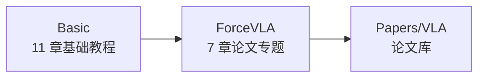

# VLA 总目录

> **VLA（Vision-Language-Action，视觉-语言-动作模型）**：看图像、听指令、直接输出机器人动作的模型。本目录分两部分：先打基础，再精读论文。

## 结构

| 子目录 | 内容 | 入口 |
|---|---|---|
| Basic | 从机器人学习概述、深度学习/Transformer 最小知识，到 VLA 概念、代表模型、数据、训练、评估、力感知，附术语表 | [Basic/00-README.md](Basic/00-README.md) |
| ForceVLA | 论文《ForceVLA: Enhancing VLA Models with a Force-aware MoE for Contact-rich Manipulation》精读：背景、方法、数据集、实验、复现、批判 | [ForceVLA/00-README.md](ForceVLA/00-README.md) |

## 建议顺序

1. Basic 01~04：建立概念。
2. Basic 05~09：知道有哪些模型、数据从哪来、怎么训练和评估。
3. Basic 10：力感知——为什么只靠视觉不够。
4. ForceVLA 01~07：精读论文并规划复现。

## 新增论文笔记

- **泛读**（一篇一个文件）：导入到论文库 [Papers/VLA](../Papers/VLA/00-README.md)，命令 `./start.sh paper <arXiv 链接> Knowledge/Papers/VLA`，或在 Web 里点"导入论文"。笔记会自动关联本目录的章节，并出现在每个相关章节底部的"📄 相关论文"里。
- **精读**（拆成多章）：像 ForceVLA 一样建一个论文专题文件夹，内部按 `NN-xxx.md` 编号，`01-paper-overview.md` 用论文笔记模板（同样要填 `related`）。

## 关联

- 世界模型：[../WAM/00-README.md](../WAM/00-README.md) —— 在 VLA 之上加入"预测未来"的能力
- 论文库：[../Papers/VLA/00-README.md](../Papers/VLA/00-README.md) —— 与 VLA 相关的论文笔记，自动关联到本目录各章节
- 基础工具：[../LinuxCommand/00-README.md](../LinuxCommand/00-README.md)
