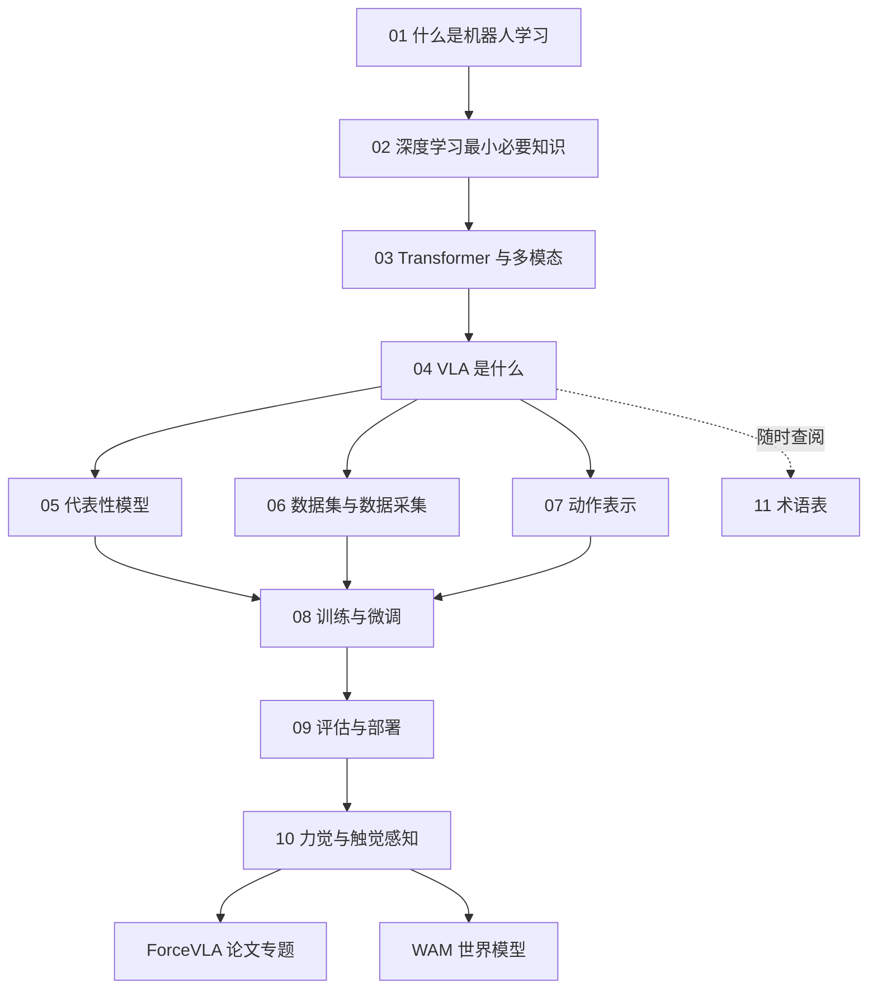

# VLA 基础：从零开始理解视觉-语言-动作模型

> 这个文件夹回答一个问题：**一个机器人怎么做到"看一眼、听一句话、然后动手"？** 学完后你能读懂主流 VLA 论文，知道如何微调和部署一个 VLA 模型，并为后续阅读 ForceVLA 论文、学习世界模型（WAM）打好基础。

## 主题简介

**VLA**（Vision-Language-Action，视觉-语言-动作模型）是近两年机器人领域最热的方向：把大语言模型 / 视觉语言模型的"理解能力"接到机器人的"手"上，让机器人能根据摄像头画面和一句自然语言指令直接输出动作。

本主题假设你：

- 会一点 Python（能看懂 for 循环和函数）
- **不需要**任何深度学习或机器人学背景

学完本主题你能做到：

1. 用自己的话解释 VLA 的输入、输出和内部数据流
2. 看懂 RT-2、OpenVLA、π0 等代表性论文的核心设计
3. 知道一份机器人数据集长什么样、怎么采集
4. 能在自己的数据上跑通一次 OpenVLA / π0 微调的基本流程
5. 理解为什么"只靠眼睛"不够，为接触丰富任务和 ForceVLA 做好准备

## 学习路线

建议顺序：01 → 02 → 03 → 04 是必读主线；05 / 06 / 07 可以按兴趣穿插；08 → 09 → 10 需要在主线读完后再看。

## 章节表格

| 章节 | 文件 | 难度 | 预计时长 | 状态 |
|---|---|---|---|---|
| 01 什么是机器人学习 | [01-what-is-robot-learning.md](01-what-is-robot-learning.md) | beginner | 30min | draft |
| 02 深度学习最小必要知识 | [02-deep-learning-essentials.md](02-deep-learning-essentials.md) | beginner | 60min | draft |
| 03 Transformer 与多模态 | [03-transformers-and-multimodal.md](03-transformers-and-multimodal.md) | beginner | 60min | draft |
| 04 VLA 是什么 | [04-vla-concept.md](04-vla-concept.md) | beginner | 45min | draft |
| 05 代表性模型 | [05-representative-models.md](05-representative-models.md) | intermediate | 60min | draft |
| 06 数据集与数据采集 | [06-datasets-and-data-collection.md](06-datasets-and-data-collection.md) | intermediate | 45min | draft |
| 07 动作表示 | [07-action-representation.md](07-action-representation.md) | intermediate | 45min | draft |
| 08 训练与微调 | [08-training-and-finetuning.md](08-training-and-finetuning.md) | intermediate | 90min | draft |
| 09 评估与部署 | [09-evaluation-and-deployment.md](09-evaluation-and-deployment.md) | intermediate | 45min | draft |
| 10 力觉与触觉感知 | [10-force-and-tactile-sensing.md](10-force-and-tactile-sensing.md) | intermediate | 45min | draft |
| 11 术语表 | [11-glossary.md](11-glossary.md) | all | 随查随用 | draft |

## 与其他主题的关系

- **前置**：[Linux 命令](../../LinuxCommand/00-README.md) —— 训练和部署 VLA 都在 Linux 服务器上进行，第 08、09 章会大量用到命令行。
- **后续**：[ForceVLA 论文专题](../ForceVLA/00-README.md) —— 第 10 章直接引向这篇论文，它在 π0 基础上加入了力觉信息。
- **后续**：[WAM 世界模型](../../WAM/00-README.md) —— 在 VLA 之上加入"预测未来"的能力：世界模型如何与 VLA 融合、做规划与数据生成。

> 💡 要点：VLA 不是一个"单独的算法"，而是"视觉语言模型 + 动作头 + 机器人数据"三件事的组合。读每一章时都想一想：这一章讲的是三者中的哪一个？
