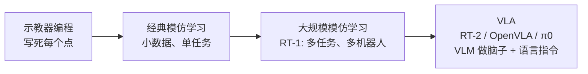

# 什么是机器人学习（Robot Learning）

> 这一章回答：以前的机器人是怎么"被告诉"该干什么的？为什么现在要改成"让它自己学"？VLA 在这条路上处于什么位置？

## 学习目标

- 能区分"传统编程控制"和"学习式控制"，并说出各自适合的场景
- 能用一句话解释模仿学习和强化学习的区别
- 能说出 VLA 出现之前机器人学习面临的三个瓶颈
- 能解释"从写规则到看示范"这句话的含义

## 前置知识

- 无

## 核心概念

| 术语 | 一句话解释 | 类比 |
|---|---|---|
| **传统编程控制** | 工程师把每一步动作写成代码或示教点 | 给新员工一本厚厚的操作手册，每一步都写死 |
| **机器人学习** | 让机器人从数据（示范、试错）中自己总结出该怎么动 | 新员工跟着师傅看、跟着做，慢慢学会 |
| **策略（Policy）** | 一个函数：输入"当前看到的状态"，输出"下一步动作" | 员工脑子里"看到什么就做什么"的直觉 |
| **模仿学习** | 看人类示范的数据，学会复制人类的做法 | 跟着师傅学手艺 |
| **强化学习** | 自己反复尝试，做对了给奖励，慢慢改进 | 玩游戏，靠分数高低摸索技巧 |
| **泛化** | 在没见过的物体、场景、指令上也能工作 | 学会了拧一种螺丝后，换个牌子的螺丝也会拧 |

## 详细讲解

### 1.1 传统编程控制：又准又脆

工业机械臂几十年来都用一种方式工作：工程师用**示教器**（一个带按键的手持面板）把机械臂拖到几个关键位置，记下坐标，再写程序让它按顺序走这些点。

这种方式的优点是**极其精确和可重复**——汽车焊装线一天焊几千个点，误差小于 0.1 毫米。

但缺点也很致命：

- 零件位置偏了 2 厘米，程序就不认识了
- 换一种零件要重新示教、重新写程序
- 没法处理"把桌上随便哪个杯子递给我"这种模糊任务

> 💡 要点：传统控制擅长**结构化环境里的重复动作**，不擅长**非结构化环境里的灵活决策**。家庭、仓库、实验室几乎都是非结构化环境。

### 1.2 学习式控制：让数据说话

机器人学习的核心思想是：不写规则，而是收集大量"状态 → 动作"的样本，训练一个**策略**（policy，可以理解为一个函数 $\pi(a|s)$，输入状态 $s$，输出动作 $a$）去拟合这些样本。

常见的两条路：

**模仿学习（Imitation Learning, IL）**
人类通过遥操作（手柄、VR 手柄、主从臂）控制机器人完成任务，同时记录摄像头画面和机器人的动作。模型学习"看到这个画面时，人类会怎么动"。
- 优点：数据干净、训练稳定、不需要机器人自己撞墙试错
- 缺点：需要人工采集，模型很难超过示范者的水平

**强化学习（Reinforcement Learning, RL）**
给机器人一个奖励函数（比如"杯子被拿起来 +1"），让它自己在仿真或真机里反复尝试，逐步提高奖励。
- 优点：理论上可以超越人类，能发现意想不到的策略
- 缺点：真机试错又慢又危险；奖励函数很难设计

> 🔍 深入：目前的 VLA 模型主要走**模仿学习**路线（在大规模示范数据上做监督训练），强化学习更多用于后续微调（如 RL fine-tuning）。

### 1.3 VLA 之前的三个瓶颈

2015 到 2022 年间，机器人学习已经有很多成果，但一直很难走出实验室。主要卡在三点：

1. **数据少**：每个实验室只有自己那一台机器人、几千条数据，模型"见识太少"，换个场景就失效。
2. **任务单一**：一个模型通常只会一个任务（比如只会抓取），要换任务就重新训练。
3. **不懂语言**：没法用自然语言下指令，只能靠编号或目标图片指定任务。

与此同时，大语言模型（LLM）和视觉语言模型（VLM）在 2022 到 2023 年爆发：它们在互联网规模的数据上训练，天然"懂语言、认物体、有常识"。一个自然的想法冒了出来：

> 能不能把 VLM 的"脑子"直接接上机器人的"手"？

这就是 VLA 的起点。Google 在 2022 年底发布的 RT-1 是第一个在大规模真实机器人数据（13 台机器人、17 个月、13 万条示范）上训练的 Transformer 策略；2023 年的 RT-2 更进一步，直接用一个 VLM 来输出动作，把"机器人动作"当成一种特殊的"语言"来生成。

### 1.4 从"写规则"到"看示范"

把这条演化路线画出来：

每往右一步，机器人的"泛化"能力就强一截，但对**数据量**和**算力**的要求也高一截。这也是为什么本主题后面要专门讲数据集（06 章）和训练资源（08 章）。

> 🔗 关联：传统控制并没有被淘汰。VLA 输出的高层动作最终还是要交给底层控制器（位置控制、阻抗控制）去执行，详见 [07 动作表示](07-action-representation.md) 和 [10 力觉与触觉感知](10-force-and-tactile-sensing.md)。

## 动手练习

1. 列出你身边三个机器人（扫地机、工厂机械臂、送餐机器人都算），判断每一个更像"传统编程控制"还是"学习式控制"，说明理由。

参考做法

- 扫地机：多数是传统控制 + 简单规则（撞到就转弯，部分高端型号有学习式视觉识别）。
- 焊接机械臂：典型传统编程控制，示教点固定。
- 送餐机器人：导航部分是传统 SLAM + 路径规划，不属于"学习策略"；少数带避障的会用学习式感知。
结论：目前落地的机器人绝大多数仍是传统控制，这正是 VLA 想改变的现状。

2. 用一句话描述一个"模仿学习很难、强化学习更合适"的任务，再描述一个相反的任务。

参考做法

- 强化学习更合适：让四足机器人学会在冰面上走——人类很难遥操作出好的步态，但奖励（不摔倒、往前走）很好定义。
- 模仿学习更合适：叠衣服——奖励很难写（什么叫"叠得好"？），但人示范几百次很容易。

## 常见错误与排查

| 现象 | 原因 | 解决 |
|---|---|---|
| 以为"机器人学习"=让机器人自己瞎试 | 混淆了模仿学习和强化学习 | 记住：当前主流 VLA 是**模仿学习**，数据来自人类示范 |
| 以为学习式控制一定比传统控制好 | 忽略了精度和可靠性要求 | 高精度重复任务仍然用传统控制；学习式控制的价值在于泛化 |
| 以为 VLA 可以直接驱动电机 | 忽略了底层控制器 | VLA 输出的是高层动作（如末端位移），底层仍需 PID/阻抗控制器 |

## 小结

- 传统控制精确但脆弱，学习式控制灵活但需要数据。
- 策略 = 从状态到动作的函数；模仿学习从示范中学，强化学习从试错中学。
- VLA 之前的瓶颈：数据少、任务单一、不懂语言。
- VLA 的思路：用预训练 VLM 当"脑子"，在大规模机器人数据上学会输出动作。
- VLA 不替代底层控制器，而是坐在它上面。

## 自测题

1. 为什么说模仿学习"很难超过示范者的水平"？

答案
因为模仿学习的目标是复现示范数据的分布，训练数据里没有比示范者更好的动作，模型自然学不到。强化学习靠奖励信号才可能超越。

2. RT-1 和 RT-2 最本质的区别是什么？

答案
RT-1 是从头训练的 35M 参数机器人专用模型；RT-2 直接把一个互联网预训练的 VLM（PaLI-X 55B 或 PaLM-E 12B）拿来微调，让它把动作当成文本 token 输出，从而继承了 VLM 的语义理解和泛化能力。

3. "非结构化环境"指什么？举一个例子。

答案
物体位置、种类、光照等不固定、无法事先精确建模的环境。例如家里的厨房台面：杯子每天放的位置都不一样。

## 参考资料

- [RT-1: Robotics Transformer for Real-World Control at Scale（arXiv）](https://arxiv.org/abs/2212.06817) —— 大规模真实机器人模仿学习的起点，读摘要即可感受"数据规模"的重要性
- [RT-2 官方博客（Google DeepMind）](https://deepmind.google/discover/blog/rt-2-new-model-translates-vision-and-language-into-action/) —— 通俗讲解"把动作当语言"的思想
- [LeRobot 文档（Hugging Face）](https://huggingface.co/docs/lerobot) —— 开源机器人学习工具库，后续章节会用到
