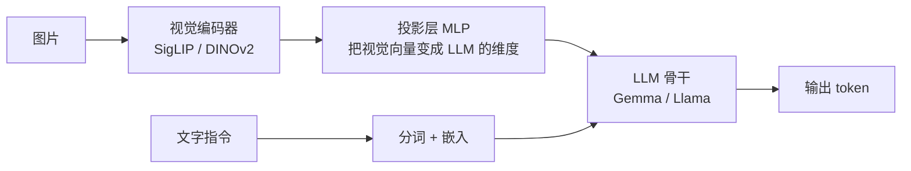

# Transformer 与多模态模型

> 所有现代 VLA 的"脑子"都是一个视觉语言模型（VLM），而 VLM 的骨架是 Transformer。这一章把 token、注意力、ViT、CLIP、LLM、VLM 这串名词串成一条线。

## 学习目标

- 能解释 token 和嵌入是什么，为什么图片和文字都能变成 token
- 能用一句话说清注意力机制在做什么
- 能说出 ViT、CLIP/SigLIP、LLM、VLM 各自的输入输出
- 能画出一个 VLM（如 PaliGemma）的数据流图

## 前置知识

- 需要先读：[02 深度学习最小必要知识](02-deep-learning-essentials.md)

## 核心概念

| 术语 | 一句话解释 | 类比 |
|---|---|---|
| **token** | 模型处理的最小单位，一个词片段或一个图像小块 | 乐高积木的一块 |
| **嵌入（embedding）** | 把一个 token 变成一个固定长度的数字向量 | 给每块积木贴一个"性格坐标" |
| **注意力（attention）** | 让每个 token 根据相关性去"看"其他 token | 读句子时眼睛在相关词之间来回扫 |
| **Transformer** | 由多层"注意力 + 前馈网络"堆叠的架构 | 多轮"互相参考再各自总结"的会议 |
| **ViT** | 把图片切成小块当 token 喂给 Transformer | 把照片剪成拼图块一块块看 |
| **CLIP / SigLIP** | 让图片和文字映射到同一个向量空间的模型 | 一本图文对照字典 |
| **LLM** | 大语言模型，根据前文预测下一个 token | 超级自动补全 |
| **VLM** | 视觉语言模型，能同时输入图片和文字的 LLM | 能"看图说话"的 LLM |

## 详细讲解

### 3.1 一切皆 token

计算机不能直接理解"猫"或者一张照片，必须先变成数字。

- **文字**：用分词器（tokenizer）把句子切成片段。"pick up the cup" 可能切成 `[pick, up, the, cup]` 四个 token，每个 token 在词表里有一个编号。
- **图片**：ViT 的做法是把 224×224 的图切成 16×16 的小块，得到 14×14 = 196 个小块，每个小块就是一个"图像 token"。

每个 token 编号接着通过一个**嵌入表**（一个大矩阵）变成一个向量，比如 1024 维。这个向量叫 **embedding**。相似的 token 会有相似的向量——这是训练出来的结果。

> 💡 要点：VLA 之所以能把图像、文字、甚至机器人动作放进同一个模型，根本原因就是它们**都能变成 token 序列**。

### 3.2 注意力：让 token 互相看

Transformer 的核心是**自注意力（self-attention）**。对序列里每个 token，模型算三个向量：Query（我在找什么）、Key（我有什么）、Value（我的内容）。每个 token 的新表示 = 用自己的 Q 去和所有 token 的 K 算相似度，再按相似度加权求和所有 V：

$$\text{Attention}(Q,K,V) = \text{softmax}\left(\frac{QK^\top}{\sqrt{d}}\right)V$$

直观理解：处理 "cup" 这个词时，注意力会让它"多看一眼" "pick up"，少看 "the"。处理一个图像块时，它会多看和自己相邻、相关的块。

一层 Transformer = 多头注意力 + 前馈网络（两层 MLP）+ 残差连接 + 归一化。把这样的层堆 20~80 层，就是一个 LLM。

> 🔍 深入：注意力的计算量和序列长度的平方成正比。一张图 196 个 token 还好，多张高分辨率图 + 长指令 + 动作历史就会很慢，这是 VLA 推理延迟的主要来源之一。

### 3.3 ViT：Transformer 看图

**ViT（Vision Transformer，2020）**证明了把图片切块后直接用 Transformer 处理，效果可以超过卷积网络。输入一张图，输出 196 个（或更多）图像 token 的向量。

VLA 里常见的视觉编码器：

- **DINOv2**：自监督训练，擅长空间和几何细节（OpenVLA 用了它）
- **SigLIP**：和文字对齐训练，擅长语义（OpenVLA、π0 都用了它）

### 3.4 CLIP / SigLIP：图文同一空间

**CLIP（2021，OpenAI）**用 4 亿对"图片-文字"训练两个编码器，目标是让匹配的图文向量靠近、不匹配的远离。结果是：你可以用一句话去检索图片，也可以用图片去匹配描述。

**SigLIP（2023，Google）**是 CLIP 的改进版，把对比损失换成 sigmoid 损失，训练更高效。它是 PaliGemma 的视觉编码器，因此也是 π0 的视觉编码器。

为什么 VLA 需要这个？因为指令是文字、观察是图片，模型必须能把"杯子"这个词和画面里的杯子对应上。CLIP 类模型提供了这种对齐。

### 3.5 LLM：预测下一个 token

**大语言模型（LLM）**就是一个很大的 Transformer，训练目标只有一个：给定前面的 token，预测下一个 token。Llama 2 7B、Gemma 2B 都是这类模型。

它们在数万亿 token 的互联网文本上训练后，"顺便"学会了常识、推理和指令跟随。VLA 想借的正是这些能力。

### 3.6 VLM：把图像 token 接进 LLM

**视觉语言模型（VLM）**的典型做法只有三步：



1. 视觉编码器把图片变成一串向量
2. 一个小的投影层把它们变换到 LLM 的嵌入维度
3. 把图像 token 和文字 token 拼接，一起送进 LLM

**PaliGemma（2024，Google）**：SigLIP（400M）+ Gemma 2B，总共约 3B 参数，是 π0 的骨干。
**Prismatic-7B**：DINOv2 + SigLIP 双编码器 + Llama 2 7B，是 OpenVLA 的骨干。

> 🔗 关联：下一章会讲，VLA 就是在这张图的 `OUT` 位置做文章——让输出的 token 变成机器人动作，或者再接一个专门的"动作头"。

## 动手练习

1. 用 Hugging Face 的 `transformers` 库加载一个小分词器，看看 "Pick up the red cup and put it in the sink." 被切成多少个 token。

<details><summary>参考做法</summary>

```python
from transformers import AutoTokenizer
tok = AutoTokenizer.from_pretrained("google/gemma-2b")
ids = tok("Pick up the red cup and put it in the sink.")["input_ids"]
print(len(ids), tok.convert_ids_to_tokens(ids))
```

通常得到 10~14 个 token。注意有些词会被切成多个片段。
</details>

2. 一张 224×224 的图，patch 大小 14×14，会产生多少个图像 token？如果用两个摄像头呢？

<details><summary>参考做法</summary>

224 / 14 = 16，16 × 16 = 256 个 token。两个摄像头 512 个。这比指令的十几个 token 多得多，所以 VLA 的输入序列主要被图像占据。
</details>

## 常见错误与排查

| 现象 | 原因 | 解决 |
|---|---|---|
| 以为 VLM 是"先用 CLIP 分类，再交给 LLM" | 混淆了检索式和端到端 | VLM 是端到端的：图像 token 直接进 LLM，一起做注意力 |
| 以为 token 就是"单词" | 分词器会切子词 | 一个长词可能是多个 token，中文一个字可能是一个或多个 token |
| 认为注意力只在文字里用 | ViT 对图像块做同样的事 | 注意力是通用机制，对任何 token 序列都适用 |
| 分不清 CLIP 和 ViT | 层次不同 | ViT 是一种架构；CLIP 是用 ViT 做视觉编码器的一种训练方式 |

## 小结

- 文字、图片都能变成 token 序列，再变成嵌入向量。
- 注意力让每个 token 按相关性参考其他 token；Transformer 是注意力层的堆叠。
- ViT 把图片切块后交给 Transformer；CLIP/SigLIP 让图和文落到同一向量空间。
- VLM = 视觉编码器 + 投影层 + LLM，PaliGemma（3B）和 Prismatic-7B 是 VLA 常用骨干。

## 自测题

1. 注意力公式里为什么要除以 $\sqrt{d}$？

<details><summary>答案</summary>Q 和 K 的点积随维度 $d$ 增大而变大，会让 softmax 过于尖锐（几乎只关注一个 token），梯度难以传播。除以 $\sqrt{d}$ 把数值拉回合理范围。</details>

2. PaliGemma 由哪两个部分组成？各自负责什么？

<details><summary>答案</summary>SigLIP 视觉编码器（把图片变成 token）和 Gemma 2B 语言模型（处理拼接后的图文 token 序列并生成输出）。</details>

3. 为什么 OpenVLA 要同时用 DINOv2 和 SigLIP 两个视觉编码器？

<details><summary>答案</summary>两者互补：SigLIP 和文字对齐、语义强；DINOv2 自监督、保留更多空间和几何细节。机器人操作既要认物体也要判断位置，所以拼接两者的特征。</details>

## 参考资料

- [Attention Is All You Need（arXiv）](https://arxiv.org/abs/1706.03762) —— Transformer 原始论文
- [The Illustrated Transformer](https://jalammar.github.io/illustrated-transformer/) —— 最经典的图解，先看这个再看论文
- [An Image is Worth 16x16 Words：ViT（arXiv）](https://arxiv.org/abs/2010.11929) —— 把图片切块的原始论文
- [CLIP（arXiv）](https://arxiv.org/abs/2103.00020) / [SigLIP（arXiv）](https://arxiv.org/abs/2303.15343) —— 图文对齐
- [PaliGemma（arXiv）](https://arxiv.org/abs/2407.07726) —— π0 的骨干 VLM
