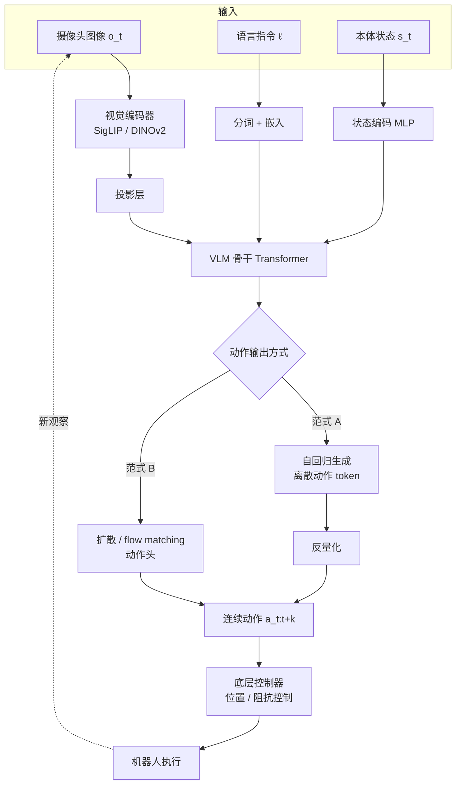

# VLA 是什么：视觉-语言-动作模型的定义与数据流

> 前三章准备好了所有零件，这一章把它们组装起来：一个 VLA 模型从摄像头画面和一句指令，到机器人动起来，中间到底发生了什么。

## 学习目标

- 能写出 VLA 的输入和输出分别是什么
- 能区分"自回归离散动作 token"和"扩散 / flow matching 动作头"两种范式
- 能解释 action chunking 为什么有用
- 能画出一个 VLA 的完整数据流图

## 前置知识

- 需要先读：[03 Transformer 与多模态模型](03-transformers-and-multimodal.md)

## 核心概念

| 术语 | 一句话解释 | 类比 |
|---|---|---|
| **VLA** | 输入图像 + 语言 + 机器人状态，输出动作的模型 | 既能看、能听、又会动手的"大脑" |
| **本体状态（proprioception）** | 机器人自己的关节角、末端位置、夹爪开合 | 你闭着眼也知道自己手在哪 |
| **动作（action）** | 下一时刻机器人应该执行的控制量 | "手往前 2 厘米，夹爪合上" |
| **离散动作 token** | 把连续动作切成 256 个格子，当成词表里的词 | 把音量 0~100 变成 10 档 |
| **扩散 / flow matching 动作头** | 从噪声逐步"去噪"生成一段连续动作 | 从模糊草图逐渐描清一条轨迹 |
| **action chunking** | 一次预测未来多步动作，而不是只预测下一步 | 一次想好接下来 1 秒的动作 |

## 详细讲解

### 4.1 定义：从观察到动作

一个 VLA 模型是一个函数：

$$a_{t:t+k} = \pi_\theta(o_t, \ell, s_t)$$

- $o_t$：当前时刻的**观察**，通常是 1~3 个摄像头的 RGB 图像（腕部相机 + 第三人称相机）
- $\ell$：自然语言**指令**，如 "put the cup in the sink"
- $s_t$：**本体状态**，关节角、末端位姿、夹爪开度等
- $a_{t:t+k}$：未来 $k$ 步的**动作**，比如每一步是 7 维（末端位移 3 + 旋转 3 + 夹爪 1）

"V-L-A" 三个字母正好对应三个部分：Vision 输入、Language 输入、Action 输出。

### 4.2 整体数据流

前半段（到 `LLM`）就是上一章的 VLM；VLA 的创新集中在 `HEAD` 之后。

### 4.3 范式 A：把动作当文字（自回归离散 token）

**代表：RT-2、OpenVLA。**

做法：
1. 把每个动作维度的连续值（如 -1 到 1）均匀切成 256 个区间（bin）
2. 每个区间对应词表里的一个 token（RT-2 直接复用数字 token，OpenVLA 覆盖了词表里最少用的 256 个 token）
3. 训练时，让 VLM 像生成文字一样，依次生成 7 个动作 token
4. 推理时，生成的 token 反量化成连续值

优点：**完全不改 VLM 架构**，可以直接用现成的 VLM 训练代码和损失（交叉熵）。
缺点：
- 自回归要一个一个生成 token，**慢**（OpenVLA 约 3~5 Hz）
- 量化成 256 格会损失精度
- 很难表达"多种都对"的动作分布（往左绕和往右绕都行时，模型可能取平均变成直冲）

### 4.4 范式 B：专门的动作头（扩散 / flow matching）

**代表：Octo（扩散头）、π0（flow matching 动作专家）、GR00T N1（扩散 Transformer）。**

做法：VLM 骨干只负责"理解"，输出的特征作为条件，交给一个独立的**动作头**生成连续动作。动作头用**扩散模型**或 **flow matching** 训练：

- 训练时：给真实动作加噪声，让网络学会预测"噪声"或"去噪方向"
- 推理时：从纯噪声开始，迭代 10 步左右，逐步变成一段干净的动作轨迹

π0 的具体设计：PaliGemma（3B）负责图文；再加一个约 300M 参数的"动作专家"（action expert），用 flow matching 一次生成 50 步动作（对应 50 Hz 下的 1 秒）。

优点：
- 输出**连续、平滑**的动作，适合高频控制（π0 可达 50 Hz）
- 天然能表达多模态分布（多种正确动作）
- 一次生成一整段动作（天然 action chunking）

缺点：需要额外设计和训练动作头，不能直接复用 VLM 的文本生成逻辑。

> 💡 要点：2024 年以后的新模型（π0、GR00T N1、π0.5）几乎都走范式 B。范式 A 的价值在于简单，是入门和快速实验的好起点。

### 4.5 Action chunking：一次想好一段

**ACT（Action Chunking with Transformers，2023）**首先系统地提出：与其每一步预测一个动作，不如一次预测未来 $k$ 步（比如 $k$ = 50）。

为什么有用？
1. **减少误差累积**：每步都重新决策，小抖动会累加；一次输出一段，轨迹更连贯。
2. **缓解推理延迟**：模型跑一次要 70 ms，但输出的 50 步可以撑 1 秒，机器人不用等。
3. **更符合人类示范**：人的动作本来就是连贯的片段，不是逐帧独立决定。

实际执行时常用**时间集成（temporal ensembling）**：每隔几步重新预测一次，新旧 chunk 重叠的部分加权平均，让衔接更平滑。

> 🔗 关联：动作的具体定义（关节空间还是末端空间、归一化方式）在 [07 动作表示](07-action-representation.md) 详细展开。

## 动手练习

1. 假设动作是 7 维，每维量化成 256 个 bin。范式 A 一次推理要生成多少个 token？如果 VLM 每生成一个 token 需要 30 ms，一次完整动作推理要多久？

参考做法

7 个 token，7 × 30 ms = 210 ms，约 5 Hz。如果再做 action chunking 输出 10 步，就是 70 个 token、2.1 秒，这就是范式 A 很少做长 chunk 的原因。

2. 把 4.2 的数据流图抄一遍，在每个方框旁标注它对应第 02 / 03 章的哪个概念。

参考做法

视觉编码器 → ViT / SigLIP（03）；投影层 → MLP（02）；VLM 骨干 → Transformer / LLM（03）；动作头 → 新内容（本章）；底层控制器 → 传统控制（01）。

## 常见错误与排查

| 现象 | 原因 | 解决 |
|---|---|---|
| 以为 VLA 直接输出电机电流 | 忽略了控制层级 | VLA 输出的是高层动作（末端或关节目标），底层控制器负责跟踪 |
| 以为扩散头就是"图像生成那套" | 只是借用了同样的数学 | 这里扩散的对象是动作序列，不是像素 |
| 分不清"本体状态"和"观察" | 都是输入 | 观察 = 外部传感器（相机）；本体状态 = 机器人自身的关节 / 位姿读数 |
| 认为 action chunking 只是"输出更多" | 忽略其对延迟和平滑的作用 | 它同时解决误差累积和推理延迟两个问题 |

## 小结

- VLA：输入图像 + 语言 + 本体状态，输出未来 k 步动作。
- 前半段就是 VLM；创新点在动作输出方式。
- 范式 A（RT-2、OpenVLA）：动作离散成 token 自回归生成，简单但慢、精度有限。
- 范式 B（π0、GR00T N1）：VLM 做条件，独立动作头用扩散 / flow matching 生成连续动作，快且平滑。
- Action chunking 一次输出一段动作，减少误差累积、掩盖推理延迟。

## 自测题

1. π0 的"动作专家"和 PaliGemma 之间是什么关系？

答案
PaliGemma 负责处理图像和语言并产生特征；动作专家是一个额外的 Transformer 分支（约 300M 参数），接收机器人状态和带噪动作，通过注意力读取 PaliGemma 的特征，用 flow matching 生成 50 步连续动作。两者在同一个 Transformer 里通过注意力交互，但参数分开。

2. 为什么自回归离散 token 难以表达"多种正确动作"？

答案
交叉熵训练下，每个 token 的预测是独立的分类，模型倾向输出各维度的"平均"选择，可能组合出一个在示范数据里从未出现的折中动作。扩散模型通过采样可以在多个模式间选择其一。

3. 一个 VLA 推理需要 100 ms，输出 chunk 为 20 步，控制频率 20 Hz。机器人会不会"卡顿"？

答案
20 步在 20 Hz 下可执行 1 秒，而推理只需 0.1 秒，所以可以在执行当前 chunk 时提前算下一个，不会卡顿。

## 参考资料

- [RT-2（arXiv）](https://arxiv.org/abs/2307.15818) —— 范式 A 的开创者
- [OpenVLA（arXiv）](https://arxiv.org/abs/2406.09246) —— 开源的范式 A 代表，附完整代码
- [π0（arXiv）](https://arxiv.org/abs/2410.24164) —— 范式 B 代表，flow matching 动作专家
- [ACT：Action Chunking with Transformers（arXiv）](https://arxiv.org/abs/2304.13705) —— action chunking 的原始论文，ALOHA 项目
- [Hugging Face 博客：π0 and π0-FAST](https://huggingface.co/blog/pi0) —— 两种范式的对比讲解
