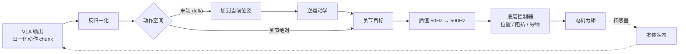

# 动作表示：从模型输出到电机转动

> 模型吐出一串数字，机器人怎么知道这串数字是什么意思？这一章讲"动作"这个词在 VLA 里的精确含义，以及它如何一路传到电机。

## 学习目标

- 能区分关节空间动作和末端空间动作，说出各自优缺点
- 能解释绝对动作与相对（delta）动作的区别
- 能说出动作归一化的做法和为什么必须做
- 能画出从 VLA 输出到底层控制器的完整链路

## 前置知识

- 需要先读：[04 VLA 是什么](04-vla-concept.md)
- 建议先读：[06 数据集与数据采集](06-datasets-and-data-collection.md)

## 核心概念

| 术语 | 一句话解释 | 类比 |
|---|---|---|
| **关节空间** | 用每个关节的角度描述机器人姿态 | 用"肩抬 30°、肘弯 90°"描述手的位置 |
| **末端空间（笛卡尔空间）** | 用夹爪在三维世界的位置和朝向描述 | 直接说"手在桌面上方 10 厘米" |
| **位姿（pose）** | 位置（x, y, z）+ 朝向（三个旋转角或四元数） | 手在哪 + 手朝哪 |
| **delta 动作** | 相对当前位置的增量 | "再往前 2 厘米" |
| **绝对动作** | 目标的绝对坐标 | "去坐标 (0.5, 0.1, 0.3)" |
| **归一化** | 把不同量纲的动作缩放到 [-1, 1] | 把米、弧度都换算成百分比 |
| **逆运动学（IK）** | 从末端位姿反算关节角 | 知道手要去哪，算出肩和肘该怎么转 |
| **控制频率** | 每秒给机器人发几次目标 | 导航每秒播报几次 |

## 详细讲解

### 7.1 动作到底是什么

VLA 里的"动作"是一个固定维度的向量。以最常见的单臂 + 夹爪为例：

**末端空间（7 维）**：$[\Delta x, \Delta y, \Delta z, \Delta r_x, \Delta r_y, \Delta r_z, g]$
- 前 3 维：末端位置增量（米）
- 中间 3 维：末端旋转增量（轴角或欧拉角，弧度）
- 最后 1 维：夹爪指令（0 开 / 1 合，或连续开度）

**关节空间（7 + 1 维）**：$[q_1, \dots, q_7, g]$
- 7 个关节的目标角度（弧度），对应 7 自由度机械臂
- 1 维夹爪

| 空间 | 优点 | 缺点 | 使用者 |
|---|---|---|---|
| 末端空间 | 与机器人型号解耦，跨本体容易；直观 | 需要 IK，奇异位形附近不稳 | RT-1/2、OpenVLA、BridgeData |
| 关节空间 | 不需要 IK，动作唯一；适合双臂和灵巧操作 | 换机器人就不通用 | ALOHA/ACT、π0（部分平台） |

> 🔗 关联：以 Franka、Flexiv 这类 7 自由度机械臂为例，关节空间 7 维，末端空间 6 维 + 夹爪；世界模型需要在同一动作空间上预测未来，见 [WAM 世界模型](../../WAM/00-README.md)。

### 7.2 绝对 vs 相对

- **绝对动作**：目标关节角或末端位姿本身。优点是不累积误差；缺点是和机器人初始位置强绑定。
- **相对（delta）动作**：相对当前状态的变化量。优点是对初始位置更鲁棒、数值范围小；缺点是每一步的小误差会累积。

OpenVLA 和 BridgeData 用末端 delta；ACT / π0 在 ALOHA 上用关节绝对值。微调时**必须和预训练的约定一致**，否则模型学到的先验完全用不上。

### 7.3 归一化：所有维度一视同仁

位置增量通常在 ±0.05 米，旋转增量在 ±0.3 弧度，夹爪是 0/1。直接把这些数塞进同一个损失函数，模型会偏向数值大的维度。

标准做法：对每个维度按训练集统计量做变换。

- **均值-方差**：$\hat a = (a - \mu) / \sigma$
- **分位数缩放（OpenVLA / π0 用）**：用 1% 和 99% 分位数把动作映射到 [-1, 1]，忽略极端离群值

$$\hat a = 2 \cdot \frac{a - q_{1\%}}{q_{99\%} - q_{1\%}} - 1$$

推理时再反变换。`stats.json` 里存的就是这些 $\mu, \sigma, q$。

> ⚠️ 注意：归一化统计量是**模型的一部分**。换了数据集但忘了更新统计量，模型输出的动作会整体偏移，机器人可能猛地冲出去。

### 7.4 离散 vs 连续的具体实现

**离散化（范式 A）**：归一化到 [-1, 1] 后，均分成 256 个 bin，每个值取所在 bin 的编号作为 token。反量化时取 bin 中心。精度损失 = 范围 / 256，对 ±0.05 米的位移就是约 0.4 毫米，通常够用；但对夹爪开度这种只有 0/1 的维度会浪费。

**连续（范式 B）**：动作头直接回归归一化后的连续值，没有量化损失。π0 输出的是形状为 $(50, d)$ 的动作块，$d$ 是该机器人的动作维度；为了让不同机器人共用一个模型，统一补零到最大维度。

### 7.5 控制频率与 chunk

| 模型 | 推理频率 | chunk 长度 | 等效控制频率 |
|---|---|---|---|
| OpenVLA | 约 3~5 Hz | 1 | 3~5 Hz |
| ACT | 约 10 Hz 推理 | 50~100 | 50 Hz |
| π0 | 约 10 Hz 推理（73 ms/次，RTX 4090） | 50 | 50 Hz |

三件事要分清：
1. **数据采集频率**：录数据时每秒多少帧
2. **模型推理频率**：模型每秒能跑几次
3. **底层控制频率**：控制器给电机发指令的频率（通常 500~1000 Hz）

VLA 输出的 chunk 按采集频率解释（π0 的 50 步 = 1 秒），底层控制器在两个目标点之间做插值，以自己的高频率平滑跟踪。

### 7.6 完整链路



> 💡 要点：**VLA 只负责"想去哪"，控制器负责"怎么去"。**控制器的类型（纯位置 vs 阻抗）决定了机器人碰到东西时是硬顶还是柔顺，这在第 10 章会详细讲。

## 动手练习

1. 给定一条训练集动作数据（形状 `(N, 7)`），用 NumPy 计算 1% / 99% 分位数并做归一化，再反归一化检查误差。

<details><summary>参考做法</summary>

```python
import numpy as np
a = np.random.randn(1000, 7) * [0.02, 0.02, 0.02, 0.1, 0.1, 0.1, 0.5]
q1, q99 = np.percentile(a, 1, axis=0), np.percentile(a, 99, axis=0)
a_norm = 2 * (a - q1) / (q99 - q1) - 1
a_back = (a_norm + 1) / 2 * (q99 - q1) + q1
print(np.abs(a - a_back).max())   # 应接近 0
```
</details>

2. 一个 7 自由度机械臂，末端只有 6 个自由度（3 位置 + 3 旋转）。多出来的 1 个自由度意味着什么？

<details><summary>参考做法</summary>

同一个末端位姿对应无穷多组关节角（冗余自由度），IK 有多解。这既是优点（可以绕开障碍、避免奇异）也是麻烦（关节空间动作更唯一，末端空间动作需要 IK 选解策略）。
</details>

## 常见错误与排查

| 现象 | 原因 | 解决 |
|---|---|---|
| 机器人一启动就猛冲 | 归一化统计量不匹配 | 核对 stats 与模型版本；首次运行用低速模式 |
| 末端动作在某些姿态下抖动 | IK 奇异位形 | 限制工作空间，或改用关节空间动作 |
| 微调后动作幅度明显变小 | 预训练是 delta，微调数据是绝对（或反之） | 统一动作约定 |
| 动作执行"一顿一顿" | chunk 之间没有插值或时间集成 | 底层做插值；推理端做 temporal ensembling |
| 夹爪永远不闭合 | 夹爪维度归一化后阈值错误 | 检查反归一化后的夹爪值与控制器期望范围 |

## 小结

- 动作是固定维度向量，常见为末端 6 维 + 夹爪 1 维，或关节 7 维 + 夹爪。
- 末端空间跨本体通用但需 IK；关节空间无歧义但绑定机型。
- 绝对 / delta 和归一化方式必须与预训练一致，统计量是模型的一部分。
- VLA 以采集频率输出 chunk，底层控制器高频插值跟踪。

## 自测题

1. 为什么 OpenVLA 把动作归一化到 [-1, 1] 后再离散成 256 个 bin，而不是直接离散原始值？

<details><summary>答案</summary>原始各维量纲不同（米、弧度、0/1），直接均分 bin 会让小范围维度几乎全落在同一个 bin。先归一化保证每维都充分利用 256 个 bin。</details>

2. 采集频率 30 Hz、chunk 长度 30 的模型，一次推理覆盖多长时间？底层控制器 1000 Hz 时每两个动作点之间要插多少个中间点？

<details><summary>答案</summary>1 秒。1000 / 30 ≈ 33，每两个点之间约插 32 个中间点。</details>

3. 什么情况下关节空间动作比末端空间更合适？

<details><summary>答案</summary>双臂协作、灵巧操作、关节冗余多、不想处理 IK 多解问题，或数据采集本身就是主从臂（直接录到关节角）时。</details>

## 参考资料

- [OpenVLA 论文附录：动作离散化细节（arXiv）](https://arxiv.org/abs/2406.09246)
- [π0 论文：动作块与归一化（arXiv）](https://arxiv.org/abs/2410.24164)
- [ACT / ALOHA：关节空间 chunking 与 temporal ensembling（arXiv）](https://arxiv.org/abs/2304.13705)
- [Modern Robotics 教材（免费）](http://hades.mech.northwestern.edu/index.php/Modern_Robotics) —— 想系统学运动学 / IK 时看第 4~6 章
