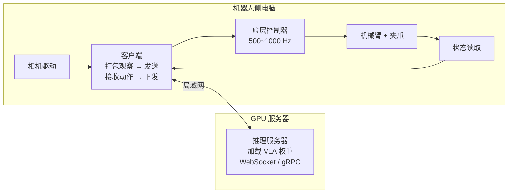

# 评估与部署：从成功率到真机运行

> 模型训练好了，怎么知道它好不好？怎么让它真的控制一台机器人？这一章讲评估指标、仿真基准、部署架构和安全。

## 学习目标

- 能解释成功率的定义和统计上的局限
- 能说出 LIBERO、SimplerEnv 的用途和仿真评估的意义与边界
- 能画出"推理服务器 + 机器人控制器"的部署架构
- 能列出真机部署必须具备的安全措施

## 前置知识

- 需要先读：[08 训练与微调](08-training-and-finetuning.md)

## 核心概念

| 术语 | 一句话解释 | 类比 |
|---|---|---|
| **成功率** | N 次试验中完成任务的比例 | 投篮命中率 |
| **仿真基准** | 在物理仿真器里标准化的任务集合 | 驾校模拟器考试 |
| **sim-to-real gap** | 仿真里好用、真机上不好用的差距 | 模拟器满分，上路翻车 |
| **推理延迟** | 从拿到图像到输出动作的时间 | 反应时间 |
| **推理服务器** | 跑模型的那台 GPU 机器，通过网络给机器人发动作 | 远程大脑 |
| **急停（E-stop）** | 一按就切断机器人动力的物理按钮 | 刹车 |

## 详细讲解

### 9.1 成功率：简单但要小心

VLA 论文几乎都用**成功率**：固定任务、固定初始条件分布，跑 N 次，数成功次数。

要注意的几点：

- **N 太小不可信**：10 次试验里 7 次成功，95% 置信区间大约是 35%~93%。论文里常见每个任务 10~50 次，比较两个模型时差 10 个百分点可能只是噪声。
- **部分成功**：长任务常用"子任务完成度"打分（如 5 步完成 3 步 = 0.6）。
- **初始条件要随机**：物体位置固定的话成功率会虚高。
- **分层评估**：OpenVLA 和 π0 都会分"见过的物体 / 没见过的物体 / 没见过的指令"分别报告，这才能反映泛化。

> 💡 要点：看论文结果时先找三个数：每个任务试了几次、初始条件怎么随机、泛化测试怎么分层。

### 9.2 仿真基准

真机评估贵且慢，所以社区建了标准化仿真基准：

| 基准 | 内容 | 用途 |
|---|---|---|
| **LIBERO** | 基于 robosuite，4 个套件（Spatial / Object / Goal / Long，各 10 个任务）+ LIBERO-90 | 评估微调后的泛化和长时程能力；OpenVLA、π0 都报告 LIBERO 分数 |
| **SimplerEnv** | 复现 Google 机器人和 WidowX 真机场景的仿真 | 直接用预训练 VLA 零样本评估，与真机成功率相关性较好 |
| **RoboCasa / ManiSkill** | 更大规模的仿真环境 | 大规模数据生成与评估 |

仿真的价值是**可重复、可大规模、免费**；局限是**物理和视觉都不够真**。一般流程：先在仿真上筛掉明显不行的方案，再上真机确认。

> 🔍 深入：OpenVLA 在 LIBERO 四个套件的平均成功率约 76%，π0 微调后可达 90% 以上，π0.5 更高。具体数值随版本变化，以各自论文 / 仓库为准。

### 9.3 推理延迟

真机上模型跑得多快，直接决定机器人动作是否流畅。

| 模型 | 硬件 | 延迟 / 频率 |
|---|---|---|
| OpenVLA 7B（bf16） | RTX 4090 | 约 6 Hz |
| OpenVLA 7B（int4） | RTX 4090 | 约 3~5 Hz，显存降到 8 GB |
| π0 | RTX 4090 | 约 73 ms / 次，配合 50 步 chunk 等效 50 Hz |

降低延迟的常见手段：量化（int8 / int4）、减少图像 token、缩短生成长度（范式 A）、action chunking、并行生成（π0-FAST 的 FAST token 化也是为了这个）。

### 9.4 部署架构

几乎所有真机部署都是"两台机器"：



- **推理服务器**：openpi 提供 `scripts/serve_policy.py`，OpenVLA 社区也有类似脚本。它只做一件事：收到观察（图像 + 状态 + 指令），返回动作 chunk。
- **客户端**：运行在机器人电脑上，负责相机采集、状态读取、调用服务器、把动作送给控制器。
- **控制器**：机器人厂商的 SDK 或 ROS 节点，负责高频插值和电机控制。

分开的好处：GPU 机器和实时控制机器各司其职；换模型只改服务器；实时控制不受模型推理抖动影响。

### 9.5 安全：上真机前的清单

> ⚠️ 注意：学习式策略可能输出任何动作。**第一次上真机前必须完成下面每一项。**

- [ ] 物理急停按钮在操作员手边，且测试过有效
- [ ] 软件层限制：关节限位、末端工作空间边界、最大速度 / 加速度
- [ ] 动作"限幅"：对模型输出做 clip，超出合理范围直接丢弃并停机
- [ ] 首次运行用 10~30% 速度缩放
- [ ] 看门狗：客户端若超过 N 毫秒没收到新动作，控制器自动减速停止
- [ ] 力 / 力矩阈值：碰撞力超过阈值立即停止（有 F/T 传感器时）
- [ ] 工作区内无人、无易碎物
- [ ] 记录每次运行的日志（观察、动作、时间戳），便于复盘

> 🔗 关联：世界模型可以在真机执行前先"想象"动作的后果，用作离线评估与安全检查，见 [WAM 世界模型](../../WAM/00-README.md)。

### 9.6 评估流程模板

1. 定义任务与成功标准（写下来，不要事后改）
2. 定义初始条件分布（物体位置范围、干扰物）
3. 每个条件至少 20 次试验，记录成功 / 失败 / 失败原因
4. 分层报告：训练分布内 / 分布外
5. 对比基线时用同样的条件和次数
6. 保存视频，失败案例逐个看

## 动手练习

1. 用 openpi 启动一个本地推理服务器，并用它自带的测试客户端发一帧随机观察，测量往返延迟。

<details><summary>参考做法</summary>

```bash
uv run scripts/serve_policy.py --env ALOHA_SIM   # 服务器
# 另一个终端，参考 examples/ 下的 client 代码，构造随机观察并计时
```

记录 10 次请求的平均延迟。首次请求会因为 JAX 编译慢很多，统计时去掉。
</details>

2. 写一个"动作限幅 + 看门狗"的伪代码。

<details><summary>参考做法</summary>

```python
last_recv = time.time()
while running:
    action = client.get_action(obs)        # 可能超时
    if action is None or time.time() - last_recv > 0.5:
        controller.stop(); break
    last_recv = time.time()
    action = np.clip(action, LOW, HIGH)
    if np.any(np.abs(action) > SAFETY_LIMIT):
        controller.stop(); break
    controller.send(action * SPEED_SCALE)
```
</details>

## 常见错误与排查

| 现象 | 原因 | 解决 |
|---|---|---|
| 仿真 90%，真机 30% | sim-to-real gap：视觉 / 物理 / 相机位置不同 | 用真机数据微调；相机位置与数据一致；域随机化 |
| 真机动作"卡顿" | 推理延迟 > chunk 覆盖时间，或网络抖动 | 增大 chunk；量化；有线网络 |
| 偶尔猛冲 | 模型输出异常值 | 动作限幅 + 速度缩放 |
| 成功率波动大 | 试验次数太少 | 每条件至少 20 次 |
| 换了光照就失败 | 训练时未做图像增强 | 开启颜色抖动等增强；补采不同光照数据 |

> 🔗 关联：在 UR 协作机械臂上部署策略的完整流程（控制频率、动作限幅、安全兜底）见 [UR 10 VLA 数据采集与部署](../../UR/10-vla-data-collection-and-deployment.md)。

## 小结

- 成功率要看试验次数、初始条件随机性和分层泛化测试。
- LIBERO / SimplerEnv 用于低成本筛选，但真机是最终标准。
- 部署 = 推理服务器（GPU）+ 机器人客户端 + 底层控制器，通过局域网连接。
- 安全清单每项都要做：急停、限位、限幅、速度缩放、看门狗、力阈值。

## 自测题

1. 两个模型在同一任务上各试 10 次，成功 7 次和 5 次。能说前者更好吗？

<details><summary>答案</summary>不能可靠地说。样本太少，置信区间重叠很大。需要至少几十次试验或多任务汇总才能得出有统计意义的结论。</details>

2. 为什么推理服务器和机器人控制要分在两台机器上？

<details><summary>答案</summary>GPU 推理有不可预测的延迟抖动，而底层控制需要严格实时；分开后控制器始终以固定频率运行，推理慢了只是动作更新变慢，不会让控制环崩溃。也便于换模型和复用服务器。</details>

3. 看门狗解决什么问题？

<details><summary>答案</summary>网络断开或推理挂掉时，机器人不会"执行最后一个动作直到撞墙"，而是在超时后自动停下。</details>

## 参考资料

- [LIBERO 基准（arXiv）](https://arxiv.org/abs/2306.03310) 与 [代码（GitHub）](https://github.com/Lifelong-Robot-Learning/LIBERO)
- [SimplerEnv（arXiv）](https://arxiv.org/abs/2405.05941) 与 [代码（GitHub）](https://github.com/simpler-env/SimplerEnv)
- [openpi 推理服务器与客户端示例（GitHub）](https://github.com/Physical-Intelligence/openpi/tree/main/examples)
- [OpenVLA 部署说明（GitHub）](https://github.com/openvla/openvla#deployment) —— 量化与推理示例
