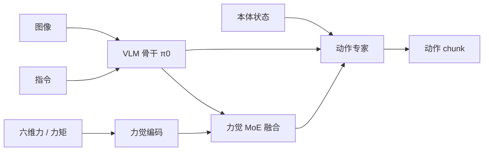

# 力觉与触觉感知：为什么只靠眼睛不够

> 插 USB、拧瓶盖、擦桌子——这些任务靠看是看不准的，必须"感觉到"接触力。这一章讲力觉信息从哪来、怎么用、怎么进入 VLA，为 ForceVLA 论文做铺垫。

## 学习目标

- 能举例说明什么是接触丰富任务，以及纯视觉 VLA 在这类任务上为什么失败
- 能解释六维力 / 力矩传感器输出的 6 个数各是什么
- 能用一句话区分阻抗控制和导纳控制
- 能说出力信息进入 VLA 的三种常见方式

## 前置知识

- 需要先读：[07 动作表示](07-action-representation.md)、[09 评估与部署](09-evaluation-and-deployment.md)

## 核心概念

| 术语 | 一句话解释 | 类比 |
|---|---|---|
| **接触丰富任务** | 任务的关键阶段机器人必须与环境持续接触、受力 | 插钥匙、拧螺丝、擦桌子 |
| **力 / 力矩传感器（F/T）** | 装在手腕上，测量三个方向的力和三个方向的力矩 | 手腕上的"触感神经" |
| **触觉传感器** | 装在指尖，测量接触面的压力分布 | 指尖皮肤 |
| **阻抗控制** | 让机器人表现得像"弹簧 + 阻尼"，受力会退让 | 握手时手会顺着对方的力 |
| **导纳控制** | 测到力后把它换算成位置修正 | 感觉到推力就往后挪一点 |
| **力觉信号时序** | 力的变化比图像快得多，几毫秒内就有意义 | 手一碰到东西立刻知道 |

## 详细讲解

### 10.1 纯视觉的盲区

前面章节的 VLA 输入都是"图像 + 状态 + 指令"。在抓取、搬运、放置这类任务上够用，因为关键信息（物体在哪）眼睛能看见。

但很多任务的关键信息**看不见**：

| 任务 | 看不见的信息 |
|---|---|
| 插 USB / 插头 | 插头是否对准孔？卡住了还是插进去了？ |
| 拧瓶盖 | 是否已经拧紧？拧过头了吗？ |
| 擦桌子 | 抹布压力够不够？ |
| 把插销推入盲孔 | 孔被遮挡，完全看不到 |
| 装配零件 | 零件之间有微小偏差，被手遮挡 |

纯视觉 VLA 在这些任务上的典型失败模式：**对准后一直往下压，不知道已经卡住，要么推不进要么把东西压坏。** 这正是 ForceVLA 论文开头描述的现象。

> 💡 要点：视觉告诉你"大概在哪"，力觉告诉你"碰到了没、碰得对不对"。接触丰富任务两者缺一不可。

### 10.2 六维力 / 力矩传感器

最常用的力觉设备是**六维力 / 力矩传感器**（6-axis F/T sensor），通常装在机械臂手腕和夹爪之间。它输出 6 个数：

$$\mathbf{F} = [F_x, F_y, F_z, \tau_x, \tau_y, \tau_z]$$

- $F_x, F_y, F_z$：三个方向的力（牛顿）
- $\tau_x, \tau_y, \tau_z$：绕三个轴的力矩（牛·米）

常见型号：ATI Mini45 / Gamma、Robotiq FT 300、Bota Systems。采样率一般 500~1000 Hz，远高于相机的 30 Hz。

使用时要注意：
- **重力补偿**：传感器会测到夹爪和工具自身的重量，必须根据当前姿态减掉。
- **零点漂移**：开机后要先在无接触状态下置零。
- **噪声**：高频信号噪声大，通常做低通滤波。

> 🔍 深入：有些机械臂（如 Franka、Flexiv）没有外部 F/T 传感器也能估计外力——通过关节力矩传感器或电机电流 + 动力学模型反算。精度不如专用传感器，但不用额外硬件。

### 10.3 底层如何用力：阻抗与导纳

VLA 输出的是位置 / 速度目标。碰到东西时，纯位置控制器会"死命"把末端推到目标点，导致巨大的接触力。所以接触丰富任务的底层控制器通常是：

**阻抗控制（Impedance Control）**：把机器人建模成一个"虚拟弹簧-阻尼器"：

$$\mathbf{F} = K(\mathbf{x}_d - \mathbf{x}) + D(\dot{\mathbf{x}}_d - \dot{\mathbf{x}})$$

$K$ 是刚度、$D$ 是阻尼。刚度越小，机器人越"软"，受力时偏离目标越多但接触力越小。适合有力矩控制接口的机器人（Franka、Flexiv 等）。

**导纳控制（Admittance Control）**：先用 F/T 传感器测到外力，再根据外力算出一个位置修正量，叠加到目标位置上。适合只有位置控制接口的工业机器人。

两者是"一体两面"：阻抗输入位置、输出力；导纳输入力、输出位置。

> 🔗 关联：力信号同样可以作为世界模型的输入，去预测"接触之后会发生什么"，见 [世界模型 × VLA](../../WAM/05-world-models-meet-vla.md)。

### 10.4 力信息怎么进入 VLA

三种常见方式，由浅到深：

**方式 1：只在底层用**
VLA 不看力，只是底层换成阻抗控制。简单，能避免压坏东西，但 VLA 不知道"卡住了"，不会调整策略。

**方式 2：拼到本体状态里**
把 6 维力直接拼到 state 向量后面一起喂给模型。实现简单，但力信号是高频、瞬态的，而模型看的是和图像同频的快照，容易"没看到"关键瞬间；而且力的数值范围和关节角差异很大。

**方式 3：专门的力觉模块**
给力信号单独的编码器和融合机制，让模型能根据力的变化动态决定"现在该相信视觉还是相信力觉"。这是 ForceVLA 的做法：它在 π0 的基础上加了一个**力觉感知的混合专家（FVLMoE）**模块，在动作解码阶段把力特征和视觉-语言特征融合，由路由器动态选择专家。论文报告在插拔、擦拭等 5 个接触丰富任务上，平均成功率比 π0 基线提升约 23 个百分点。



> 🔗 关联：ForceVLA 的完整拆解（模块设计、数据集、实验、复现）见 [ForceVLA 论文专题](../ForceVLA/00-README.md)。读之前确保已理解本章和 [04 VLA 是什么](04-vla-concept.md) 中 π0 的动作专家结构。

### 10.5 触觉传感器一瞥

F/T 传感器测的是手腕处的合力，分不清"哪根手指碰到了什么"。**触觉传感器**（如 GelSight、DIGIT 这类基于相机的指尖传感器）能给出接触面的高分辨率压力 / 形变图像。它们的输出本身就是图像，可以直接当成另一路视觉输入喂给 VLA。目前触觉 VLA 还在早期，但是明显的发展方向。

### 10.6 采集带力的数据

要训练力觉 VLA，数据里必须有力信号，这给采集带来新要求：

- F/T 数据和图像、动作要**严格时间对齐**（力的采样率高，通常取每个图像帧时刻附近的均值或最近样本）
- 遥操作时操作员最好也能"感到力"（力反馈主手），否则示范里的力控行为不自然
- 要**故意包含失败和恢复**：对不准 → 感到阻力 → 微调 → 插入成功，这样模型才能学到"卡住时怎么办"

## 动手练习

1. 列出你所在实验室 / 项目中三个任务，判断每个是否属于接触丰富任务，以及纯视觉 VLA 是否足够。

<details><summary>参考做法</summary>

例：
- 把零件从料盘放到夹具：不是接触丰富，纯视觉够。
- 把零件压入过盈配合孔：接触丰富，需要力觉。
- 拧紧螺丝到指定力矩：接触丰富，而且"指定力矩"只能靠力觉判断。
</details>

2. 用 NumPy 模拟一个 1000 Hz 的力信号（含噪声）和 30 Hz 的图像时间戳，写出"每个图像帧取最近 33 ms 内力的均值"的对齐代码。

<details><summary>参考做法</summary>

```python
import numpy as np
t_ft = np.arange(0, 10, 0.001); f = np.sin(t_ft) + 0.1*np.random.randn(len(t_ft))
t_img = np.arange(0, 10, 1/30)
aligned = [f[(t_ft > t - 0.033) & (t_ft <= t)].mean() for t in t_img]
```
</details>

## 常见错误与排查

| 现象 | 原因 | 解决 |
|---|---|---|
| 力传感器空载也有读数 | 未做重力补偿 / 未置零 | 开机置零；按姿态补偿工具重量 |
| 模型拼了力信号但效果没变化 | 力信号被归一化到接近 0，或采样时刻错过接触瞬间 | 单独归一化力；用窗口统计量（均值 / 最大值）而非单点 |
| 阻抗控制下机器人"软得拿不动东西" | 刚度设太低 | 分方向设刚度：接触方向软，其他方向硬 |
| 插入任务里机器人把插头压坏 | 底层仍是纯位置控制 | 换阻抗 / 导纳控制，并设力阈值停机 |

> 🔗 关联：UR e-Series 末端自带六维力/力矩传感器，读数方式、零漂处理和力控模式见 [UR 09 力传感与力控](../../UR/09-force-sensing-and-force-mode.md)。

## 小结

- 接触丰富任务的关键信息看不见，纯视觉 VLA 会"盲压"。
- 六维 F/T 传感器给出 3 力 + 3 力矩，需重力补偿、置零、滤波。
- 阻抗控制让机器人像弹簧一样柔顺；导纳控制把测到的力换成位置修正。
- 力进入 VLA 的三种方式：只在底层用、拼进状态、专门的融合模块（ForceVLA）。

## 自测题

1. 为什么把 6 维力直接拼进 state 向量效果往往不好？

<details><summary>答案</summary>力信号高频、瞬态，关键信息在变化中而非某个快照；拼进 state 后只能看到与图像同频的单点值，并且数值范围与关节角差异大，容易被模型忽略。</details>

2. 阻抗控制中刚度 $K$ 调小会带来什么后果？

<details><summary>答案</summary>机器人更柔顺，受外力时偏离目标更多、接触力更小；但精度和抗干扰能力下降，可能拿不稳重物。</details>

3. ForceVLA 和"只换阻抗控制器"的本质区别是什么？

<details><summary>答案</summary>阻抗控制只让底层在碰到东西时不硬顶，但策略本身不知道发生了接触；ForceVLA 把力信息送进策略，模型能根据力的变化改变高层动作（如重新对准、换抓法）。</details>

## 参考资料

- [ForceVLA 论文（arXiv）](https://arxiv.org/abs/2505.22159) —— 本章的直接后续
- [π0 论文（arXiv）](https://arxiv.org/abs/2410.24164) —— ForceVLA 的基座，先看动作专家部分
- [ATI 六维力传感器产品页](https://www.ati-ia.com/products/ft/sensors.aspx) —— 看参数表理解量程与分辨率
- [GelSight 触觉传感器](https://www.gelsight.com/) —— 基于相机的触觉感知
- [Modern Robotics 第 11 章：力控制](http://hades.mech.northwestern.edu/index.php/Modern_Robotics) —— 阻抗 / 导纳控制的系统讲解
