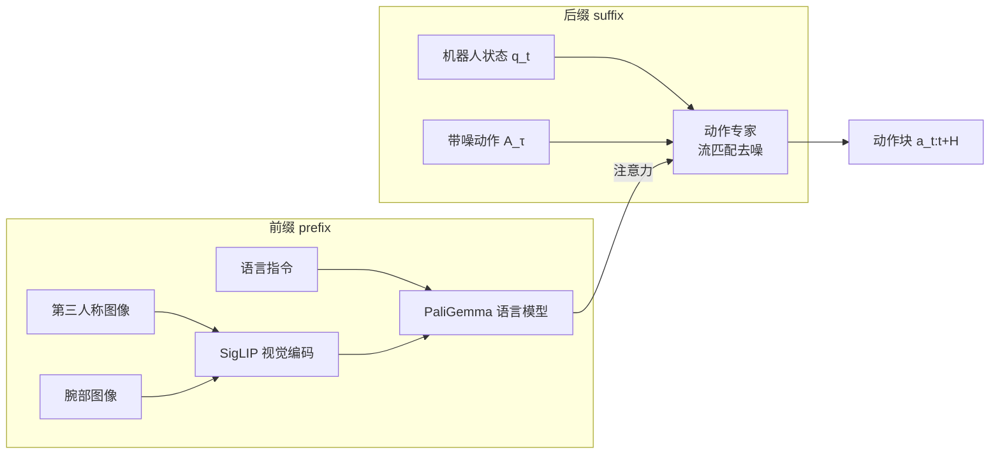
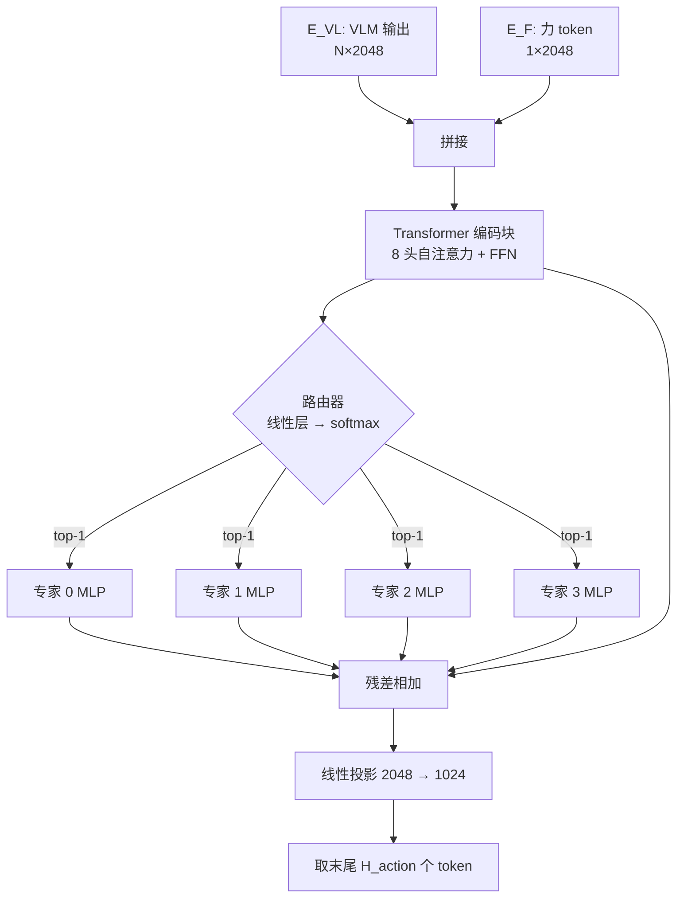

# 方法详解：π0 骨干 + FVLMoE 力感知融合

> 本章把 ForceVLA 拆成"输入 → 处理 → 输出"的流水线，逐模块讲清楚力信号从传感器一路走到机器人动作的全过程。

## 学习目标

- 能画出 π0 的两段式结构（VLM 骨干 + 动作专家），并指出 FVLMoE 插在哪里。
- 能写出力编码和 FVLMoE 的张量维度变化（6 → 2048 → 1024）。
- 能解释路由器如何选专家、残差连接的作用。
- 能复述训练配置（优化器、学习率、步数、精度），并知道单任务与多任务训练的差别。

## 前置知识

- 需要先读：[02 背景与动机](02-background-and-motivation.md)、[VLA 基础：代表性模型（π0）](../Basic/05-representative-models.md)
- 建议先读：[Transformer 与多模态](../Basic/03-transformers-and-multimodal.md)

## 核心概念

| 术语 | 一句话解释 | 类比 |
|---|---|---|
| **π0** | Physical Intelligence 提出的 VLA：PaliGemma VLM + 流匹配动作专家 | 一个"看图说话"的大脑 + 一个"画动作曲线"的小脑 |
| **VLM 骨干** | 处理图像和文本的预训练模型（PaliGemma，视觉编码器为 SigLIP） | 大脑的视觉与语言皮层 |
| **动作专家**（action expert） | 一个较小的 Transformer，根据 VLM 特征生成动作块 | 小脑 |
| **流匹配**（flow matching） | 从随机噪声逐步"流"向真实动作的生成方法 | 把一团乱线慢慢拉直成目标曲线 |
| **后缀特征**（suffix features） | π0 中由机器人状态和带噪动作组成的 token 序列 | 小脑收到的"当前身体状态 + 草稿动作" |
| **力 token** | 6 维力经过线性层后得到的一个 2048 维向量 | 把"手感"翻译成大脑能懂的一个词 |
| **TCP** | Tool Center Point，工具中心点，即末端执行器的参考点 | 手指尖 |

## 详细讲解

### 3.1 π0 回顾：两段式结构



- **前缀**：图像和文字经 VLM 得到视觉-语言特征 E_VL。
- **后缀**：状态和"加了噪声的动作草稿"进入动作专家，动作专家通过注意力读取前缀特征，输出去噪方向，迭代若干步后得到干净的动作块。

> 🔍 深入：论文表 4 给出 D_action = 32、D_act_e = 1024（动作专家隐层维度）；动作块长度 H_action、去噪步数、噪声调度论文正文没写，默认沿用 π0。

### 3.2 力的来源与编码

**输入**：f_t ∈ R^6 = (F_x, F_y, F_z, M_x, M_y, M_z)，论文定义为"作用在 TCP 上、在世界坐标系下表示的**估计**外力/力矩"。

> ⚠️ 注意："估计"意味着它不是独立 F/T 传感器的直接读数（Flexiv Rizon 通过关节力矩传感器反推末端外力）。这既是优点（不用额外传感器）也是作者承认的局限（精度有限）。

**编码**：一个线性投影 φ_F，把 6 维映射到 D_model = 2048 维，得到一个力 token E_F。

```python
# 伪代码（维度示意，非官方实现）
E_F = W_F @ f_t + b_F        # (6,) -> (2048,)
E_in = concat([E_VL, E_F])    # (N_VL + 1, 2048)
```

### 3.3 FVLMoE 模块



逐步说明：

| 步骤 | 输入 | 处理 | 输出 | 设计理由 |
|---|---|---|---|---|
| 拼接 | E_VL (N×2048)、E_F (1×2048) | 序列维度拼接 | (N+1)×2048 | 让力 token 能和每个视觉-语言 token 做注意力 |
| Transformer 块 | (N+1)×2048 | 8 头自注意力 + 前馈网络 | (N+1)×2048 | 让视觉特征"知道"当前受力，力也"知道"看到了什么 |
| 路由 | 每个 token | 线性层打分 → softmax → 取最大 | 专家编号 | 稀疏计算，不同 token 走不同专家 |
| 专家 MLP | 被路由到的 token | 对应专家的 MLP | 同维度 | 4 个专家各自学习不同接触模式 |
| 残差 | 专家输出 + Transformer 块输出 | 相加 | (N+1)×2048 | 即使路由不好也不丢信息，训练更稳 |
| 投影 | 2048 | 线性层 | 1024 | 对齐动作专家的隐层维度 |

### 3.4 注入动作头

FVLMoE 输出序列的**末尾 H_action 个 token** 被取出，与 π0 后缀特征（状态 + 第 τ 步去噪的带噪动作）**逐元素相加**，然后送入流匹配动作专家。

为什么是"相加"而不是"拼接"？相加不改变序列长度，动作专家结构完全不用动；这正是"可插拔"的来源。

### 3.5 为什么晚期融合

论文 §5.4 的消融给出了直接证据：

| 融合位置 | 成功率 |
|---|---|
| 不用力（π0） | 45% |
| VLM **之前**线性注入 | 55% |
| VLM **之前**用 MoE | 0% |
| VLM **之后**直接拼接 | 60% |
| VLM **之后**用 FVLMoE（本文） | 80% |

结论：在 VLM 前动手会破坏预训练表示（MoE 前置甚至彻底失败）；VLM 后融合安全，再加专家路由还能再提 20 个百分点。

> 💡 要点：FVLMoE 的两个关键词——**晚期**（保护预训练）和**专家**（按阶段分工）。

### 3.6 训练流程

| 项目 | 设置 |
|---|---|
| 起点 | π0 框架（代码基于 openpi），加载预训练权重后微调 |
| 数据 | ForceVLA-Data，每任务约 50 条演示 |
| 优化器 | Adam，β1 = 0.9，β2 = 0.95 |
| 学习率 | 峰值 2.5×10⁻⁵，30k 步内衰减到 2.5×10⁻⁶ |
| 精度 / 裁剪 | bfloat16；梯度范数裁剪 1.0 |
| 多任务 | 2 张 RTX 4090（24 GB），数据并行，30k 步约 12 小时 |
| 单任务 | 1 张 RTX 4090，10k 步约 9 小时 |
| 损失 | 论文未显式写出；沿用 π0 的流匹配损失（预测速度场的 MSE） |

公开仓库提供 `forcevla_lora` 配置，用 **LoRA**（低秩适配，只训练少量新增参数）微调，显存需求 >22.5 GB；全量微调 >70 GB。

> ❓ 待解决：论文和仓库均未说明 MoE 是否使用负载均衡损失、路由器是否加噪声（noisy gating）。需要读 `openpi` 源码中的 MoE 实现确认。

## 动手练习

1. 手算维度：假设 VLM 输出 N = 300 个 token，H_action = 50。写出 FVLMoE 每一步的张量形状。
<details><summary>参考做法</summary>
拼接后 301×2048 → Transformer 块 301×2048 → MoE（每 token 走 1 个专家）301×2048 → 残差 301×2048 → 投影 301×1024 → 取末尾 50 个 → 50×1024，与后缀特征 50×1024 相加。
</details>

2. 画出"把力在 VLM 之前注入"的框图，并解释为什么 MoE 前置会导致 0% 成功率。
<details><summary>参考做法</summary>
前置意味着力 token 和图像 token 一起进入 PaliGemma；随机初始化的 MoE 输出扰动了 VLM 输入分布，预训练权重无法适应，微调数据又太少（每任务 50 条），导致整体崩溃。
</details>

## 常见错误与排查

| 现象 | 原因 | 解决 |
|---|---|---|
| 以为 FVLMoE 替换了动作专家 | 看图不仔细 | FVLMoE 在 VLM 与动作专家之间，输出**加到**后缀特征上，动作专家不变 |
| 把"4 个专家"理解为 4 个完整模型 | 混淆专家与模型 | 每个专家只是一个 MLP 层，共享前后所有结构 |
| 复现时显存溢出 | 用全量微调 | 改用仓库的 `forcevla_lora` 配置 |

## 小结

- ForceVLA = π0 + 力线性编码 + FVLMoE（Transformer 块 → 4 专家 top-1 MoE → 投影），输出加到后缀特征上。
- 力只占 1 个 token，但通过自注意力影响所有视觉-语言 token。
- 晚期融合保护 VLM 预训练表示；专家路由让模型按接触阶段切换。
- 训练是标准 π0 微调配方，30k 步，2 张 4090 约 12 小时。

## 自测题

1. 力 token 的维度变化路径是什么？
<details><summary>答案</summary>6 →（线性 φ_F）→ 2048 →（FVLMoE 内部保持 2048）→（线性投影）→ 1024。</details>

2. FVLMoE 的输出如何进入动作专家？
<details><summary>答案</summary>取输出序列末尾 H_action 个 token，与 π0 的后缀特征（状态 + 带噪动作）逐元素相加，再进入流匹配动作专家。</details>

3. 消融中成功率为 0% 的配置是哪一个？说明了什么？
<details><summary>答案</summary>"VLM 之前用 MoE 融合"。说明在预训练 VLM 前端插入随机初始化的复杂模块会破坏其表示，微调无法恢复。</details>

## 参考资料

- [ForceVLA 论文 §4 方法、§5.4 消融](https://arxiv.org/html/2505.22159v3) —— 本章数字与结构来源
- [π0 论文（Physical Intelligence）](https://arxiv.org/abs/2410.24164) —— 理解 VLM + 流匹配动作专家
- [ForceVLA 代码仓库](https://github.com/ft-robotic/ForceVLA) —— `forcevla_lora` 配置与训练脚本
- [VLA 基础：训练与微调](../Basic/08-training-and-finetuning.md) —— LoRA 与微调通识
