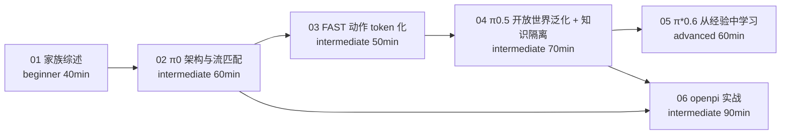

# π 系列模型专题目录

> **π 系列**是 Physical Intelligence（简称 PI）公司从 2024 年 10 月起发布的一组通用机器人基座模型：π0、π0-FAST、π0.5、π0.6 / π*0.6。它们是目前最有影响力的 VLA（视觉-语言-动作）模型家族，也是本知识库里 ForceVLA 论文的基座。本专题把这一家族按"一代解决一个问题"的线索讲清楚，并教你用开源的 openpi 跑起来。

## 1. 主题简介

学完本专题你能够：

- 说出 π0 → π0-FAST → π0.5 → π\*0.6 每一代**新增了什么、为了解决什么问题**，并能从对比表里查到骨干、动作表示、数据规模和开源情况。
- 画出 π0 的两段式结构（VLM 骨干 + 流匹配动作专家），解释流匹配为什么能输出 50 Hz 的平滑动作。
- 解释 FAST 为什么能把高频动作压缩成少量 token，以及它和流匹配的取舍。
- 解释 π0.5 的"异构数据协同训练 + 分层推理"和"知识隔离"如何带来开放世界泛化。
- 解释 π*0.6 的 RECAP 如何让 VLA 从自己的部署经验里继续变强。
- 用 openpi 下载权重、跑推理服务、在自己的数据上微调。

## 2. 学习路线

建议顺序：先读 01 建立全貌，再按 02 → 05 逐代深入；想先动手的读者在 02 之后可以直接跳到 06。零基础读者在本专题之前先完成 [VLA 基础](../Basic/00-README.md) 的 01~05、07 章。

## 3. 章节表格

| 章节 | 文件 | 类型 | 难度 | 预计时长 | 状态 |
|---|---|---|---|---|---|
| 00 目录 | `00-README.md` | index | all | 10min | draft |
| 01 π 系列家族综述 | [01-pi-series-overview.md](01-pi-series-overview.md) | tutorial | beginner | 40min | draft |
| 02 π0：VLM 骨干 + 流匹配动作专家 | [02-pi0-architecture-and-flow-matching.md](02-pi0-architecture-and-flow-matching.md) | tutorial | intermediate | 60min | draft |
| 03 FAST：把高频动作压缩成 token | [03-fast-action-tokenization.md](03-fast-action-tokenization.md) | tutorial | intermediate | 50min | draft |
| 04 π0.5：协同训练、分层推理与知识隔离 | [04-pi05-open-world-and-knowledge-insulation.md](04-pi05-open-world-and-knowledge-insulation.md) | tutorial | intermediate | 70min | draft |
| 05 π*0.6：用 RECAP 从经验中学习 | [05-pi06-learning-from-experience.md](05-pi06-learning-from-experience.md) | tutorial | advanced | 60min | draft |
| 06 openpi 实战：推理、微调与部署 | [06-openpi-hands-on.md](06-openpi-hands-on.md) | tutorial | intermediate | 90min | draft |

对应的论文笔记在论文库：[π0](../../Papers/VLA/02-pi0.md)、[FAST](../../Papers/VLA/03-fast.md)、[π0.5](../../Papers/VLA/04-pi05.md)、[知识隔离](../../Papers/VLA/05-knowledge-insulation.md)、[π*0.6](../../Papers/VLA/06-pi06.md)。每篇论文笔记都通过 `related` 挂回本专题的章节，章节底部会显示"📄 相关论文"。

## 4. 与其他主题的关系

- **前置**：[VLA 基础](../Basic/00-README.md)，尤其是 [04 VLA 是什么](../Basic/04-vla-concept.md)、[05 代表性模型](../Basic/05-representative-models.md)、[07 动作表示](../Basic/07-action-representation.md)。
- **后续**：[ForceVLA 论文专题](../ForceVLA/00-README.md) 在 π0 上加入力觉 MoE，读完本专题 02 章再看它的 [03 方法详解](../ForceVLA/03-method.md) 会轻松很多。
- **延伸**：π0.5 的"先预测子任务再输出动作"与 [世界模型 × VLA](../../WAM/05-world-models-meet-vla.md) 的分层思路相通；π*0.6 的强化学习与 [用世界模型做规划与控制](../../WAM/06-planning-and-control-with-world-models.md) 可以对照着读。
- **上真机**：openpi 自带 UR5 示例，和 [UR：VLA 数据采集与部署](../../UR/10-vla-data-collection-and-deployment.md) 配合使用。

> 🔗 关联：本专题的 `> ❓ 待解决：` 多为论文里只画在图中、没有写成数字的结果，以及各章对同一指标（如 π0 推理延迟）的不同说法；复核时以论文原文为准。
