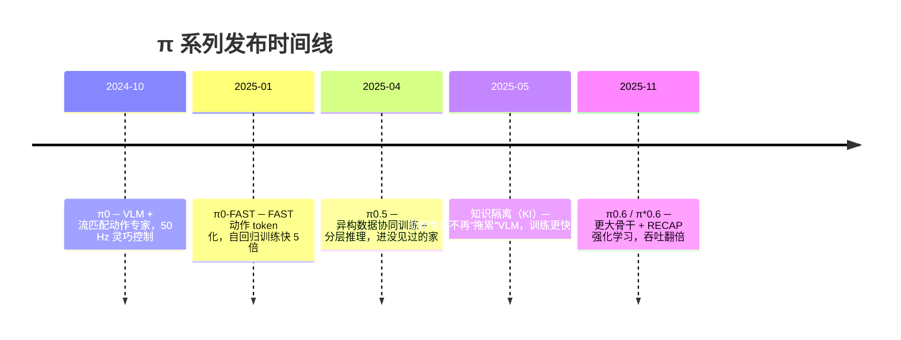

# π 系列家族综述：一代解决一个问题

> 这一章先不讲公式，只回答一个问题：**Physical Intelligence 为什么一年多里连发四代模型，每一代到底在修什么毛病？** 读完你会有一张"家谱"，后面几章讲到任何细节都知道它在家谱里的位置。

## 学习目标

- 能按时间顺序说出 π0 → π0-FAST → π0.5 → π*0.6 各自的核心改动和要解决的问题
- 能从对比表里查到每一代的骨干、动作表示、训练数据和开源情况
- 能解释"流匹配动作专家"和"FAST 离散 token"两条路线的取舍
- 能判断自己的项目该从哪一代、哪个权重入手

## 前置知识

- 需要先读：[04 VLA 是什么](../Basic/04-vla-concept.md)、[05 代表性模型](../Basic/05-representative-models.md)
- 建议先读：[07 动作表示](../Basic/07-action-representation.md)（知道"离散 token"和"连续动作头"是什么）

## 核心概念

| 术语 | 一句话解释 | 类比 |
|---|---|---|
| **Physical Intelligence（PI）** | 2024 年成立的美国公司，目标是做"能控制任何机器人做任何任务"的基座模型，π 系列是它的主线产品 | 机器人领域的"OpenAI 式"实验室 |
| **基座模型（foundation model）** | 在海量多样数据上预训练、再针对具体任务微调的通用模型 | 先读完大学通识课，再进公司做岗位培训 |
| **动作专家（action expert）** | π0 里专门负责把"看到的 + 听到的"变成连续动作的小 Transformer 分支 | 大脑（VLM）旁边的"小脑" |
| **流匹配（flow matching）** | 从随机噪声一步步"流"向真实动作的生成方法，扩散模型的高效变体 | 把一团乱线慢慢拉直成目标曲线 |
| **动作 token 化（action tokenization）** | 把连续动作变成离散符号，让模型像写文字一样"写动作" | 把一段录音转成乐谱 |
| **协同训练（co-training）** | 把机器人数据、网页图文、子任务标注等不同类型数据混在一起训练同一个模型 | 一门课同时布置实验、阅读和写作 |
| **RECAP** | π*0.6 的强化学习方法：用示范、人工纠正和自主经验一起训练"优势条件化"的策略 | 教练示范 → 纠错 → 自己练习 |

## 详细讲解

### 1.1 一张时间线

每一代都不是"推倒重来"，而是在上一代的基础上修一个明确的毛病：

| 代 | 发布 | 核心改动 | 它在修什么毛病 | 开源 |
|---|---|---|---|---|
| **π0** | 2024.10 | PaliGemma 3B VLM + 约 300M 流匹配动作专家，输出 50 步动作块 | 之前的 VLA（RT-2、OpenVLA）用离散 token 逐个生成动作，又慢又不够灵巧，做不了叠衣服这类任务 | openpi：`pi0_base` 等权重 |
| **π0-FAST** | 2025.01 | FAST 动作 token 化（DCT + BPE），同一骨干改成自回归解码 | 流匹配训练太贵；朴素 binning 在高频数据上完全学不会 | openpi：`pi0_fast_base`；HuggingFace 上的 FAST+ tokenizer |
| **π0.5** | 2025.04 | 协同训练多机器人、多环境、网页图文、子任务标注等异构数据；同一模型先用文字预测子任务，再用流匹配输出动作 | π0 只在训练过的环境附近好用，换一个没见过的家就不行 | openpi：`pi05_base`（用知识隔离训练） |
| **知识隔离** | 2025.05 | 骨干用 FAST 离散 token 学习，动作专家的梯度不回传给骨干，并与网页数据协同训练 | 直接把动作专家接到 VLM 上会拖慢训练、损伤 VLM 的语义知识 | 已用于 openpi 的 π0.5 权重 |
| **π0.6 / π*0.6** | 2025.11 | 骨干换成 Gemma 3 4B（博客称约 5B 的 VLM）、动作专家扩到 860M；RECAP 用离线强化学习预训练，再用部署中的纠正和自主经验继续训练 | 只靠模仿学习"有时成功"，做不到长时间可靠、高吞吐地工作 | ❓ 见下文 |

> ❓ 待解决：π0.6 / π*0.6 的权重截至本章撰写时未见在 openpi 公开，是否开源以 openpi 仓库为准。

### 1.2 π0：先把"手"做灵巧

π0 的出发点是：**VLM 已经很会"看"和"听"，缺的是一双灵巧的手**。它保留了预训练的 PaliGemma（3B）负责理解图像和指令，另外加一个只有约 300M 参数的动作专家，用流匹配一次生成 50 步（按 50 Hz 算就是 1 秒）的连续动作块。训练数据约 1 万小时，来自 PI 自己的 7 种机器人配置（UR5e、双臂 UR5e、Franka、双臂 Trossen、双臂 ARX、移动 Trossen、移动 Fibocom）加上开源的 Open X-Embodiment。

结果是它能叠衣服、收拾餐桌、装纸箱——这些任务 OpenVLA 和 Octo 在 PI 的评测里几乎得零分。细节见 [02 π0 架构与流匹配](02-pi0-architecture-and-flow-matching.md)。

**留下的毛病**：流匹配训练贵；换到没见过的环境泛化不足。

### 1.3 π0-FAST：让"写动作"也行得通

离散 token 路线有个天然优势：训练流程和训练语言模型一模一样，简单、快、还能更好地继承 VLM 的语言能力。问题出在**怎么切 token**：RT-2 / OpenVLA 那种"每一维每一步切 256 档"的做法，在 50 Hz 的数据上相邻动作几乎一样，模型只要学会"抄上一步"就能把损失降到很低，结果什么技能都学不会。

FAST 借用 JPEG 的思路：先对动作序列做**离散余弦变换**（DCT）把它变成少数几个频率系数，再用 **BPE** 压缩成 token，每个动作块通常只剩 30~60 个 token，比朴素切档少约 10 倍。用 FAST 训练的 π0-FAST 效果追平 π0，训练快 5 倍，还第一次在 DROID 数据集上训出了能在陌生环境里零样本跟随语言指令的策略。代价是自回归解码慢（每个动作块约 750 ms，流匹配约 100 ms）。细节见 [03 FAST 动作 token 化](03-fast-action-tokenization.md)。

### 1.4 π0.5：进一个没见过的家

π0.5 的目标不是更灵巧，而是**泛化**：把机器人放进一个训练数据里从未出现的家，让它收拾厨房、铺床。做法是"协同训练"——把约 400 小时、来自约 100 个家的移动操作数据，和其他机器人的数据、网页图文数据、"下一步该做什么"的子任务标注、人工口头指令一起训练；推理时同一个模型先用文字说出子任务（"拿起枕头"），再用流匹配动作专家输出动作。消融实验显示：去掉网页数据，陌生物体的成功率从 94% 掉到 74%；去掉多环境数据掉到 31%。

一个月后的**知识隔离**论文解释了 π0.5 训练配方里的一个关键细节：动作专家的梯度如果回传到 VLM 骨干，会把骨干的语义知识"洗掉"；把它隔离开，训练更快、泛化更好。openpi 里的 `pi05_base` 就是这么训的。细节见 [04 π0.5 与知识隔离](04-pi05-open-world-and-knowledge-insulation.md)。

### 1.5 π*0.6：从自己的经验里继续变强

前三代都只用人类示范做监督学习。π*0.6 指出这条路的天花板：模仿学习的策略会犯小错，小错把机器人带进训练数据里没有的状态，接着犯更大的错（**复合误差**）。RECAP 把三种数据一起用起来——示范、机器人跑偏时专家接管的纠正、机器人自己跑出来的经验——训练一个价值函数判断"每一步让任务更接近完成还是更远"，再把"这一步好不好"作为条件输入策略。结果在最难的任务（做意式咖啡）上吞吐量翻倍以上、失败率减半，并能连续工作一整天。细节见 [05 π*0.6 从经验中学习](05-pi06-learning-from-experience.md)。

### 1.6 两条路线怎么选

| | 流匹配动作专家（π0、π0.5 低层） | FAST 离散 token（π0-FAST、π0.5 高层 / 预训练） |
|---|---|---|
| 训练 | 慢、贵 | 快约 5 倍，流程和训练 LLM 一样 |
| 推理 | 快（几十到一百毫秒一个动作块） | 慢（自回归逐 token 解码） |
| 语言跟随 | 一般 | 更好（动作和文字共用一套机制） |
| 适合 | 真机部署、高频灵巧任务 | 大规模预训练、需要强语言理解 |

π0.5 的答案是**两个都要**：预训练阶段用 FAST token 让骨干学得又快又好，后训练阶段再加流匹配动作专家负责真机上的快速输出。

> 💡 要点：π 系列的主线可以概括成一句话——**先用流匹配把手做灵巧（π0），再用 token 化把训练做便宜（FAST），再用协同训练把泛化做出来（π0.5），最后用强化学习把可靠性做上去（π*0.6）**。

### 1.7 该从哪一代入手

| 你的目标 | 建议 |
|---|---|
| 在自己的机械臂上微调一个能用的策略 | `pi05_base`（openpi），用流匹配头；见 [06 openpi 实战](06-openpi-hands-on.md) |
| 复现 ForceVLA 等基于 π0 的论文 | `pi0_base`，先读 [02 章](02-pi0-architecture-and-flow-matching.md) 再读 [ForceVLA 方法详解](../ForceVLA/03-method.md) |
| 想要强语言跟随、在 DROID 平台上零样本试用 | `pi0_fast_droid` 或 `pi05_droid` |
| 研究强化学习微调 VLA | 读 [05 章](05-pi06-learning-from-experience.md)，权重暂不可得时可在 π0.5 上复现 RECAP 思路 |

## 动手练习

1. 打开 openpi 仓库的 README，把"Base Models"和"Fine-Tuned Models"两张表里的权重按"属于哪一代"分组。

参考做法

- π0：`pi0_base`、`pi0_droid`、`pi0_aloha_towel`、`pi0_aloha_tupperware`、`pi0_aloha_pen_uncap`
- π0-FAST：`pi0_fast_base`、`pi0_fast_droid`
- π0.5：`pi05_base`、`pi05_libero`、`pi05_droid`
以仓库当前列表为准。

2. 用一句话分别写出四代模型"修的毛病"，不看本章对比表。

参考做法

π0：离散 token 太慢太粗，做不了灵巧任务；π0-FAST：流匹配训练贵、朴素切档学不会高频动作；π0.5：换个没见过的环境就不行；π*0.6：只靠模仿做不到稳定可靠、高吞吐。

## 常见错误与排查

| 现象 | 原因 | 解决 |
|---|---|---|
| 以为 π0.5 只是"更大的 π0" | 参数量差不多，变化在数据配方和推理方式 | 看 1.4 节：协同训练 + 分层推理 + 知识隔离 |
| 以为 FAST 是为了推理更快 | FAST 压缩的是 token 数，推理仍是自回归，比流匹配慢 | 看 1.6 节的对比表 |
| 把 π\*0.6 和 π0.6 混为一谈 | π0.6 是监督学习的基座，π\*0.6 是在它上面用 RECAP 强化学习得到的模型 | 带星号 = 经过强化学习 |
| 直接拿 `pi0_base` 上自己的机器人 | 基座权重只覆盖 PI 的机器人配置和相机布局 | 几乎总要微调，见 06 章 |

## 小结

- π 系列四代各修一个毛病：灵巧（π0）→ 训练效率（π0-FAST）→ 开放世界泛化（π0.5 + 知识隔离）→ 可靠性与吞吐（π*0.6）。
- 流匹配动作专家与 FAST 离散 token 各有取舍，π0.5 把两者合在一个模型里。
- 开源的 openpi 提供 π0 / π0-FAST / π0.5 的基座与微调权重，是上手的入口。

## 自测题

1. π0 为什么要在 VLM 之外单独加一个动作专家，而不是像 RT-2 那样直接让 VLM 输出动作 token？

答案
离散 token 逐个自回归生成，慢且有量化误差，难以支撑 50 Hz 的灵巧控制；动作专家用流匹配一次生成一整块连续动作，又快又平滑。

2. π0.5 推理时"同一个模型跑两次"分别在做什么？

答案
第一次用离散 token 输出高层子任务（一句话，如"拿起枕头"），第二次以这句话为指令，用流匹配动作专家输出 50 步连续动作块。

3. RECAP 里的"纠正数据"和普通示范数据有什么本质区别？

答案
纠正是在机器人自己执行、跑偏之后由专家接管采集的，覆盖的是策略真正会进入的状态；普通示范只覆盖人类操作时的状态，所以修不了复合误差。

## 参考资料

- [π0 论文（arXiv 2410.24164）](https://arxiv.org/abs/2410.24164) —— 家族起点，RSS 2025
- [FAST 论文（arXiv 2501.09747）](https://arxiv.org/abs/2501.09747) —— 动作 token 化
- [π0.5 论文（arXiv 2504.16054）](https://arxiv.org/abs/2504.16054) —— 开放世界泛化
- [知识隔离论文（arXiv 2505.23705）](https://arxiv.org/abs/2505.23705) —— 训练配方的关键细节
- [π*0.6 论文（arXiv 2511.14759）](https://arxiv.org/abs/2511.14759) —— 强化学习微调 VLA
- [Physical Intelligence 博客](https://www.pi.website/blog/pi0) —— 每一代都有一篇通俗介绍，带视频
- [openpi 代码库（GitHub）](https://github.com/Physical-Intelligence/openpi) —— 权重与训练 / 推理代码
