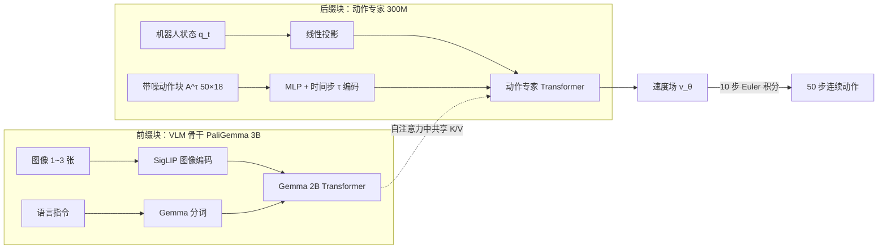

# π0：VLM 骨干 + 流匹配动作专家

> 这一章把 π0 拆开看：一个"会看图说话"的 3B 视觉语言模型，怎么接上一个"会画动作曲线"的小模型，再用 1 万小时机器人数据训练成能叠衣服、折纸箱的通用策略。后面的 π0-FAST、π0.5、π0.6 和 ForceVLA 都是在这张图上做加减法。

## 学习目标

- 能画出 π0 的两段式结构，说清楚图像、指令、状态、动作各自从哪里进、到哪里出
- 能写出流匹配的训练目标和推理时的 10 步积分，并解释为什么训练时偏爱"噪声大"的时间步
- 能说出预训练数据的规模、7 种机器人配置以及"按 $n^{0.43}$ 加权"的用意
- 能复述"预训练 → 后训练"配方和主要实验结论，知道 π0 比 OpenVLA、Octo 强在哪

## 前置知识

- 需要先读：[01 π 系列总览](01-pi-series-overview.md)、[VLA 基础 04 VLA 是什么](../Basic/04-vla-concept.md)、[VLA 基础 07 动作表示](../Basic/07-action-representation.md)
- 流匹配的直观理解可以先看 [VLA 基础 04](../Basic/04-vla-concept.md) 里"范式 B"的部分

## 核心概念

| 术语 | 一句话解释 | 类比 |
|---|---|---|
| **VLM 骨干（PaliGemma）** | 预训练好的视觉语言模型，负责"理解画面和指令" | 读过很多书的大脑 |
| **动作专家（action expert）** | 一套单独的 Transformer 权重，只处理机器人状态和动作 token | 专管手脚的小脑 |
| **流匹配（flow matching）** | 从一团随机噪声出发，沿着学到的"速度场"一步步走到真实动作 | 把乱线慢慢拉直成目标曲线 |
| **动作块（action chunk）** | 一次预测未来 $H=50$ 步动作，而不是只预测下一步 | 一次写完一整句话而不是逐字猜 |
| **分块因果掩码** | 图像文本、状态、动作三块之间"只能往前看" | 先读题目，再看自己的姿势，最后写答案 |
| **预训练 / 后训练** | 先用杂而多的数据学通用能力，再用少而精的数据学做好某个任务 | 先上通识课，再跟师傅学一门手艺 |

## 详细讲解

### 2.1 为什么要给 VLM 装一个"动作专家"

在 π0 之前，RT-2 和 OpenVLA 的做法是**把动作切成离散 token 让语言模型逐个吐出**。这对低频、简单的任务够用，但叠衣服需要每秒 50 次的连续控制，逐 token 自回归既慢又粗糙。π0 的回答是：**骨干照用 VLM，动作改用连续生成**。它受 Transfusion 启发，让动作 token 走流匹配损失；再给机器人专属的 token（状态和动作）单独一套权重，论文发现这比共用权重更好。这就是"动作专家"——结构上像只有两个专家的混合专家模型：图像和文本走大的 VLM 权重，状态和动作走小的动作专家权重，两者只在自注意力层里交换信息。

### 2.2 结构：3B 骨干 + 300M 专家

- **骨干**：PaliGemma，开源的 30 亿参数 VLM，基于 Gemma 2B 语言模型（宽度 2048、18 层、MLP 维度 16384），论文选它是因为"够小，能实时控制"。
- **动作专家**：从头初始化，宽度缩到 1024、MLP 维度 4096，共 3 亿参数，总计 **33 亿**。缩小它是因为推理时要跑 10 次前向，专家越小越快。
- **输入**：观测 $o_t = [I^1_t,\dots,I^n_t,\ell_t,q_t]$，每个机器人 2 或 3 张图、一句指令、一个关节角向量；不足 3 张图的槽位被掩码掉。
- **动作块**：$A_t=[a_t,\dots,a_{t+H-1}]$，$H=50$。状态和动作向量统一补零到数据集中最大的机器人维度 **18 维**（两条 6 自由度臂 + 2 个夹爪 + 底盘 + 可升降躯干）。
- **注意力掩码**：三块——`[图像, 文本]`、`[q_t]`、`[带噪动作]`。块内双向、块间只能看前面的块。图像文本不看后面是为了少改动 VLM 预训练时的分布；状态单独成块是因为它在 10 步积分里不变，键值可以缓存。
- **时间步注入**：每个带噪动作 $a^\tau$ 经 $W_3\cdot\text{swish}(W_2\cdot\text{concat}(W_1 a^\tau,\phi(\tau)))$ 变成 token，$\phi$ 是正弦位置编码。

> 💡 要点：π0 = "PaliGemma 原样保留 + 一个只有它十分之一大的动作专家"。ForceVLA 等后续工作改的都是后缀那一侧，前缀的 VLM 基本不动。

### 2.3 流匹配：训练目标与 10 步推理

**训练**。对真实动作块 $A_t$ 采一个噪声 $\epsilon\sim\mathcal N(0,I)$ 和时间步 $\tau\in[0,1]$，构造带噪动作 $A_t^\tau=\tau A_t+(1-\tau)\epsilon$，让网络预测"从噪声指向数据"的方向：

$$
L^\tau(\theta)=\mathbb E\,\big\|v_\theta(A_t^\tau,o_t)-u(A_t^\tau\mid A_t)\big\|^2,\qquad u(A_t^\tau\mid A_t)=A_t-\epsilon
$$

这里 $\tau=0$ 是纯噪声、$\tau=1$ 是真实动作。动作 token 之间用完全双向注意力。

**时间步怎么采**。原版流匹配均匀采 $\tau$，图像生成常用"偏向中间"的分布。π0 认为动作预测不一样：观测对动作的约束远强于文字对图片的约束，所以"从纯噪声猜出动作的均值"这件事本身就难、值得多练。于是用 $p(\tau)=\text{Beta}\!\big(\tfrac{s-\tau}{s};1.5,1\big)$，偏向**低 $\tau$（噪声大）**，并且 $\tau>s$ 的部分根本不采；$s=0.999$，意味着只要积分步长 $\delta>1/1000$ 就够用。

**推理**。从 $A^0\sim\mathcal N(0,I)$ 出发做前向 Euler：$A^{\tau+\delta}=A^\tau+\delta\,v_\theta(A^\tau,o_t)$，$\delta=0.1$，共 **10 步**。前缀（图像、文本、状态）的键值只算一次并缓存，每步只重算动作 token。

> 🔍 深入：论文在 RTX 4090 上用 3 张相机计时：图像编码 14 ms、观测前向 32 ms、10 次动作前向共 27 ms，**本机总计 73 ms**；离板经 Wi-Fi 再加 13 ms 网络延迟，共 86 ms。20 Hz 的 UR5e / Franka 每 0.8 秒（执行 16 步）重新推理一次，50 Hz 的机器人每 0.5 秒（执行 25 步）一次，动作块开环执行，不做时间集成（试过，反而变差）。

### 2.4 数据：1 万小时、7 种配置、68 个任务

预训练混合由两部分组成：

| 来源 | 份额 | 说明 |
|---|---|---|
| 开源数据：OXE、Bridge v2、DROID | 9.1% | 多为 1~2 个相机、2~10 Hz 低频控制，但物体和场景很广 |
| π 自有数据 | 其余 | **9.03 亿**时间步（单臂 1.06 亿、双臂 7.97 亿），约 1 万小时，68 个任务 |

这里的"任务"口径很宽：一个"bussing"任务就包含收拾各种盘子、杯子、餐具和垃圾。因为叠衣服这类难任务的数据特别多，每个"任务 × 机器人"组合按 $n^{0.43}$ 加权（$n$ 为样本数），把过多的压下去。

7 种机器人配置：UR5e（7 维）、双臂 UR5e（14 维）、Franka（8 维）、双臂 Trossen（ALOHA 式，14 维）、双臂 ARX / AgileX（14 维）、移动 Trossen / ARX（14 维状态、16 维动作）、移动 Fibocom（全向底盘，17 维动作）。语言标注既有任务名，也有约 2 秒一段的片段标注。

### 2.5 配方：预训练 → 后训练

论文照搬大模型的两阶段思路：

- **预训练**：数据杂、质量参差，目标是"什么都会一点、会从错误里恢复"。主模型训 **70 万步**。
- **后训练（post-training）**：用某个任务的高质量数据微调，目标是"做得流畅、稳定"。最简单的任务只需 **5 小时**数据，最复杂的要 **100 小时以上**。
- 两者缺一不可：只用高质量数据的模型脆、不会纠错；只有预训练的模型会做但不利索。

对照组 **π0-small**（4.7 亿参数）不用 VLM 初始化：DistilBERT 编码语言、ResNet-ViT 编码图像、DiT 动作专家用交叉注意力读观测，用来回答"VLM 预训练到底值多少"。

### 2.6 实验结论

**开箱评估**（预训练后直接用语言指令，每任务 10 次，满分 1.0 可得部分分）：

| 任务 | π0 | π0-small | OpenVLA（全混合） | OpenVLA（仅 UR5e） | Octo |
|---|---|---|---|---|---|
| Bussing Easy（UR5e） | 0.971 | 0.443 | 0 | 0.343 | 0.043 |
| Bussing Hard（UR5e） | 0.875 | 0.333 | 0 | 0 | 0 |
| Shirt Folding（双臂 ARX） | 1.000 | 0.500 | 0 | 0 | 0 |
| Grocery Bagging（UR5e） | 0.786 | 0.271 | 0 | 0 | 0 |
| Toast out of Toaster（双臂 Trossen） | 0.750 | 0 | 0 | 0 | 0 |

OpenVLA 和 Octo 都在同一混合上训练；OpenVLA 不支持动作块，Octo 表达能力有限。即使只训 16 万步的"算力对齐版"π0 也全面领先，π0-small 也强于两者——说明**大骨干 + 连续动作生成**和**VLM 预训练**都重要。

- **语言跟随**：π0 比 π0-small 明显更会听懂中间指令；人类专家或高层 VLM 逐步下指令都能提升表现，π0-small 听不懂、加了专家也不涨。
- **微调学新技能**（叠碗、叠毛巾、饭盒进微波炉、换纸巾卷、Franka 收抽屉）：对比 ACT、Diffusion Policy 和微调后的 OpenVLA、Octo，π0 总体最好；预训练在相似任务上收益最大，有时达到从头训练的 2 倍。
- **复杂长时程任务**（叠一筐衣服、卸烘干机、收真实餐桌、折纸箱、装鸡蛋等，耗时 5~20 分钟）：其他方法做不了。完整的"预训练 + 微调"在所有任务上拿到超过 50% 的满分，远好于只预训练或只微调。

> ⚠️ 注意：后三组实验的分数只画在论文图 9、11、13 里，正文没有数字；本章只转述结论，复现对比时请看原图。

> 🔗 关联：ForceVLA 正是在 2.2 节的"后缀块"上注入力信息，见 [ForceVLA 方法详解](../ForceVLA/03-method.md)；把连续动作换回离散 token 的尝试见 [03 FAST 动作 token 化](03-fast-action-tokenization.md)；想自己跑起来看 [06 openpi 上手](06-openpi-hands-on.md)。

## 动手练习

1. 用纸笔推一遍流匹配：取一维动作 $A=2$、噪声 $\epsilon=-1$，写出 $\tau=0.3$ 时的带噪动作 $A^\tau$ 和目标速度 $u$；再假设网络预测完美，从 $A^0=-1$ 出发用 $\delta=0.1$ 积分 10 步，验证终点。

参考做法

$A^{0.3}=0.3\times 2+0.7\times(-1)=-0.1$，$u=A-\epsilon=3$。完美预测时每步加 $0.1\times 3=0.3$，10 步共加 3，从 $-1$ 走到 $2$，正好是真实动作。

2. 打开 openpi 仓库的 `src/openpi/models/pi0.py`，找出三块注意力掩码是在哪一行构造的，并确认动作专家的宽度是否为 1024。

参考做法

在模型文件里搜索 `attn_mask` 或 `make_attn_mask`，可以看到前缀（图像 + 文本）、状态、动作三段的掩码；动作专家配置搜索 `gemma_300m` 或 `width=1024`。代码会随版本变化，以仓库当前实现为准。

## 常见错误与排查

| 现象 | 原因 | 解决 |
|---|---|---|
| 以为 π0 是"把 PaliGemma 整个微调成动作模型" | 忽略了独立的动作专家 | 记住两套权重只在自注意力里交互，动作专家从头初始化 |
| 把 $\tau=0$ 当成"干净动作" | 和扩散模型的习惯相反 | π0 约定 $\tau=0$ 纯噪声、$\tau=1$ 真实动作 |
| 推理频率只有 1~2 Hz 就以为模型太慢 | 混淆了"推理一次的耗时"和"多久推理一次" | 一次约 73 ms，但论文是每 0.5~0.8 秒推理一次、中间开环执行动作块 |
| 只用高质量数据微调，机器人一出错就卡死 | 跳过了预训练阶段 | 从预训练权重出发微调，保留纠错能力 |

## 小结

- π0 = PaliGemma 3B 骨干 + 300M 动作专家，总 3.3B；两套权重只在自注意力里交互，三块因果掩码。
- 动作块 $H=50$，流匹配训练偏向高噪声时间步（Beta 分布，$s=0.999$），推理 10 步 Euler，RTX 4090 上约 73 ms。
- 预训练 1 万小时、7 种机器人配置、68 个任务、开源数据占 9.1%，按 $n^{0.43}$ 加权。
- 预训练教"会做 + 会纠错"，后训练（5~100+ 小时）教"做得好"，两者缺一不可。
- 开箱评估大幅领先 OpenVLA 和 Octo，并能完成 5~20 分钟的叠衣服、折纸箱等长任务。

## 自测题

1. 为什么机器人状态 $q_t$ 要单独成一个注意力块？

答案
它在 10 步流匹配积分中保持不变，单独成块后其键值可以缓存，每步只需重算动作 token；同时它不被允许看到带噪动作，避免信息泄漏。

2. π0 的时间步采样为什么偏向噪声大的区间，而不是像图像生成那样偏向中间？

答案
论文认为观测对动作的约束很强，"从纯噪声直接估计动作均值"是难点，值得多训练；而高 $\tau$（接近干净动作）时网络几乎只需学恒等映射，所以 $\tau>s=0.999$ 的区间干脆不采。

3. "算力对齐版"π0 是什么？它的结果说明了什么？

答案
只训 16 万步的 π0，步数不超过基线（OpenVLA 16 万、Octo 32 万）。它仍然全面领先基线，说明优势来自架构（VLM 骨干 + 流匹配动作块）而不只是训练更久。

## 参考资料

- [π0 论文（arXiv 2410.24164，RSS 2025）](https://arxiv.org/abs/2410.24164) —— 附录 A-B 有完整架构参数，A-D 有推理耗时表
- [Physical Intelligence 博客：π0](https://www.pi.website/blog/pi0) —— 带视频的通俗介绍，开箱评估分数来自这里
- [openpi 代码库（GitHub）](https://github.com/Physical-Intelligence/openpi) —— 官方实现与权重
- [论文笔记：π0](../../Papers/VLA/02-pi0.md) —— 本章对应的完整论文笔记与复现清单
