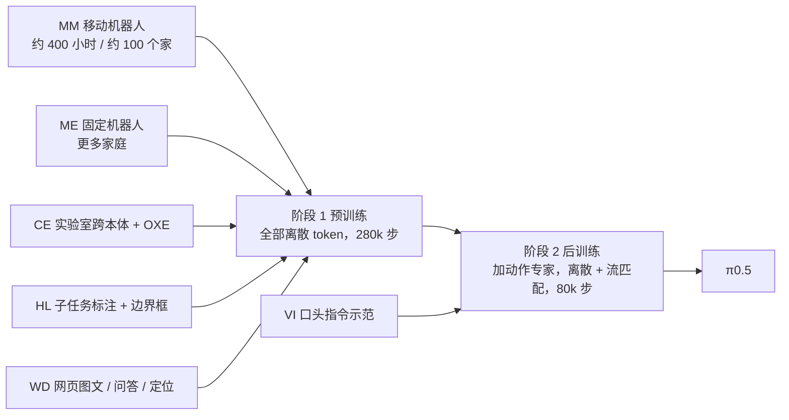
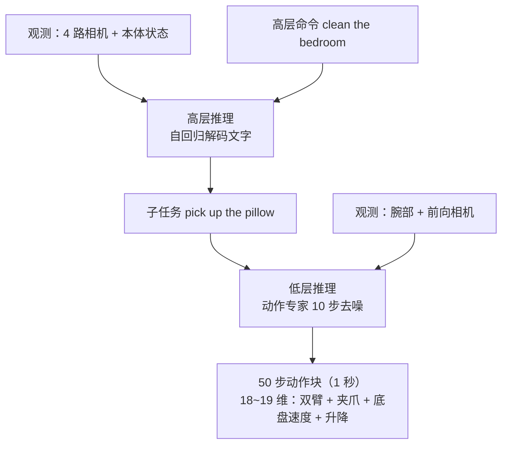

# π0.5：异构数据协同训练、分层推理与知识隔离

> π0 只在和训练数据很像的环境里好用；π0.5 要回答的是"把机器人推进一个它从没见过的家，它还能不能收拾厨房和卧室"。办法不是多采数据硬堆，而是让一个模型同时吃机器人数据、网页数据和"下一步该做什么"的语言标注，推理时先用文字想一步、再用动作做一步。配套的"知识隔离"论文则解释了为什么这套"先离散、后连续"的训练顺序是对的。

## 学习目标

- 能说出 π0.5 相对 π0 的三处改动：数据配方、两阶段训练、分层推理
- 能列出协同训练的六类数据源（MM / ME / CE / HL / WD / VI）各自是什么、教会模型什么
- 能解释"先用离散 token 预训练，再加流匹配动作专家后训练"的理由
- 能读懂消融表，判断去掉哪类数据对泛化伤害最大
- 能说清知识隔离要解决的问题和它的三个做法（联合训练、网页数据协同、梯度截断）

## 前置知识

- 需要先读：[02 π0 架构与流匹配](02-pi0-architecture-and-flow-matching.md)、[03 FAST 动作 token 化](03-fast-action-tokenization.md)
- 建议回顾：[VLA 基础 06 数据集与数据采集](../Basic/06-datasets-and-data-collection.md)、[VLA 基础 09 评估与部署](../Basic/09-evaluation-and-deployment.md)

## 核心概念

| 术语 | 一句话解释 | 类比 |
|---|---|---|
| **协同训练（co-training）** | 把不同来源、不同格式的数据混在一起训练同一个模型 | 学一门手艺既要看师傅示范，也要读书、听人口头指点 |
| **子任务（subtask）** | 把"收拾卧室"拆成"捡起枕头""铺平被子"这类一句话能说清的小步骤 | 菜谱里的每一步 |
| **分层推理（hierarchical inference）** | 模型先用文字输出下一个子任务，再根据这个子任务输出动作 | 先在心里说"该拿枕头了"，手再动 |
| **口头指令示范（verbal instruction, VI）** | 人不碰手柄，而是一句一句告诉机器人下一步做什么，记录下这些"该说什么" | 教练在场边喊口令 |
| **后训练（post-training）** | 预训练之后、针对目标场景的第二阶段训练 | 通识教育之后的专业实习 |
| **知识隔离（knowledge insulation）** | 训练时不让新加的动作模块的梯度流回预训练好的 VLM，保护它的语义知识 | 新员工上手时先用沙盒，别直接改生产库 |
| **梯度截断（stop-gradient）** | 前向照常计算、反向传播时把某条路径的梯度置零 | 单向阀：信息能过去，"修改意见"回不来 |

## 详细讲解

### 4.1 问题：泛化到没见过的家

π0 和同期的 VLA 几乎都在"和训练数据很像的环境"里评估。π0.5 把评估全部放在**训练集里没有的**厨房和卧室：三个真实家庭加若干模拟房间，任务有餐具进水槽、物品进抽屉、衣服进洗衣篮、铺床，以及只给一句"clean the kitchen"就连续干 10 到 15 分钟的整间清理。

直接相关的数据不多：移动操作机器人在约 100 个家里采的约 400 小时。第一阶段训练里 **97.6%** 的样本都不是"移动机器人在家里干活"，而是来自其他机器人或网页。靠"间接经验"实现泛化，正是 π0.5 的核心主张。

> 💡 要点：π0.5 的目标不是更灵巧，而是**换个家还能用**。它的贡献是一套数据配方加训练流程，而不是新的网络结构。

### 4.2 数据配方：六类数据各管一层

| 缩写 | 数据 | 规模 / 来源 | 教会模型什么 | 用在哪个阶段 |
|---|---|---|---|---|
| **MM** | 移动操作机器人在真实家庭里的示范 | 约 400 小时，约 100 个家 | 目标平台的低层技能 | 预训练 + 后训练 |
| **ME** | 固定单臂 / 双臂机器人在更多家庭里的示范 | 轻便所以能搬到更多家 | 环境多样性（不同本体） | 预训练 + 后训练 |
| **CE** | 实验室里多种机器人的跨本体数据，含开源 OXE | π0 数据集的扩展版 | 通用操作技能（叠衣服、收桌子等） | 只在预训练 |
| **HL** | 给多步任务手工标注的子任务文字，以及相关物体的边界框 | 覆盖 MM / ME / CE | "现在该做哪一步"的高层判断 | 预训练；后训练只保留多环境那部分 |
| **WD** | 网页多模态数据：图像描述（CapsFusion、COCO）、视觉问答（Cambrian-7M、PixMo、VQAv2）、物体定位 | 另补充了室内场景和家居物品的框标注 | 语义常识、认新物体 | 预训练 + 后训练 |
| **VI** | 口头指令示范：专家用语言"遥操作"已训练的低层策略，记录好的子任务序列 | 约占高层移动操作样本的 11% | 高层策略该怎么下指令 | 只在后训练 |

动作处理和 π0 一样：按每个数据集的 1% / 99% 分位数归一化到 [-1, 1]，维度补零到最大值；关节目标和末端位姿目标都预测，用提示词里的 `control_mode` 标记区分。



### 4.3 两阶段训练：先离散，后连续

π0.5 的架构仍是 π0 那一套：PaliGemma 做 VLM 骨干（2B 语言模型，width 2048、18 层），外加一个 300M 参数的动作专家（width 1024）。变化在训练顺序：

1. **预训练（280k 梯度步）**：所有任务都变成"预测下一个 token"。机器人动作用 [FAST](03-fast-action-tokenization.md) 压成离散 token，子任务和网页问答本来就是文字，边界框也写成 token。这时流匹配损失的权重 $\alpha = 0$，模型就是一个普通的自回归 VLM。
2. **后训练（80k 步）**：随机初始化一个动作专家接上去，用联合损失训练：交叉熵（文字 + FAST 动作 token）加 $\alpha = 10$ 倍的流匹配损失。数据换成 MM 和 ME 里成功且不太长的片段，加上 WD（保住语义能力）、多环境的 HL 和新采的 VI。

注意力掩码保证两种动作表示互不"偷看"：FAST 动作 token 只看前缀（图像、提示词、状态）和自己之前的 token；动作专家的连续 token 看前缀和彼此，但不看 FAST token；VLM 的任何 token 都不看动作专家。

为什么这样安排？论文对比了原版 π0（始终带动作专家）和"π0-FAST+Flow"（同样两阶段，但只用动作数据）。π0.5 显著优于两者，π0 训练到 300k 步也追不上：离散 token 训练在算力上更划算，与 FAST 论文结论一致。

> 🔗 关联：为什么"流匹配损失直接训骨干"会拖慢收敛并损害语言理解，见下面 4.6 节的知识隔离论文。

### 4.4 分层推理：先说一句，再动手

模型把联合分布拆成两步：

$$
\pi_\theta(\mathbf{a}_{t:t+H}, \hat{\ell} \mid \mathbf{o}_t, \ell) = \pi_\theta(\mathbf{a}_{t:t+H} \mid \mathbf{o}_t, \hat{\ell})\,\pi_\theta(\hat{\ell} \mid \mathbf{o}_t, \ell)
$$

其中 $\ell$ 是用户给的高层命令（"clean the bedroom"），$\hat{\ell}$ 是模型自己生成的子任务（"pick up the pillow"），动作只依赖子任务。两步用**同一套权重**：



高层用全部四路相机，低层只用腕部和前向相机，动作块以 50 Hz 交给简单的 PD 控制器，没有轨迹规划和碰撞检测。

"谁来当高层策略"的对比：完整 π0.5 最好，甚至超过人类专家手动下子任务的"上限"基线；第二名是训练含 HL 数据、推理不分层的 implicit HL，说明把子任务数据混进训练就拿到了大部分收益；去掉 VI 或 WD 都显著变差；零样本 GPT-4 最差。

### 4.5 实验：真的能泛化吗

- **真实家庭**：三个厨房、三个卧室都不在训练集里，按评分表（每完成一个子步骤得一分）计分，模拟房间的分数与真实家庭基本一致。
- **环境数量 scaling**：用 3、12、22、53、82、104 个地点的数据分别后训练（各 40k 步），性能随地点数稳步上升；104 个地点的模型接近"训练集含测试家庭"的对照模型；去掉协同训练配方只用这些数据直接训则差得多。
- **数据消融（语言跟随实验，博客数字）**：

| 模型 | 见过类别·跟随率 | 见过类别·成功率 | 新类别·跟随率 | 新类别·成功率 |
|---|---|---|---|---|
| π0.5 完整 | 86% | 83% | 94% | 94% |
| no WD（去网页数据） | 86% | 82% | 80% | 74% |
| no CE（去实验室跨本体） | 74% | 67% | 67% | 49% |
| no ME（去多环境固定机器人） | 66% | 57% | 33% | 31% |

整间任务的消融里，去掉 ME 或 CE 都显著下降，去掉 WD 统计上不显著；但面对**没见过的物体类别**（漏斗、药瓶、点火器、护目镜）时，WD 的作用立刻显现。

> ⚠️ 注意：语言跟随实验里目标物体故意放得比干扰物远，瞎抓只能拿到 20% 的跟随率。

### 4.6 知识隔离：别让动作专家"污染"VLM

一个月后的论文《Knowledge Insulating VLA Models》把 π0.5 的训练顺序提炼成一般原则。先看标准配方的毛病：

| 配方 | 毛病 | 论文里的证据 |
|---|---|---|
| π0 式：随机初始化的动作专家，流匹配梯度直接回传到 VLM | 训练慢、听不进语言 | 收桌子任务上 π0 要 **7.5 倍**训练步数才追平；被要求收勺子却去抓垃圾 |
| π0-FAST 式：全部自回归离散 token | 推理慢 | RTX 4090 上生成 1 秒动作块要 **750 ms**（约 1.3 Hz），动作专家可到 10 Hz |
| 冻结 VLM 只训新模块 | 表征不够用 | 物品进抽屉任务 0% |

解法叫**知识隔离**，三个动作：

1. **联合训练**：骨干同时预测 FAST 离散动作 token（交叉熵）作为表征学习信号，动作专家同时用流匹配学连续动作，一个阶段完成，不再像 π0.5 那样分两段。
2. **网页数据协同训练**：混入图像描述、视觉问答、物体定位和机器人规划数据，减少预训练知识的遗忘。
3. **梯度截断**：在注意力层里，动作专家对骨干 token 的注意力计算用 stop-gradient 包住，骨干只从离散 token 损失学习。因为两个损失作用在互不重叠的参数上，流匹配权重 $\alpha$ 可以直接设成 1。

```text
                 交叉熵（文字 + FAST 动作 token）
                           ▲
  图像 / 文本 / 状态 ──► VLM 骨干 ──注意力（只读，stop-gradient）──► 动作专家 ──► 流匹配损失
                                                                       ▲
                                                               带噪动作块 + 时间步
```

效果：未见厨房里"物品进抽屉"全面领先；DROID 真机 0.55±0.09，高于 π0 的 0.49±0.09 和 π0-FAST 的 0.45±0.09；LIBERO-Spatial 98.0、LIBERO-90 96.0 为新最优。代价是每步多约 20% 计算，但收敛快得多，总时间仍远少于纯流匹配。

> 💡 要点：openpi 发布的 π0.5 权重就是用知识隔离训出来的，仓库里只支持流匹配头做训练和推理（见 [06 openpi 上手](06-openpi-hands-on.md)）。

### 4.7 局限

论文自列：陌生把手或太重的柜门打不开；手臂挡住要擦的污渍（部分可观测）；高层推理偶尔反复开关同一个抽屉；只接受简单提示词；上下文短，跨房间记不住东西。知识隔离论文也承认语言跟随"远非完美"。

## 动手练习

1. 选一个 5 分钟左右的家务（比如"把餐桌收拾干净"），按 π0.5 的方式写出子任务序列，并标注每条更依赖"操作技能"还是"语义常识"。验收标准：至少 6 条，每条有标注，说明哪几条是 WD 数据才帮得上忙。

<details><summary>参考做法</summary>

例："把盘子摞起来"（操作）、"把果皮扔进垃圾桶"（语义：认出果皮是垃圾）、"把遥控器放回电视柜"（语义：知道遥控器该放哪）、"用抹布擦桌面"（操作 + 语义：挑对工具）。凡是需要认出训练集里没见过的物体或推断"该放哪"的，都是网页数据能提供的知识。
</details>

2. 用 4.5 节的消融表计算：去掉 ME、CE、WD 后，"新类别成功率"各下降多少个百分点，并用一句话解释排序。

<details><summary>参考做法</summary>

no ME 下降 63 个百分点（94 → 31），no CE 下降 45（94 → 49），no WD 下降 20（94 → 74）。其他机器人的数据决定了基本操作能力，没有它连抓取都不稳；网页数据主要帮助认出新物体，所以对"新类别"影响明显，对基本操作影响小。
</details>

## 常见错误与排查

| 现象 | 原因 | 解决 |
|---|---|---|
| 以为 π0.5 的高层和低层是两个模型 | 混淆了 SayCan 式"VLM 规划器 + 独立策略" | π0.5 用同一套权重，只是先解码文字再去噪动作 |
| 以为"知识隔离"就是冻结 VLM | 字面理解 | 冻结后表征不够用（0%）；隔离的是**梯度**，骨干仍在用离散 token 学习 |
| 把 400 小时当成 π0.5 的全部数据 | 只看到 MM | 预训练里 97.6% 的样本来自其他机器人和网页 |
| 消融里"去网页数据没差别"就不要网页数据 | 只看了整间任务的结果 | 面对新物体类别和高层推理时 WD 显著有用 |
| 后训练只保留流匹配损失 | 想省算力 | 文字预测能力会丢，分层推理就没法用；论文后训练仍保留交叉熵项 |

## 小结

- π0.5 = π0 架构 + 六类异构数据协同训练 + 先离散后连续的两阶段训练 + 同一模型的分层推理。
- 直接相关的移动操作数据只有约 400 小时，泛化主要靠其他机器人（ME、CE）和网页（WD）数据的迁移。
- 环境数量到约 100 个时，泛化性能接近"在测试家里采过数据"的模型。
- 知识隔离解释了训练顺序背后的原理：用离散 token 当骨干的学习信号、网页数据协同、动作专家梯度不回传，训练快 7.5 倍且更听指令。
- 剩下的难点是部分可观测、记忆和复杂指令。

## 自测题

1. π0.5 预训练阶段为什么把流匹配损失的权重设为 0？后训练为什么又加回来？

<details><summary>答案</summary>预训练只用离散 token 是为了训练快、稳定，并和网页数据统一成"下一个 token 预测"；后训练加上流匹配动作专家，是为了推理时不用慢速自回归解码，也能输出更精细的连续动作。</details>

2. "implicit HL"基线不做高层推理却是第二名，这说明了什么？

<details><summary>答案</summary>把子任务预测数据混进训练本身就带来大部分收益，分层推理在此之上再加一点；真正关键的是协同训练配方，而不只是推理时的"先说后做"。</details>

3. 知识隔离论文为什么说冻结 VLM 骨干不可行，而梯度截断可行？

<details><summary>答案</summary>VLM 预训练里没有机器人数据，冻结后的表征不足以支撑精细操作；梯度截断只切断动作专家到骨干的梯度，骨干仍通过 FAST 离散 token 的交叉熵损失学习机器人相关表征。</details>

## 参考资料

- [π0.5 论文（arXiv 2504.16054）](https://arxiv.org/abs/2504.16054) —— 数据配方、消融和分层推理实验的原始出处
- [知识隔离论文（arXiv 2505.23705）](https://arxiv.org/abs/2505.23705) —— 训练顺序背后的原理与大量对比实验
- [Physical Intelligence 博客：π0.5](https://www.pi.website/blog/pi05) —— 消融数字和视频
- 本库论文笔记：[π0.5](../../Papers/VLA/04-pi05.md)、[知识隔离](../../Papers/VLA/05-knowledge-insulation.md)
- 延伸：[世界模型 × VLA](../../WAM/05-world-models-meet-vla.md) —— 另一条解决"部分可观测"和"预测后果"的路线
