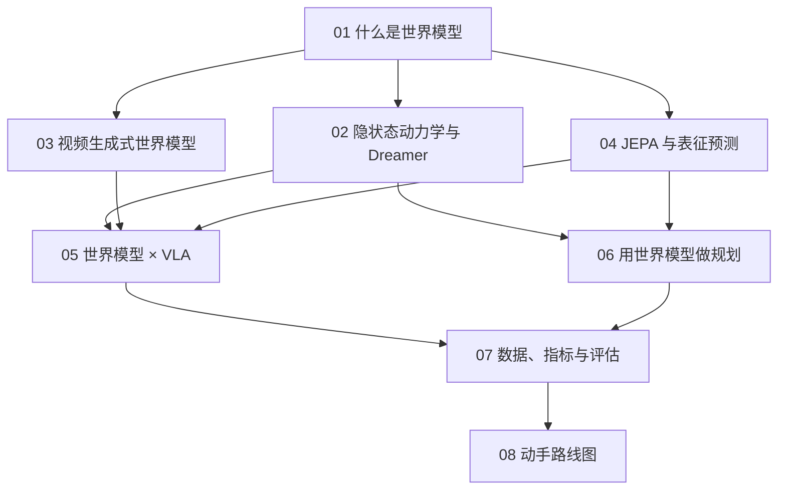

# 世界模型（WAM）总目录

> 本文件夹的 **WAM** 指 **世界模型（World Model）**，在机器人领域也常写作 **World Action Model（世界-动作模型）**：一种能回答"如果机器人这样做，接下来世界会变成什么样"的模型。它和 VLA 是一对互补的技术：VLA 直接给出动作，世界模型负责预测后果。

## 这个主题学完能做什么

- 看懂"世界模型"这个词在不同论文里的不同含义，不再被 Dreamer、Genie、V-JEPA、WorldVLA 这些名字绕晕。
- 理解三条技术路线：隐状态动力学（Dreamer 系）、视频生成（Genie / Cosmos 系）、表征预测（JEPA 系）。
- 知道世界模型怎样和 VLA 结合：当策略、当数据引擎、当模拟器。
- 能按第 8 章的路线动手跑通一个最小世界模型实验，并规划自己的复现。

## 学习路线

| 章节 | 文件 | 难度 | 预计时长 | 状态 |
|---|---|---|---|---|
| 01 什么是世界模型 | [01-what-is-a-world-model.md](01-what-is-a-world-model.md) | beginner | 40min | draft |
| 02 隐状态动力学与 Dreamer | [02-latent-dynamics-and-dreamer.md](02-latent-dynamics-and-dreamer.md) | intermediate | 60min | draft |
| 03 视频生成式世界模型 | [03-video-generation-world-models.md](03-video-generation-world-models.md) | intermediate | 50min | draft |
| 04 JEPA 与表征预测 | [04-jepa-and-latent-prediction.md](04-jepa-and-latent-prediction.md) | intermediate | 50min | draft |
| 05 世界模型 × VLA | [05-world-models-meet-vla.md](05-world-models-meet-vla.md) | intermediate | 60min | draft |
| 06 用世界模型做规划与控制 | [06-planning-and-control-with-world-models.md](06-planning-and-control-with-world-models.md) | intermediate | 50min | draft |
| 07 数据、指标与评估 | [07-data-metrics-and-evaluation.md](07-data-metrics-and-evaluation.md) | intermediate | 40min | draft |
| 08 动手路线图 | [08-hands-on-roadmap.md](08-hands-on-roadmap.md) | advanced | 90min+ | draft |

## 与其他主题的关系

- **前置**：[VLA 基础](../VLA/Basic/00-README.md)，尤其是 [04 VLA 是什么](../VLA/Basic/04-vla-concept.md) 与 [03 Transformer 与多模态](../VLA/Basic/03-transformers-and-multimodal.md)。
- **并行**：[ForceVLA 论文专题](../VLA/ForceVLA/00-README.md)。第 5 章会讨论"力条件世界模型"这一延伸方向。
- **工具**：[Linux 命令](../LinuxCommand/00-README.md)，第 8 章的实验都在 Linux 服务器上跑。
- **论文库**：[Papers/WAM](../Papers/WAM/00-README.md)，世界模型方向的论文笔记会关联到本主题各章，并显示在章节底部的"📄 相关论文"里。

> 🔗 关联：两篇综述是本主题的"地图"——[A Step Toward World Models: A Survey on Robotic Manipulation（arXiv 2511.02097）](https://arxiv.org/abs/2511.02097) 与 [World Models for Robotic Manipulation: A Survey（arXiv 2606.00113）](https://arxiv.org/abs/2606.00113)。读完本主题再去翻它们，会轻松很多。
