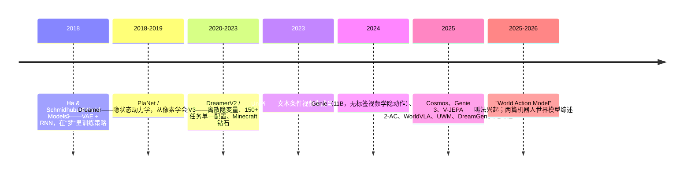

# 什么是世界模型（World Model）

> 人在伸手拿杯子之前，脑子里已经"演练"过一遍：手会碰到哪里、杯子会不会倒。世界模型就是让机器人也拥有这种"先在脑子里演一遍"的能力。

## 学习目标
- 能用一句话说清世界模型是什么、输入输出是什么。
- 能说出机器人为什么需要世界模型（至少三个理由）。
- 能区分世界模型与 VLA 的分工，并说出二者如何互补。
- 能辨析 world model / dynamics model / simulator / video model / World Action Model 这些词。
- 能画出从 2018 年到今天的技术脉络。

## 前置知识
- 需要先读：[VLA 是什么](../VLA/Basic/04-vla-concept.md)
- 建议先读：[深度学习最小必要知识](../VLA/Basic/02-deep-learning-essentials.md)

## 核心概念
| 术语 | 一句话解释 | 类比 |
|---|---|---|
| **世界模型（world model）** | 输入当前观测和一个动作，预测下一步世界会怎样的模型 | 脑内"预演" |
| **动力学模型（dynamics model）** | 世界模型的学术别名，强调"状态如何随动作演化" | 物理课的运动方程 |
| **观测（observation）** | 机器人此刻看到/测到的东西，如相机图像 | 眼睛看到的画面 |
| **隐状态（latent state）** | 把观测压缩成的一串数字，世界模型常在这上面做预测 | 画面的"内容摘要" |
| **想象 / rollout** | 不动真机器人，只用世界模型连续预测很多步 | 闭眼模拟 |
| **VLA** | 输入图像+语言，直接输出动作的模型 | 条件反射 |

## 详细讲解
### 1.1 一句话定义

世界模型做的事只有一件：

$$
\hat{o}_{t+1} \;(\text{或 } \hat{z}_{t+1}) = f_\theta(o_t\ (\text{或 } z_t),\ a_t)
$$

给它**现在的观测**（$o_t$）或其压缩后的隐状态（$z_t$），再给它**打算执行的动作**（$a_t$），它预测**下一刻**会看到什么。把预测结果再喂回去，就能连续预测很多步，这叫 **rollout**（想象）。

> 💡 要点：世界模型回答的是"如果我这样做会怎样"（what if），而不是"我应该做什么"（what to do）。后者是策略 / VLA 的工作。

### 1.2 机器人为什么需要它

1. **数据效率**：真机采集一条轨迹要几十秒，还会磨损硬件。有了世界模型，大量"试错"可以在想象里完成。Dreamer 系列正是靠"在想象中训练"把需要的真实交互减少了一个数量级（见第 2 章）。
2. **规划与安全**：执行前先在模型里预演，能提前发现"这样伸手会撞倒杯子"，再换一个动作。
3. **利用无动作标签的视频**：互联网上有海量人类操作视频，但没有机器人动作标签。世界模型可以从这些视频学"物理常识"，再迁移到机器人（第 3、4 章）。
4. **生成训练数据**：世界模型能"做梦"生成新的任务视频，再反推动作，扩充数据集（第 5 章 DreamGen）。

### 1.3 和 VLA 的关系：互补而非替代

| | VLA | 世界模型 |
|---|---|---|
| 输入 | 图像 + 语言（+ 本体状态） | 观测 + 动作 |
| 输出 | 动作 | 未来观测 / 隐状态 |
| 回答的问题 | 该做什么 | 做了会怎样 |
| 典型用法 | 直接控制机器人 | 规划、数据生成、评估、辅助训练 |

两者可以组合：VLA 提出几个候选动作，世界模型逐个预演并打分，选最好的执行；或者干脆把两者揉进一个网络（WorldVLA、UWM，见第 5 章）。

> 🔗 关联：ForceVLA 的问题之一是"看不见的接触状态"（[ForceVLA 批判与开放问题](../VLA/ForceVLA/07-critique-and-open-questions.md)）。一个能预测力变化的世界模型，是解决它的候选方向。

### 1.4 术语辨析

| 词 | 通常指什么 | 注意 |
|---|---|---|
| world model | 泛称，所有"预测未来"的模型 | 不同论文含义差别很大 |
| dynamics model | 强调状态转移 $s_{t+1}=f(s_t,a_t)$ | 多见于强化学习文献 |
| simulator | 手写物理引擎（MuJoCo、Isaac） | 不是学出来的，但可被世界模型替代或补充 |
| video (generation) model | 预测/生成未来视频帧 | 不一定以动作为条件；以动作为条件时才算世界模型 |
| World Action Model（WAM） | 2025~2026 年兴起的叫法：复用视频生成骨干，既预测未来又输出动作 | 与 VAM、video-action world model 混用，尚无统一定义 |

2026 年的综述（arXiv 2606.00113）把世界模型定义为"**以动作为条件的预测系统**"，并明确把它和感知模块、逆模型、策略、奖励函数区分开。记住这条定义，读论文时就能判断"这篇到底是不是世界模型"。

### 1.5 历史脉络



> 🔍 深入：2018 年那篇论文的核心做法是——先用 **VAE** 把画面压成小向量，再用 **RNN** 预测向量怎么变，最后用一个很小的控制器在"梦"里学开车（CarRacing），学完再放回真实环境居然能用。今天的所有路线都是这个思路的放大版。

## 动手练习
1. 用自己的话给同学解释"世界模型"和"VLA"的区别，要求用到"what if / what to do"这对说法，并各举一个机器人例子。
<details><summary>参考做法</summary>

VLA：看到桌上的杯子、听到"把杯子递给我"，直接输出手臂轨迹——回答"该做什么"。世界模型：给它当前画面和"向左移 5 cm"这个动作，它预测下一帧杯子会被碰倒——回答"这样做会怎样"。组合：让 VLA 出 5 个候选动作，世界模型预演，淘汰会碰倒杯子的。
</details>

2. 找出 [VLA 代表性模型](../VLA/Basic/05-representative-models.md) 里的任意一个模型，判断它是否含有世界模型成分，说明理由。
<details><summary>参考做法</summary>

RT-2、OpenVLA、π0 都不含世界模型：它们只输出动作，不预测未来观测。判断标准就是 1.4 节的定义——是否以动作为条件去预测未来。
</details>

3. 写出世界模型 rollout 的伪代码（5 行以内）。
<details><summary>参考做法</summary>

```python
z = encode(o_0)
for a in plan:          # plan 是一串候选动作
    z = f(z, a)         # 世界模型一步预测
    frames.append(decode(z))
```
</details>

## 常见错误与排查
| 现象 | 原因 | 解决 |
|---|---|---|
| 以为"视频生成模型 = 世界模型" | 混淆了"是否以动作为条件" | 问自己：输入里有没有动作？没有就只是视频模型 |
| 以为世界模型能取代 VLA | 世界模型不输出动作 | 它需要配规划器或策略才能控制机器人（第 6 章） |
| 以为世界模型必须生成像素 | 只看过 Genie/Cosmos 一类 | Dreamer、JEPA 都在隐空间预测，不画图 |
| 把 WAM 当成固定术语查文献 | 2026 年起才流行，叫法不统一 | 同时搜 world action model / video-action model / unified world model |

## 小结
- 世界模型 = 以动作为条件预测未来的模型，回答 what if。
- 机器人需要它来省数据、做规划、用无标签视频、生成数据。
- VLA 与世界模型互补：一个决定动作，一个预测后果，可组合或融合。
- 三条路线：隐状态动力学、视频生成、表征预测，后面三章各讲一条。

## 自测题
1. 世界模型的输入和输出分别是什么？
<details><summary>答案</summary>输入：当前观测（或隐状态）+ 动作；输出：下一步观测（或隐状态）。</details>

2. 一个只根据文本生成视频、不接受动作输入的模型，算世界模型吗？
<details><summary>答案</summary>按 2026 综述的定义不算，因为它不以动作为条件。但它可以被改造（加动作条件）成世界模型。</details>

3. "在想象中训练"指的是什么？
<details><summary>答案</summary>不与真实环境交互，只用世界模型连续预测（rollout）来生成经验并训练策略。</details>

4. 2018 年《World Models》用了哪两个核心组件？
<details><summary>答案</summary>VAE（压缩画面）+ RNN（预测隐状态演化），外加一个很小的控制器。</details>

## 参考资料
- [World Models（Ha & Schmidhuber, 2018）](https://arxiv.org/abs/1803.10122) —— 一切的起点，短小易读
- [A Step Toward World Models: A Survey on Robotic Manipulation（2025）](https://arxiv.org/abs/2511.02097) —— 按感知/预测/控制三个角色梳理方法
- [World Models for Robotic Manipulation: A Survey（2026）](https://arxiv.org/abs/2606.00113) —— 给出"动作条件预测系统"的清晰定义
- [WorldVLA（2025）](https://arxiv.org/abs/2506.21539) —— 世界模型与 VLA 融合的代表
