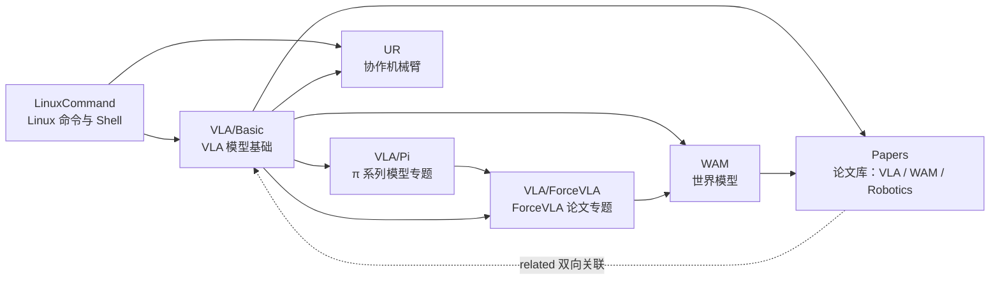

# Learning 知识库总览

> 一个从零开始、按章节组织、可被 Agent 读取与扩展的个人学习知识库。所有文档遵守 [STANDARD.md](STANDARD.md)，内容都在 `Knowledge/` 下。

## 这个知识库是什么

- **给人看**：每个主题从"完全不会"讲起，章节有顺序、有练习、有自测。
- **给 Agent 用**：每个文件带元数据（主题 / 难度 / 标签 / 前置章节），固定段落结构，`agent/` 里的系统能检索、回答、写笔记、导入论文。
- **会生长**：读到的论文、问过的问题、做过的实验，都按同一标准回流到知识库。

## 主题地图



| 主题 | 入口 | 适合谁 | 学完能做什么 |
|---|---|---|---|
| 内容总目录 | [Knowledge/00-README.md](Knowledge/00-README.md) | — | 看整体路线 |
| Linux 命令 | [Knowledge/LinuxCommand/00-README.md](Knowledge/LinuxCommand/00-README.md) | 零基础 | 在终端里自如地管理文件、权限、进程，写简单脚本，远程登录服务器跑训练 |
| VLA 基础 | [Knowledge/VLA/Basic/00-README.md](Knowledge/VLA/Basic/00-README.md) | 会一点 Python | 理解视觉-语言-动作模型的原理、代表模型、数据与训练流程 |
| π 系列模型 | [Knowledge/VLA/Pi/00-README.md](Knowledge/VLA/Pi/00-README.md) | 读完 VLA 基础 | 读懂 π0 → π0-FAST → π0.5 → π*0.6 每一代的设计与取舍，用 openpi 跑推理和微调 |
| ForceVLA 论文 | [Knowledge/VLA/ForceVLA/00-README.md](Knowledge/VLA/ForceVLA/00-README.md) | 读完 VLA 基础 | 读懂并能复现一篇力感知 VLA 论文 |
| WAM 世界模型 | [Knowledge/WAM/00-README.md](Knowledge/WAM/00-README.md) | 读完 VLA 基础 | 理解世界模型（World Model / World Action Model）的原理、与 VLA 的融合、规划与数据生成 |
| UR 协作机械臂 | [Knowledge/UR/00-README.md](Knowledge/UR/00-README.md) | 会用终端，想上真机 | 安全地操作 UR，用 URScript / Python（RTDE）/ ROS 2 控制，读力传感器，采集数据并部署 VLA 策略 |
| 论文库 | [Knowledge/Papers/00-README.md](Knowledge/Papers/00-README.md) | 学完对应主题 | 按领域读论文；每篇论文都关联到知识章节，章节底部能反查相关论文 |

## 推荐学习路线（零基础）

1. **第 1~2 周**：Linux 命令 01~10 章（每天一章，动手做练习）。
2. **第 3 周**：Linux 命令 11~18 章 + VLA 基础 01~03 章（深度学习与 Transformer 的最小必要知识）。
3. **第 4~5 周**：VLA 基础 04~11 章。
4. **第 6 周**：π 系列模型专题 01~06 章，把主流基座模型一代代读懂并跑起来。
5. **第 7 周**：ForceVLA 论文专题 01~07 章，学会精读一篇论文并规划复现。
6. **第 8~9 周**：WAM 世界模型 01~08 章，理解"预测未来"如何与 VLA 结合。
6. **之后**：到 [论文库](Knowledge/Papers/00-README.md) 按"待读清单"导入论文，记录问题，持续沉淀。

## 目录结构

```text
Learning/
├── README.md            # 本文件
├── STANDARD.md          # 编写标准（协议）
├── templates/           # 教程 / 论文笔记 / 硬件文档模板
├── Knowledge/           # 全部知识内容
│   ├── 00-README.md     # 内容总目录
│   ├── LinuxCommand/    # Linux 命令（18 章）
│   ├── VLA/
│   │   ├── 00-README.md
│   │   ├── Basic/       # VLA 基础（11 章）
│   │   ├── Pi/          # π 系列模型专题（6 章：π0 / FAST / π0.5 / π*0.6 / openpi）
│   │   └── ForceVLA/    # ForceVLA 论文专题（7 章）
│   ├── WAM/             # 世界模型（8 章）
│   ├── UR/              # UR 协作机械臂（10 章）
│   └── Papers/          # 论文库：VLA / WAM / Robotics，论文与知识章节双向关联
├── notes/               # 问答沉淀、临时笔记（自动创建）
├── CONTRIBUTING.md      # 迭代流程：分支、提交规范、本地 CI、发布
├── CHANGELOG.md         # 发布记录（./start.sh release 生成）
├── .githooks/           # pre-commit / commit-msg / pre-push / post-merge
└── agent/               # Agent 系统（Node.js），见 agent/README.md
```

## 网站

| 想做什么 | 打开 |
|---|---|
| 在任何设备上阅读、搜索 | 公网阅读站（GitHub Pages，push 到 `main` 自动发布），网址见 [CONTRIBUTING.md](CONTRIBUTING.md) 的"部署"一节 |
| 问助教、导入论文、**在网页里写笔记** | 本机 http://localhost:8787（`./start.sh service install` 后开机自启，用 Claude Max 订阅）。"✎ 新建笔记"/文档页"✎ 编辑"保存后自动重建索引、刷新论文库目录并重新生成静态站 |

## Agent 系统

详见 [agent/README.md](agent/README.md)。一句话：

```bash
./start.sh login   # 用 Claude Max 账号登录 Claude Code（只需一次）
./start.sh         # 启动 Web，助教与论文导入走 Max 订阅额度
# 打开 http://localhost:8787
```

- 网页是一个"物理智能研究工作台"：总览页看研究方向、论文时间线、最近更新与待解决问题；"论文库"按领域 / 状态 / 难度筛选并可切时间线；"关联图"把知识章节与论文的 related 画成力导向图；文档右栏有"研究状态"（状态、更新、关联数、本页待解决列表）。
- 左侧目录树阅读所有章节，右侧研究助手随时提问（答案附文档链接），可以把回答存成笔记。
- "导入论文" 把 PDF / arXiv 自动整理成符合标准的论文笔记。
- `npm run check` 检查所有文档是否符合 STANDARD.md。

## 如何新增内容

最省事的方式是打开本机版 http://localhost:8787 点"✎ 新建笔记"：选文件夹和模板，左边写右边预览，保存后索引、论文库目录和静态站都会自动重建；规范检查有问题会直接显示在页面上。手工方式：

1. 复制 `templates/` 里对应的模板，按 [STANDARD.md](STANDARD.md) 填写。
2. 文件名 `NN-kebab-case.md`，放进 `Knowledge/` 下对应主题文件夹；论文用 `./start.sh paper <arXiv链接> Knowledge/Papers/<领域>` 导入。
3. 在该文件夹的 `00-README.md` 章节表中登记（论文库目录由 `./start.sh papers` 自动生成）。
4. 运行 `./start.sh ci`，修到全绿为止。

## 迭代流程（本地 CI/CD）

第一次先运行 `./start.sh setup` 启用 git 钩子。之后每件事一个分支 → `./start.sh ci` → 按 Conventional Commits 提交（钩子自动检查）→ `--no-ff` 合并回 `main` → `./start.sh release` 生成 CHANGELOG、版本号和标签。完整说明见 [CONTRIBUTING.md](CONTRIBUTING.md)。
