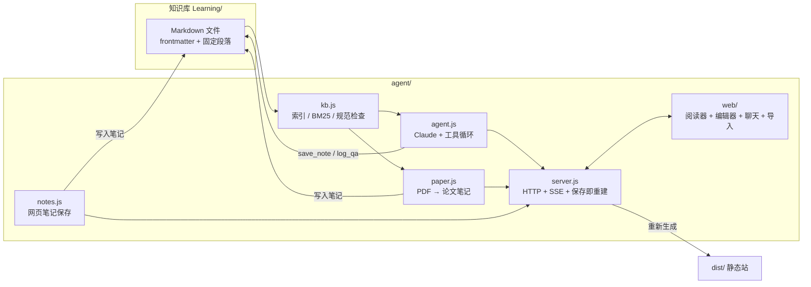

# Learning 知识库 Agent 系统

> 这是一个本地运行的"Copilot"：把 `Learning/` 下所有符合 [STANDARD.md](../STANDARD.md) 的 Markdown 索引起来，用网页阅读，用 Claude 回答问题、记笔记，并能把论文（PDF / arXiv）自动整理成论文笔记写回知识库。

## 功能一览

| 功能 | 入口 | 说明 |
|---|---|---|
| 📖 网页阅读 | `http://localhost:8787` | 文档站风格：左侧分组目录、右侧页内大纲、阅读进度、上一章/下一章、代码一键复制、提示块卡片、KaTeX 公式、Mermaid 图、深浅色切换、⌘K 搜索面板；渲染库随 `npm install` 本地安装，不依赖外网 CDN |
| 🔍 全文检索 | 顶部搜索框 / `/api/search` | BM25，支持中英文混合 |
| 💬 Copilot | 右侧聊天面板 / `npm run ask` | Claude 带工具：先检索知识库再回答，答案附文档链接；可按要求把内容写成笔记 |
| ✏️ 网页写笔记 | "✎ 新建笔记"（快捷键 `n`）/ 文档页"✎ 编辑"（`e`）/ `POST /api/note` | 选文件夹和模板（教程 / 论文笔记 / 硬件 / 自由笔记），左写右预览，边写边按 STANDARD 实时检查（缺字段、固定段落、坏链接、未标语言的代码块…），一键插入提示块 / 表格 / 折叠答案 / 章节相对链接，草稿自动暂存，⌘S 保存。**保存即重建**：写文件 → 重建索引 → 刷新论文库目录 → 新章节自动登记到所在文件夹的 `00-README.md` → 重新生成静态站（`dist/`）→ 通过 `/api/events` 通知所有打开的页面刷新。Copilot 的回答可一键"存为笔记" |
| 📄 论文导入 | "导入论文"按钮 / `npm run paper` | 读取 PDF，按 STANDARD 第 5 节模板生成论文笔记，保存到 `Knowledge/Papers/<领域>/`，自动填写 `related` 并刷新论文库目录 |
| 🔗 论文 ↔ 知识 | 文档页底部 / `npm run papers` | 论文的 `related` 反查成"相关论文"，显示在每个知识章节底部；论文库 `00-README.md` 的表格自动生成 |
| 🧾 问答沉淀 | 自动 | 每次有价值的问答会追加到 `notes/qa-log.md` |
| ✅ 规范检查 | `npm run check` / `/api/check` | 检查 frontmatter、固定段落、文件名、坏链接、未标语言的代码块、论文 `related` 与论文库结构 |
| 🧪 本地 CI | `npm run ci` / `npm test` | 语法、密钥扫描、术语守卫、规范、论文索引、单元 + 冒烟测试，见 [CONTRIBUTING.md](../CONTRIBUTING.md) |

## 快速开始

```bash
cd ~/Learning/agent        # 桌面上的 Learning 是指向这里的快捷方式
npm install

npm start
# 打开 http://localhost:8787
```

### 用哪个 Claude：Max 订阅（默认）或 API

聊天和论文导入有两个后端，用环境变量 `KB_BACKEND` 切换（只读阅读两者都不需要）：

| 后端 | 怎么用 | 计费 | 实现 |
|---|---|---|---|
| `claude-code`（默认） | 装好 Claude Code，`./start.sh login` 用 Max / Pro 账号登录 | 用订阅额度，和你平时用 Claude Code 共用 | `src/claude-code.js`：在后台运行官方 `claude -p`（headless 模式），由 Claude Code 自己检索、读文件、写笔记 |
| `api` | `KB_BACKEND=api`，再 `./start.sh login`（`ant auth login`）或在 `agent/.env` 写 API Key | 按 API 用量 | `src/agent.js` / `src/paper.js`：`@anthropic-ai/sdk` 手写工具循环 |

`claude-code` 后端的约束：

- 启动 `claude` 子进程时会去掉 `ANTHROPIC_API_KEY` 等变量，否则 Claude Code 会改用 API Key 计费；也不使用 `--bare`（它不读订阅登录）。
- 权限用 `--permission-mode dontAsk` 白名单：聊天只能读文件、跑 `node agent/src/cli.js search`、写 `notes/`；论文导入只能写目标文件夹和 `Knowledge/Papers/`，并跑 `./start.sh papers` / `./start.sh ci --fast`。任何情况下都不能读 `.env`。
- 论文导入按项目技能 `.claude/skills/import-paper/SKILL.md` 的流程执行；在 Claude Code 里也可以直接 `/import-paper <arXiv链接>`。
- 模型用 `KB_CC_MODEL`（默认 `opus`），推理深度沿用 `KB_CHAT_EFFORT` / `KB_PAPER_EFFORT`。
- 这是"你自己登录、调用未修改的官方 Claude Code"，属于 Claude Code 文档允许的用法；**不要**把订阅令牌（`sk-ant-oat…`）塞进 `.env` 或 SDK，`start.sh` 会拒绝它。订阅额度按"个人正常使用"设计，批量导入大量论文时留意用量。

命令行用法：

```bash
npm run index                      # 查看索引统计
npm run search -- chmod 权限        # 全文检索
npm run ask -- "管道和重定向有什么区别？"
npm run paper -- https://arxiv.org/abs/2406.09246 Knowledge/Papers/VLA   # topic 在论文库内自动推断
npm run papers                     # 重新生成论文库目录表格（-- --check 只检查）
npm run check                      # 检查所有文档是否符合 STANDARD.md
npm test                           # 单元 + 冒烟测试（node:test，零依赖）
npm run ci                         # 完整本地 CI（ci:fast 跳过测试）
npm run release -- --dry-run       # 预览下一次发布
```

## 架构



### Copilot 可用的工具

| 工具 | 作用 | 安全限制 |
|---|---|---|
| `search_knowledge_base` | BM25 检索段落 | 只读 |
| `read_document` | 读取整篇文档（末尾附"反向关联"的论文） | 只读，限知识库内 |
| `list_documents` | 列出文档元数据 | 只读 |
| `save_note` | 写入符合标准的 Markdown | 只能写 `.md`；路径不能越出知识库；不能改 `STANDARD.md` / `templates/`；默认不覆盖 |

网页写接口（`POST /api/note`、`/api/register`、`/api/chat`、`/api/paper`）只接受同源页面发来的 JSON 请求（校验 `Origin` / `Sec-Fetch-Site` / `content-type`），浏览器里的其他网站不能借你的本机服务写文件。
| `log_qa` | 追加问答摘要到 `notes/qa-log.md` | 只追加 |

### 模型与参数

| 环境变量 | 默认 | 说明 |
|---|---|---|
| `KB_BACKEND` | `claude-code` | `claude-code`（Max/Pro 订阅，经本机 `claude` CLI）或 `api` |
| `KB_CC_MODEL` | `opus` | claude-code 后端的模型（别名或完整 ID） |
| `KB_MODEL` | `claude-opus-5-5` | api 后端的模型 ID |
| `KB_CHAT_EFFORT` | `medium` | 聊天推理深度：low / medium / high / xhigh / max |
| `KB_PAPER_EFFORT` | `high` | 论文笔记生成的推理深度 |
| `KB_FALLBACKS` | `1` | 服务端拒答回退（被安全策略拒答时自动改用 claude-opus-4-8 重试，仅 Claude API 可用）；设为 `0` 关闭 |
| `KB_ROOT` | `../` | 知识库根目录 |
| `PORT` | `8787` | 端口 |
| `KB_AUTO_BUILD` | `1` | 保存笔记或磁盘上 `.md` 变化后自动重新生成静态站；`0` 只重建索引 |
| `KB_DIST` | `<知识库>/dist` | 自动构建的静态站输出目录（已 gitignore） |

## 工作流程建议

1. **学习**：按各主题 `00-README.md` 的路线阅读；遇到不懂的就问 Copilot（勾选"附带当前文档路径"，Copilot 会结合你正在读的章节回答）。
2. **沉淀**：自己写就点"✎ 新建笔记"（或在文档页点"✎ 编辑"），保存后索引、论文库目录、静态站都会自动重建；也可以让 Copilot"把刚才的解释整理成笔记保存到 notes/"。定期把 `notes/` 里有价值的内容合并进正式章节。
3. **读论文**：导入到 `Knowledge/Papers/<领域>/` → 人工复核数字、结论与 `related` → 把 `status` 改成 `reviewed`（论文库目录自动更新，不用手动登记）。
4. **检查**：提交前跑 `./start.sh ci`；启用钩子后 commit / push 会自动跑。

## 目录

```
agent/
├── package.json
├── README.md
├── src/
│   ├── config.js    # 配置（环境变量）
│   ├── kb.js        # 索引、检索、规范检查
│   ├── prompts.js   # 系统提示词（引用 STANDARD.md 与模板）
│   ├── agent.js     # 聊天 Agent 与工具
│   ├── paper.js     # 论文导入
│   ├── papers.js    # 论文库目录生成（related → 反向索引）
│   ├── notes.js     # 网页笔记保存：路径校验、写入、重建索引、刷新论文库目录、规范检查
│   ├── server.js    # HTTP / SSE 服务
│   └── cli.js       # 命令行
├── scripts/
│   ├── ci.js        # 本地 CI 流水线
│   ├── commit-msg.js# 提交信息校验（Conventional Commits）
│   └── release.js   # 发布：CHANGELOG + 版本号 + 标签
├── test/            # node:test 单元 + 冒烟测试
└── web/
    ├── index.html
    ├── app.js
    └── style.css
```

## 后续可扩展

- 向量检索（embedding）替换/补充 BM25
- 学习进度追踪（已读章节、自测题得分）
- 定时抓取 arXiv 关键词 → 自动生成候选论文笔记
- 多用户 / 部署到服务器
