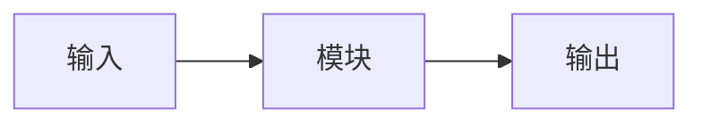

# 论文中文译名

## 论文信息
| 项目 | 内容 |
|---|---|
| 标题 | English Title |
| 作者 / 机构 | |
| 发表 | 会议/期刊 + 年份 |
| 链接 | [arXiv](https://arxiv.org/abs/xxxx) · [项目页]() · [代码]() |
| 关键词 | |

## 一句话总结
（≤60 字）解决什么问题、怎么解决、效果如何。

## 背景与动机
- 之前的方法有什么问题？
- 为什么这个问题重要？

## 方法
### 整体框架

### 关键模块
#### 模块 1
- 输入：
- 处理：
- 输出：
- 为什么这样设计：

## 实验
- 数据集 / 任务 / 基线：
- 主要结果：

| 方法 | 指标 1 | 指标 2 |
|---|---|---|

- 消融实验说明了什么：

## 优点与不足
| 优点 | 不足 / 疑问 |
|---|---|
| | |

## 与知识库的关联
（与 frontmatter 的 related 对应，链接相对本文件；每条说明关联点）
- 用到的基础知识：[VLA 概念](../../VLA/Basic/04-vla-concept.md) —— 本文在哪一点上用到了它
- 可延伸的主题：

## 复现清单
- [ ] 环境
- [ ] 数据
- [ ] 关键超参数
- [ ] 预期指标

## 我的问题与想法
> ❓ 待解决：
